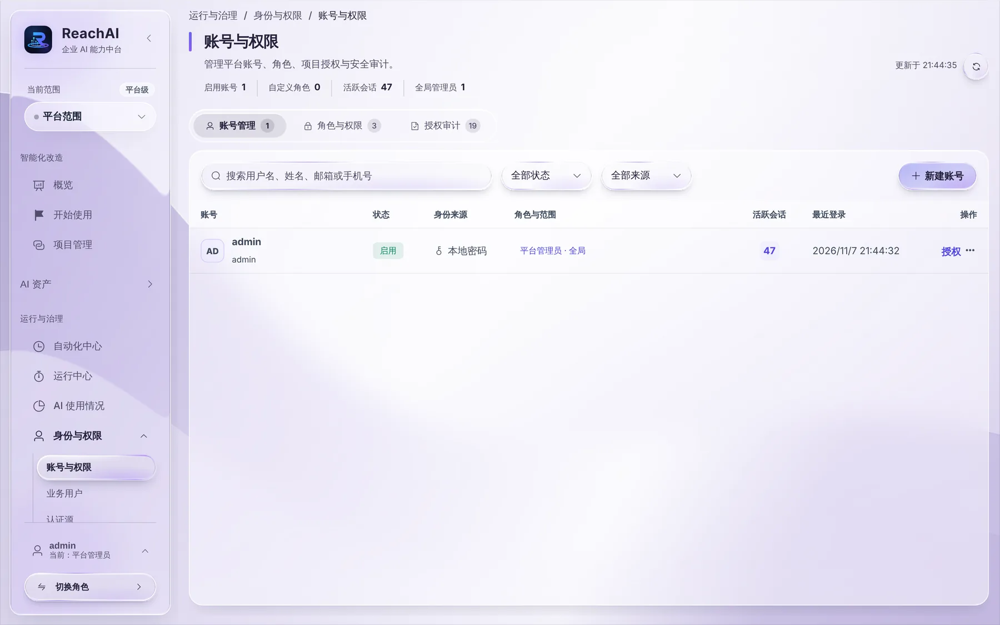
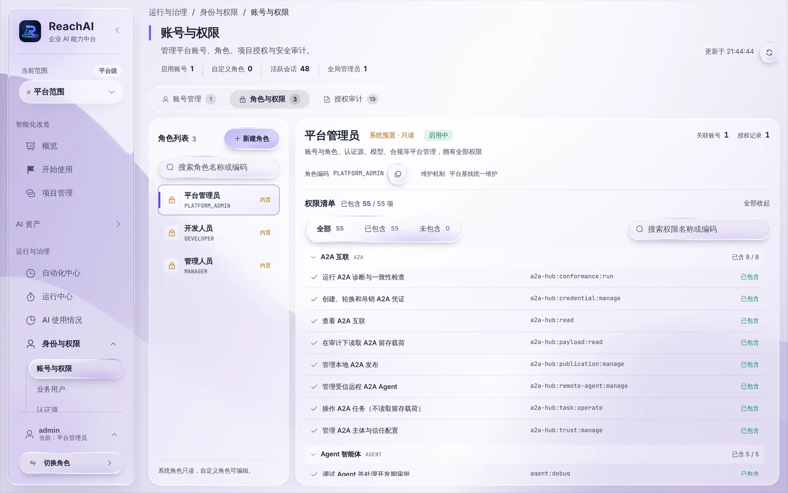

# 账号和角色

> 适合：平台管理员。读完你能给开发人员、管理人员开管理台账号，并分配合适的角色。

## 先分清两种人

| 谁 | 用什么账号 | 在哪里用 AI |
| --- | --- | --- |
| 业务人员（员工） | 业务系统自己的账号，**不需要** ReachAI 账号 | 业务系统里的助手、自己的 Codex / Claude Code |
| 开发人员、管理人员、平台管理员 | ReachAI 管理台账号 | ReachAI 管理台 |

本文讲的是第二种。

## 三个内置角色

| 角色 | 适合谁 | 能做什么 |
| --- | --- | --- |
| 开发人员 | 接入业务系统、搭建智能体的工程师 | 接入业务系统，开发和发布 Agent、Workflow、知识库，创建 MCP 服务 |
| 管理人员 | 业务主管、运营人员 | 上线和运营智能体，开通员工使用，审批写操作，看使用情况，管理调用权限和自动化 |
| 平台管理员 | 负责整套平台的人 | 全部功能，包括账号、认证、模型、Skill 评审发布 |

另外每个人都有一个「我的」身份，用来管理自己的 AI 工具连接和记忆。

一个账号可以有多个角色。登录后左下角 **切换角色** 只改变菜单显示什么，权限是所有角色加起来的。

## 第 1 步：打开账号与权限

用平台管理员登录，左侧「运行与治理 → 身份与权限 → 账号与权限」：

## 第 2 步：新建账号

1. 点右上角 **新建账号**。
2. 填写用户名、姓名、手机号（可选）和初始密码。
3. 保存。把用户名和初始密码私下告诉对方，提醒他登录后修改密码。

## 第 3 步：分配角色

在账号那一行点 **授权**，选择平台角色（开发人员、管理人员或平台管理员）和适用范围，保存。

对方重新登录后，左下角就能切换到对应的角色。

## 查看和自定义角色

切到「角色与权限」标签，可以看到每个角色包含哪些权限：

内置角色是只读的。确实需要不同的权限组合时，点 **新建角色** 建自定义角色，勾选需要的权限。只有自定义角色的账号，登录后看到的是「全部功能」菜单，按权限显示能用的入口。

「授权审计」标签记录了每一次账号和授权的变更：谁、什么时候、改了什么。

## 常见操作

**员工离职。** 在账号那一行的更多操作里停用账号，他的登录会话立即失效。

**忘了密码。** 让另一位平台管理员在更多操作里重置密码。唯一的平台管理员忘了密码时，初始密码在 `reachai.env` 里；改过又忘了，参见 [常见问题](troubleshooting.md)。

**让员工用业务系统账号登录。** 在「身份与权限 → 认证源」的「用业务系统账号登录」里点 **添加**：

1. 业务系统类型选「芋道」，填芋道地址，登录页、换令牌、用户信息地址会自动填好；企业微信、钉钉、飞书、Keycloak 等选「标准 OIDC」。
2. 在业务系统里登记一个登录应用。芋道是「系统管理 → OAuth 2.0 → 应用管理」：授权类型选授权码，权限范围 `user.read` 设为自动授权（这样员工看不到确认页），可重定向地址填页面上显示的回调地址。把得到的 Client ID 和 Secret 填回 ReachAI。Secret 加密保存，保存后不再显示。
3. 打开「启用」保存。登录页就会出现「用芋道 ERP 账号登录」按钮。

员工点按钮：已经登录芋道的直接进来，没登录的先在芋道登录一次。普通员工进「我的」个人页，第一次登录会自动出现在业务用户目录里，调用权限仍按芋道角色生效。经理、开发人员要进管理端：在「账号与权限」新建账号时登录方式选「用业务系统账号」，填他在芋道的用户编号，这个账号不需要平台密码。每次登录成功或失败都会记下来，在 [AI 使用情况](../manager/usage.md) 的审计导出里能看到。

服务器需要配置 `REACHAI_INTERNAL_SERVICE_SECRET`（一键部署默认已有）用来加密登录密钥；也可以单独设置 `REACHAI_BUSINESS_SSO_KEY_BASE64`。换了这个密钥要重新填一次 Secret。

## 下一步

- [日常运维](operations.md)
