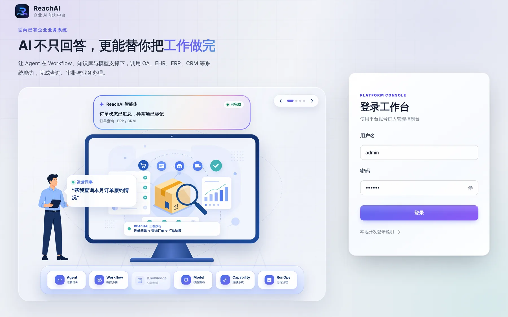
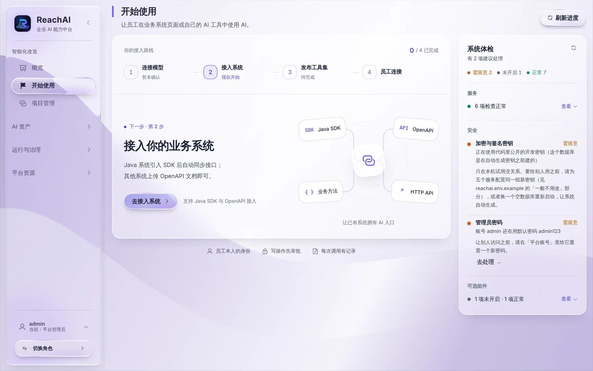
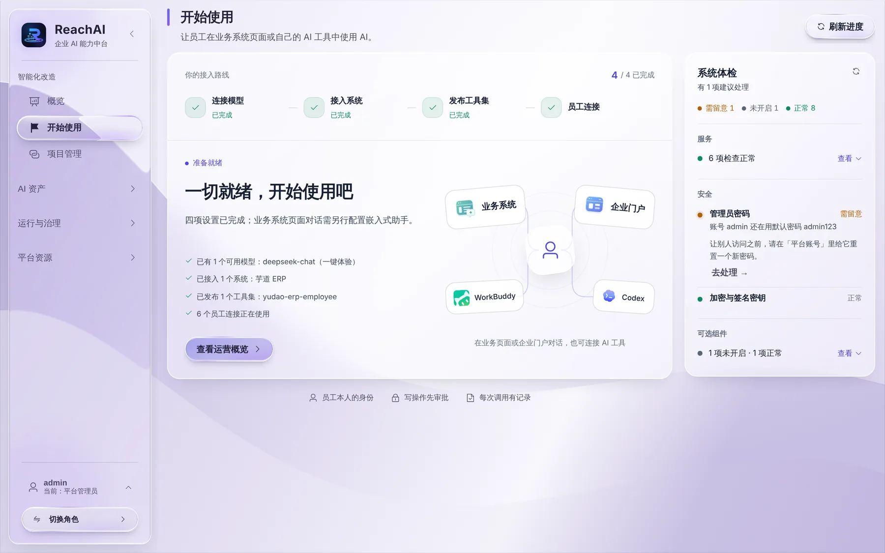

# 第一次登录和「开始使用」

> 适合：平台管理员。读完你会完成 ReachAI 的首次设置：登录、改密码、接模型、接业务系统、开放给员工。

## 第 1 步：登录

打开安装结束时打印的访问地址，用 `admin` 和初始密码登录。忘了初始密码的话，它写在安装目录 `reachai.env` 的 `REACHAI_BOOTSTRAP_ADMIN_PASSWORD` 里。

第一次登录会弹出一段说明，讲清楚这是一个正在快速迭代的开源项目、哪些地方要注意。看完点「我已了解上述说明，并愿意继续体验」。

## 第 2 步：打开「开始使用」

左侧点 **开始使用**。这一页把首次设置拆成四步，并在右边做「系统体检」：

### 四步接入路线

| 步骤 | 做什么 | 谁来做 | 怎么做 |
| --- | --- | --- | --- |
| 1. 连接模型 | 接入一个大模型（DeepSeek、通义千问、OpenAI 等），AI 才能理解和回答 | 平台管理员 | [接入模型](../developer/model-setup.md) |
| 2. 接入系统 | 把业务系统（如芋道 ERP）接进来，ReachAI 才知道能做哪些业务操作 | 开发人员 | [开发者从这里开始](../developer/overview.md) |
| 3. 发布工具集 | 选出开放给员工的操作，发布成 MCP 服务 | 开发人员 / 管理人员 | [开通员工使用](../manager/open-to-employees.md) |
| 4. 员工连接 | 员工在业务系统里生成连接，用自己的 AI 工具办业务 | 业务人员 | [在自己的 AI 工具里办业务](../business/own-ai-tool.md) |

每完成一步，这里会自动打勾。四步都完成后是这样：

### 系统体检

右边的「系统体检」逐项检查：各个服务是否正常、加密和签名密钥是否就绪、管理员是否还在用默认密码、Milvus 和文档解析等可选组件的状态。有问题的项会写清楚怎么修，并给出「去处理」链接。

**上线给别人用之前，一定把管理员默认密码改掉**（体检里「管理员密码」一项会提醒你）。

## 第 3 步：建账号、分角色

团队里还有开发人员、管理人员要用管理台时，为他们建账号并分配角色，见 [账号和角色](accounts-and-roles.md)。

业务人员（员工）**不需要**在 ReachAI 建账号，他们用业务系统的账号登录业务系统即可。

## 下一步

- [账号和角色](accounts-and-roles.md)
- [日常运维](operations.md)
