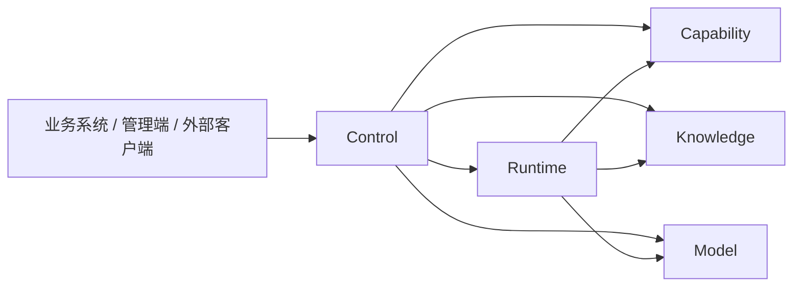

# 架构

## 五个服务

| 服务 | 职责 | 本地默认端口 |
| --- | --- | ---: |
| `reachai-control-service` | Control / Embed Gateway：公共 API、平台身份、页面接入、MCP/A2A、标准 Skill 和治理编排 | 18603 |
| `reachai-runtime-service` | Runtime Host：Agent、Workflow、GraphSpec、运行、Trace、评测和自动化 | 18604 |
| `reachai-capability-service` | Capability Catalog：注册、来源、业务方法/API、变化接纳和 API 市场 | 18605 |
| `reachai-knowledge-service` | Knowledge / Retrieval：文件、解析、知识检索、业务索引和记忆检索投影 | 18602 |
| `reachai-model-service` | Model Gateway：模型目录、实例、Chat、Embedding 和 Rerank | 18601 |

浏览器和外部协议请求由 Control 验证相应身份，再进入 owning service。Knowledge 的 context path 为 `/ai`，Model 使用 `/model`；管理端请求仍经 Control 的认证边界，不直连内部服务端口。

## 数据与调用边界

- 五服务共用 MySQL，但每张表只有一个 owner，详见[表所有权](contracts/tables.md)。
- 跨服务使用显式 client、内部 API 或服务自有 read model，不直接访问其他服务的 Mapper、Entity 或表。
- 内部请求绑定真实身份、目标资源、精确 body、时间窗与 nonce；路径叫 `/internal` 本身不构成认证。
- 当前接口按[公共路由](contracts/public-routes.md)和[内部 API](contracts/internal-apis.md)维护。Control 应保留下游明确的 4xx/5xx 语义，不用 HTTP 200 包装资源不存在或冲突。

## Runtime 内核

AgentScope Supervisor 负责理解、选择与有限重规划；Workflow 执行经过 `RuntimeGraphSpecExecutor`、编译器、不可变 Handler 注册表和类型化 Port。GraphSpec 是唯一执行语义，Canvas 只保存布局。节点能力、AI 编辑和发布校验必须一致，详见[Workflow](workflow.md)。

## 服务内模块

服务内模块声明和依赖方向只维护在 [internal-module-boundaries.json](../scripts/internal-module-boundaries.json)。模块通过 application port 或不可变 contract 协作，不越过对方持久化边界，不引入循环依赖；基础设施事件通过 port 交给产品模块处理。

Control 的 Agent 配置 HTTP 入口负责请求授权与代理；[RuntimeAgentBindingGuard](../reachai-control-service/src/main/java/com/enterprise/ai/control/runtime/RuntimeAgentBindingGuard.java)集中负责 Skill / A2A 绑定的草稿组装、发布前复核与项目迁移限制。普通发布和更新 Workflow 引用版本共用同一套绑定校验。

SDK 与 Starter 保持 Java 8 兼容；平台服务运行于 Java 17。公共业务索引契约位于 `ai-runtime-contract`，共享基础设施位于 `ai-common`。依赖版本以根目录及模块 `pom.xml` 为准。
