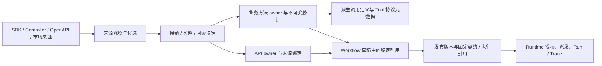

# 业务方法与 API 资产架构

2026-10-13。本文描述当前业务能力的资产所有权、统一工作台与附属成果职责；实施证据和环境限制见[专项进度](../plans/业务方法与API重构实施进度.md)、[BMAPI-6 完成条件](../plans/BMAPI-6-资产体系收口方案与验收.md)与[BMAPI-11 分类实施计划](../plans/BMAPI-11-业务分类融入能力目录.md)。

## 产品入口

“业务能力”是统一查找和使用业务操作的工作台，包含“Java 业务方法”和“HTTP API”两个 TAB。业务方法表示业务系统明确开放的 Java 业务操作；API 表示项目内有明确 HTTP 契约的操作。两者各自管理资产事实，统一入口不新增第三套可维护目录，也不要求为同一对象维护通用 Tool。

| 用户任务 | 入口 | 管理的事实 |
| --- | --- | --- |
| Java 开发者接入、声明和同步 | 项目接入与同步、SDK/Starter | 项目、实例、明确分类的声明和来源观察 |
| 实施人员看懂、试通和使用方法 | 业务能力 → Java 业务方法、方法详情 | 输入/返回、调用条件、试调用、具体使用位置 |
| 发现、接纳并使用 HTTP 操作 | 项目来源管理、业务能力 → HTTP API、API 详情 | 多来源、当前接纳契约、连接配置、试调用、具体引用 |
| 处理变化和定位发布影响 | 所属项目的来源变化、资产详情 | 当前候选、接纳/忽略/回滚决定及实际草稿/发布引用 |
| 编排和对外服务 | Workflow Studio、Agent、MCP/A2A/Embed | 已发布 Workflow 与协议身份，不复制源资产 |

发现方式与资产类型分开。普通方法、Controller、OpenAPI、市场都是来源机制；发现到来源不意味着接纳、配置、验证或授权。同一 Java 实现明确同时声明方法与 HTTP API 时，两种资产保持关联，各自维护契约。

工作台通过 `/business-capabilities/java-methods` 与 `/business-capabilities/http-apis` 两个嵌套目录路由保存分类。HTTP API 详情位于 `/business-capabilities/http-apis/:id`，只匹配正整数资产 ID，避免将来源、分组、语义或图谱子路径当作详情；旧目录 URL 仅重定向并迁移原筛选字段。公共筛选/分页机制使用 method/api query 命名空间，保留项目范围和另一类目录条件。面板卸载、项目或会话变化均使旧响应失效。

后端维持 typed method/API 读取接口及既有调用主路径。方法统计 `GET /api/business-methods/summary?projectId=…` 经 Control 同目录授权后转发 Capability；省略项目要求 GLOBAL grant。Capability 一次聚合已接纳 owner 返回 `total/enabled/disabled`，不解析来源详情、不读取调用投影，统计独立于关键词和分页。HTTP API 列表仅返回 Capability owner 分页事实，不请求 Runtime 连接与当前账号最近试调用汇总；这两类信息由详情既有连接与调用查询按需读取，继续归 Runtime 所有。

同一工作台内以“能力目录／接入与变更”组织主任务。业务分类融入两类目录，分类说明、重命名和附加归属就地完成，整理菜单提供批量说明和关联分析。分类合并的前端与后端处理均已退场。局部辅助路径为 `/business-capabilities/{java-methods|http-apis}/{sources|semantics|graph}`；原 groups 路径回到目录，GROUP 说明书签定位分类说明。来源页由 `views/capability/source/BusinessCapabilitySourceWorkbench.vue` 按已授权项目解析可信来源范围，旧 `views/scan/ScanProjectDetail.vue` 页面实现和路由退场。项目管理进入同一来源视图，不再维护另一份 API 管理页。

同步、扫描设置、完整参数导出和敏感数据扫描属于当前项目的来源操作；进入 Java 或 HTTP 分类不会把整个项目同步伪装成只同步某一种资产。工作台页头保持查找与使用的任务焦点，接入入口位于项目及来源操作上下文。无实际索引写入的“更新检索索引”及其前后端重建链路已退场；实验室调用候选检索仍按当前调用投影做关键词匹配，不需要手工重建。

## 单向事实链

来源观察、接纳资产和执行事实各自维护一次。调用投影可以删除或重建，不能反向补成资产契约；发现、历史成功或展示状态也不能代替当前执行授权。

## 来源接入与读取职责

| 模块 | 负责的行为 | 复用与边界 |
| --- | --- | --- |
| `StarterMvcHttpApiIntakeService` | 将业务系统的 SDK HTTP 清单转换为可验证观察 | 明确区分未提供清单、受支持的空清单和完整清单 |
| `ScannerHttpApiIntakeService` / `ScannerHttpApiContractAdapter` | 将 Controller 与 OpenAPI 扫描结果转换为 HTTP 契约 | 保留来源类型与解析差异；旧两个重复 Intake 实现删除 |
| `ScannerHttpApiSingleSourceIntakeService` / `ScannerHttpApiSourceIdentity` | 将单条重扫及来源附属成果精确关联到已有扫描绑定 | 共用实际扫描格式匹配；项目、环境、类型、方法、完整路径与规范化身份一致且唯一才刷新，歧义或身份变化要求完整同步 |
| `HttpApiInventoryIntakeService` | 预校验清单、写入观察、完整清单的移除及确认记录 | 三种接入共同维护一份生命周期；不完整或未知清单不推断删除 |
| `CapabilityScanProjectReadinessService` | 项目 SDK 接入、签名、实例、心跳和回调地址诊断 | 诊断只说明条件，不替代真实来源确认或赋予调用权 |
| 方法/API owner store 与 catalog | 读取已接纳契约、当前来源状态与目录汇总 | 列表按请求批读修订、快照、来源、清单及接纳记录；执行和接纳边界仍即时重读 |

HTTP API 的市场来源从当前固定版本、Operation 和项目接入选择确认，不使用扫描清单代替。状态筛选按最多 100 条的批次核对当前事实，先处理市场失效锁存，再计算真实总数与目标页。此路径仍需要遍历匹配候选；其成本是按批查询，不能描述为一次常量查询。市场目录重新出现不会自动恢复已经 `BROKEN` 的选择或旧发布引用。

单条重扫不作为完整清单，不移除其他绑定。当前已有受支持清单时保留其 token，只更新目标成员的确认；无法确认时仅失效已定位的目标。原清单未知时，新局部 token 只确认本次唯一目标，不能恢复其他未确认成员。接口返回来源观察及独立确认结果，页面区分“来源已刷新并确认”和“仍需完整同步”，不将扫描记录更新当作正式契约已接纳。

## 分组、语义与图谱

`catalog/enrichment` 定义附属成果的类型化目标和可信解析。`PROJECT`、`GROUP`、`BUSINESS_METHOD`、`HTTP_API`、`SOURCE_OBSERVATION` 只表示成果属于哪个已存在对象；解析器校验项目和 owner，不创建第三种可调用资产，也不从 Tool/扫描行猜测正式方法身份。

分组面向用户称为“业务分类”，沿用来源分类并维护类型化成员。SDK module 或 Controller/路径等线索是初始分类，不能宣称其等同于真实业务模块。扫描自动成员与人工成员分别维护；`sourceClasses` 保存分类关联的来源类标识，用于同步识别与说明读取。重命名只改变显示信息，不搬迁其他分类的成员、说明或图谱关系。

`GET /api/business-capabilities/projects/{projectId}/classification/{BUSINESS_METHOD|HTTP_API}` 返回当前项目该类型的完整分类、成员数、正式 owner 与分类关系以及未分类数量，经 Control 项目读取授权和签名内部调用。查询不含尚未归属正式 owner 的来源候选；分类显示和 groupId/ungrouped 查询共用同一成员规则，筛选在 count/paging 前执行。`ungrouped=true` 必须指定项目且与 groupId 互斥；目录分页仅安排当前页，不能把本页成员数冒充项目总量。分类不改变执行权限、版本引用或 Workflow 依赖。

Java 业务方法列表与详情还随正式 owner 返回 `classifications: [{id, displayName}]`，按页内项目批量读取持久成员；空数组表示已确认未分类，分类读取失败时返回 `null` 表示归属待更新，保留方法目录与详情可读。跨项目列表的分类标签不依赖单一项目分类索引。Java 目录将方法平铺在一张表中，分类列可进入现有 GROUP 说明详情；项目分类索引继续负责筛选、计数和调整。HTTP API 目录保留现有分段呈现。

来源观察关联正式 API 时，只使用同项目、项目当前环境、非移除绑定和已知扫描格式下的唯一匹配；同文件名、重载或多绑定歧义不自动归属。旧环境 API 仍能读取自己的附属资料，不能接走当前扫描候选的文档或人工分组。候选获得可信正式归属后，说明和人工分组在短事务中承接，观察行清理不会丢失整理成果。

语义文档使用非空的目标类型与稳定 key 作为唯一归属。生成、人工编辑和批量任务共用同一服务；“仅补缺失”保留已存在的生成文档和人工文档。正式方法/API详情读取同一附属成果。生成与编辑携带契约基准、生成时的接纳状态和微秒文档修订；候选被接纳后，即使契约指纹相同，原先描述“未接纳”的说明也需要复核。短项目事务在写入前重读目标与版本，模型调用在事务外；迟到结果不能覆盖变化后的事实，语义补充不能回写 owner 的执行契约。任务离开页面时停止本地轮询，服务重启丢失任务状态时明确提示未知，不能显示成功。

图谱从当前方法/API owner 和未接纳来源候选投影；操作、字段与模型节点具有稳定 key，名称和分组不参与身份。重命名保留手动关系与布局；契约变化使相应证据和参数来源提示失效。候选确认/拒绝、手动边、布局保存均校验所属项目；再次推断不把已确认关系重置为候选。参数来源提示只消费当前契约下已确认的关系，不自动修改 Workflow GraphSpec 或发布版本。

## 数据与服务所有权

| 事实 | Owner | 约束 |
| --- | --- | --- |
| SDK 注册项目、实例、来源快照/diff/决定、SDK 签名凭据 | Capability | 同项目锁内接收与接纳；SDK apply 没有审批权，诊断不能变成真实来源 |
| `capability_business_method_asset` | Capability | 项目/方法稳定身份、当前接纳修订；展示名称变化不换资产身份 |
| `capability_business_method_revision` | Capability | 不可变来源与决定引用；分别保存业务契约、完整调用和传输绑定指纹 |
| HTTP API asset/source binding/acceptance | Capability | 项目/环境/操作身份与独立接纳契约；等价来源归同一 API，冲突来源阻止使用 |
| 分组成员、语义文档、图谱节点/关系/布局 | Capability | 类型化关联已存在对象；展示与理解成果，不拥有执行契约或调用权限 |
| `capability_tool_definition` | Capability | 派生技术调用投影；不作为方法目录、执行或发布的源资产事实 |
| HTTP 连接、运行凭据、Console ledger、Workflow 版本/pin、Run/Trace | Runtime | 配置与验证分离，结果归属当前操作者；发布引用不可静默追最新契约 |
| 平台身份、项目 RBAC、公开 BFF、Page Action/Embed 会话与开放协议管理 | Control | 解析 owner 项目后授权，服务间精确字节 HMAC/nonce；不跨服务读写 owner 表 |

五服务拓扑和同库阶段保持。完整表归属见[所有权清单](./service-table-ownership.md)，服务方向见[服务边界](./service-boundaries.md)。SDK 注册签名凭据继续归 Capability；HTTP 调用连接和运行凭据归 Runtime，两者不混用。

## 接纳、变化与固定引用

同内容同步保持同一方法资产、来源观察和接纳修订。可自动接受的只读新声明或纯展示更新仍按服务端策略处理；风险、身份、参数、路由或契约变化先形成候选，不能由 SDK 请求自行批准。

业务方法目录、详情、试调用条件和内部技术 lookup 从接纳 owner 读取。删除或污染 Tool/扫描投影不改变资产身份、契约或真实来源状态。接纳事务失败一并回滚资产、修订、决定与派生写入；回滚恢复原 owner 修订，再重建投影。

Workflow 草稿明确引用方法资产或 API 资产。GraphSpec 的 `TOOL` 是运行节点技术类型；`businessMethodAssetId`、`httpApiAssetId` 与对应稳定引用说明调用哪个 owner。发布由服务端固定资产、接纳修订、契约、来源和执行绑定，旧发布遇到变更或移除先拒绝派发。升级契约必须显式重新读取、校验和发布，不能自动修改历史版本。

业务契约与传输/执行绑定分层。业务语义不变的凭据轮换、有效期、状态或使用策略变化也会改变执行修订，使旧 Console 确认、Studio 批准和 Workflow 发布引用失效；它们需要重新读取当前条件。

项目删除在锁内直接检查各状态的方法/API owner 和引用，有资产返回带具体目标的409；不级联丢弃接纳记录。来源重扫单独预检，owner 存在本身不阻止同步。

## 调用与使用边界

Console 使用已接纳 owner、项目接入身份、平台操作权限和精确 ACL；浏览器不选择地址、角色、业务用户或凭据。写方法/API 在每个新尝试前明确确认，同一 invocationId 用于去重和只读查询。派发后超时或响应丢失可能已经生效，UNKNOWN 不自动重发；新尝试必须重新确认。

HTTP 响应 schema 描述实际 HTTP JSON body。Starter MVC 和 Controller 静态扫描仅展开 `HttpEntity`、`ResponseEntity` 等传输容器及 `Optional`，保留 `WebApiResult<T>`、`ApiResult<T>` 等业务包装和其中泛型字段；例如真实 `{success,data:{count}}` 的输出路径是 `data.count`。未知 `Object` 或未绑定泛型保留不受约束的 schema，不虚构可选字段。开发者需要可编排的响应字段时应声明明确 DTO，并声明 JSON 媒体类型；扫描修复后仍通过普通同步、比较与显式接纳更新 HTTP 契约，不自动修改旧发布。

Studio 使用保存的草稿和受签名的 `STUDIO_PROJECT_TEST`，限定当前支持的明确只读方法/API及下游变量。普通 Debug、模型输入和节点配置不能自行制造可信身份；试运行批准绑定草稿、graph、owner 和执行修订，运行留下 Run/Trace，不创建发布版本或 pin。

Agent 按已发布配置与 Workflow-as-Tool 白名单使用 Workflow。MCP 的直接业务方法分支由 owner 派生技术协议元数据，执行核对固定的调用契约 hash 并使用当前可用 SDK 签名凭据；不将它描述为携带完整 Workflow owner/执行引用。API 通过固定 API owner 的已发布 Workflow 暴露；A2A/Embed 保持各自认证与运行边界。Page Action 由 Control 管理，合法交互恢复保存的 Workflow GraphSpec，缺少快照在执行前报 `GRAPH_MISSING`。

## 旧模型与新库

旧能力目录、`/tool` 重定向、人工 scan promote/edit/test 和公开 raw Tool/组合/独立交互执行入口已删除。独立 Module/ToolAsset/CompositionDefinition/InteractionDefinition 不再拥有业务事实；多步骤编排归 Workflow，交互归 Workflow 会话，页面动作归 Control。必要 Tool 协议、ACL、调用日志和内部技术入口保留，不形成另一套资产。

新库以 [initV2.sql](../../sql/initV2.sql) 直接创建当前模型。BMAPI-8 的附属表重建脚本 [upgrade-20261008-business-capability-enrichment.sql](../../sql/upgrade-20261008-business-capability-enrichment.sql) 清空旧语义与图谱数据，不改方法/API owner、接纳修订、来源、凭据或 Workflow；本批只提供脚本，尚未执行到已有库。升级影响及前序 BMAPI-6 的执行说明见 [SQL README](../../sql/README.md)。未分类旧行不猜测类型、不自动回填 owner，正常可信同步或来源发现重新形成资产；不建立旧数据兼容路径，既有引用不会自动迁移。本批没有提交、推送或部署，受控验证不代替客户系统或真人任务签收。
