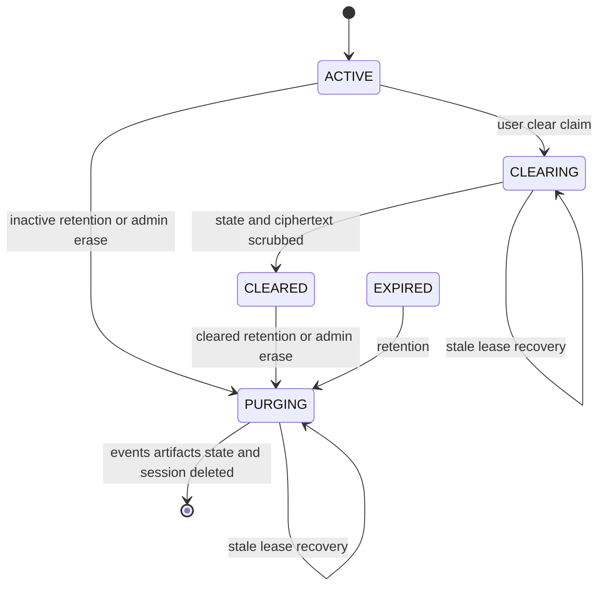

# Agent 记忆

> 状态：记忆模块重设计 M1–M4 已实施（2026-10-17），依据 [记忆模块重设计方案](../plans/记忆模块重设计方案.md)。
> 生产运维、迁移与准入门禁见 [个人记忆生产运行手册](../operations/personal-memory-production-runbook.md)。

记忆是 Agent 的一项能力，不是独立模块。实施人员在 Agent 配置里决定这个 Agent 用不用记忆；终端用户在嵌入式对话里查看和管理自己的记忆。

## 两类记忆

| | 会话记忆 | 个人长期记忆 |
| --- | --- | --- |
| 记什么 | 同一次对话里前面说过的话 | 用户的事实、偏好、长期规则和备注（FACT / PREFERENCE / RULE / NOTE） |
| 属于谁 | 一个用户在一个 Agent 的一次会话 | 一个用户（tenant + 运行时用户），所有开启个人记忆的 Agent 共享，并记录来源 Agent |
| 谁决定用不用 | Agent 配置「会话记忆」开关和窗口条数 | Agent 配置「读取个人记忆」和「写入个人记忆」（关闭 / 仅用户明确要求 / 明确要求 + 待确认候选） |
| 用户怎么管理 | 清空会话 | 嵌入式对话里的「我的记忆」面板；管理端「个人 / 我的记忆」 |
| 存在哪 | Runtime：AgentScope state + `runtime_conversation_*` 事件账本 | Control：`control_personal_memory*`；Knowledge 只存可重建的检索投影 |

「业务索引回源」不是记忆：业务系统才是事实源，业务索引只提供带版本的引用，Agent 使用前按当前用户身份重新回源鉴权。见 [业务索引回源](./business-index-resolution.md)。

记忆不授予权限，不覆盖安全规则、当前请求或业务数据；密码、Token、密钥禁止存储（写入时校验）。

## Agent 记忆策略

记忆字段随 Agent 配置版本发布（`runtime_agent_config_version`）：

- `session_memory_enabled` / `session_memory_window`：会话记忆开关和保留的最近消息条数（4–100）。
- `personal_memory_read`：执行时是否召回该用户的个人长期记忆。
- `personal_memory_write`：`OFF`、`EXPLICIT`（只在用户说「请记住……」时写入）、`EXPLICIT_AND_CANDIDATE`（另外把对话中识别到的信息作为待确认候选）。

Runtime 按已发布版本执行策略，并在响应 `metadata.memoryPolicy` 中回报；Control 只按这份回报决定是否写入，响应里没有策略时什么都不写。请求体不能自行打开或关闭记忆。

## 个人长期记忆怎么产生

1. **用户明确要求**：一轮对话成功后，「请记住……」或明确的长期规则直接成为记忆，来源记为 `CONVERSATION`，用 turn 派生的幂等键防重。写入失败会让本轮返回错误，不会假装已经记住。
2. **待确认候选**（仅 `EXPLICIT_AND_CANDIDATE`）：只识别姓名、常住地、时区、岗位、明确偏好等高精度模式，问题、歧义和疑似密钥直接忽略。候选 30 天过期；相同内容合并出现次数；同一语义键的不同内容标记为「会替换已有记忆」。用户确认后来源记为 `CANDIDATE`。
3. **用户手动添加**：管理端「我的记忆」可以新增和编辑，来源记为 `MANUAL`。

同一用户内按正文摘要去重，按语义键（如回复语言、常住地）覆盖旧值；靠唯一键而不是行锁保证并发安全。每个用户的记忆和待确认候选都有上限，超出时新增返回 429、候选跳过并记审计。

## 用户怎么管理

| 入口 | 身份 | 能做什么 |
| --- | --- | --- |
| 嵌入式对话「我的记忆」（`EmbedChatHost`，`ReachAiChatElement` 与 `createEafChat` 共用；`createEafChat({ memories: false })` 可关闭） | 嵌入 token：tenant + externalUserId（缺省 globalUserId），与对话召回、写入同一身份 | 查看、按来源 Agent 筛选、删除、全部清空、确认或忽略候选 |
| 管理端「个人 / 我的记忆」（`/me/memories`，侧栏底部「个人」面板） | 平台登录会话；非 default tenant 经「运行时用户映射」确定运行时用户 | 以上全部，外加新增、编辑、审计记录和 JSON 导出 |
| 管理端「合规 / 跨域数据擦除」（`/compliance/erasure`） | 平台登录 + `context:memory:erasure:manage` | 为某个运行时用户发起九域擦除，逐域跟踪和补交人工证据 |

删除是物理删除：记忆行、相关候选立即删除，审计行保留事件但抹掉记忆 ID、会话和 trace；Knowledge 投影随后异步删除。召回时 Control 总是按当前 owner 回读 canonical 记录，所以投影延迟也不会让已删除内容回到对话里。带 `expiresAt` 的记忆由生命周期任务按批到期删除。

「全部清空」只覆盖个人长期记忆和候选，返回值列出不在范围内的数据域（Runtime 会话、RunOps / Trace、业务源系统、备份）；完整数据主体请求走合规擦除。

## 接口

| 接口 | 说明 |
| --- | --- |
| `GET/POST /api/me/memories` | 当前用户列表（type / agentId / keyword 筛选）和新增 |
| `GET/PUT/DELETE /api/me/memories/{id}` | 读取、修改、删除；别人的记忆统一 404 |
| `POST /api/me/memories/erase-all` | 强确认清空（`confirmation=ERASE_ALL_PERSONAL_MEMORIES`） |
| `GET /api/me/memories/audit`、`/export` | 审计记录（不含正文）和 JSON 导出 |
| `GET /api/me/memories/candidates`、`POST .../{id}/approve\|reject` | 待确认候选 |
| `GET /api/embed/memories`、`DELETE /api/embed/memories/{id}`、`POST /api/embed/memories/erase-all` | 嵌入式对话终端用户自助，返回 `ApiResult` 包装 |
| `GET /api/embed/memories/candidates`、`POST .../{id}/approve\|reject` | 嵌入式对话候选确认 |
| `/api/compliance/erasure-requests/**` | 跨域擦除请求创建、查看、重试和人工证据 |
| `/api/runtime-user-mappings/**` | 平台用户与运行时用户映射（`context:runtime-user:mapping:manage`） |

## 数据表

| 表 | 所有者 | 用途 |
| --- | --- | --- |
| `control_personal_memory` | Control | 记忆本身；唯一键 `(tenant, owner, content_sha256)`、`(tenant, owner, semantic_key)` |
| `control_personal_memory_candidate` | Control | 待确认候选 |
| `control_personal_memory_audit` | Control | 增删改、召回和候选审计，不存正文 |
| `control_personal_memory_outbox` | Control | 到 Knowledge 检索投影的事务 outbox |
| `control_memory_erasure_request` / `_domain` | Control | 跨域擦除编排 |
| `control_runtime_user_mapping` | Control | 平台用户到运行时用户 |
| `knowledge_personal_memory_index` / `_event` | Knowledge | owner 哈希化的检索投影和消费幂等账本，可重建，不是事实源 |
| `runtime_agent_config_version`（记忆列） | Runtime | Agent 记忆策略 |
| `runtime_conversation_*` | Runtime | 会话目录和完整事件账本 |

## 实现要点

### 会话记忆

- 只有 HMAC 验证过、可解析 user ACL 的 `AGENT` / `EMBED_SESSION` 身份进入持久会话；匿名、Debug 和直连 Runtime 请求保持 turn-local。
- 状态键由 tenant、可信 user、Agent、session 派生，原始用户 ID 不进入 AgentScope key。
- 同一 session 使用数据库 turn lease 防止并发写乱序；`turnId + role` 提供 durable event 幂等。
- AgentScope 上下文按 `RUNTIME_SESSION_MEMORY_MAX_CONTEXT_MESSAGES` 做滑动窗口；完整用户/助手事件另写 Runtime ledger。
- `DELETE /api/runtime/agents/sessions/{sessionId}` 只能经 Control 以精确路径和空 body HMAC 签名调用；它清理短期状态并标记 session cleared，不静默销毁合规事件账本。

### 会话保留、Legal Hold 与并发擦除



- tenant policy 只定义 `ACTIVE` 未活动天数和 `CLEARED` 保留小时数；无 tenant 行时使用 Runtime 配置默认值。自动任务按有界批次执行，且默认关闭，必须在迁移、策略、Legal Hold、备份到期和恢复流程验证后显式设置 `RUNTIME_SESSION_RETENTION_ENABLED=true`。
- Legal Hold 使用机器原因码、可选外部案件/审批引用、设置时间和设置者哈希；它阻止用户 clear、自动 retention 和管理员 erase。Hold 与生命周期状态更新都使用条件更新，不能跨过已取得的 `CLEARING` / `PURGING` claim。
- 普通用户 clear 先取得 `CLEARING` 生命周期租约，再删除 AgentScope state 并擦除 Tool artifact 密文，最后进入 `CLEARED`。失败会保留可重试的 `CLEARING`，后台只在租约过期后恢复；事件账本此时仍保留。
- retention 或管理员 erase 先取得 `PURGING` claim，再幂等删除 AgentScope state、Tool artifact 行、`runtime_conversation_event` 和 `runtime_conversation_session`。崩溃后只有租约过期的工作可被其他副本接管。
- 活跃 turn 的数据库租约阻止 clear/purge；AgentScope 常规保存、上下文裁剪、超限恢复持久化、Tool artifact 写入/读取以及 turn 结束写账本都必须持有精确 lease owner，并在外部副作用前原子续租。失去租约的旧 turn 无法重建已擦除 state/artifact、继续读取已清理 artifact、提交事件或把已清理 session 重新激活。
- Control 管理入口是 `/api/runtime/session-retention/**`，要求实时平台登录和全局权限 `runtime:session:retention:manage`；Control 只通过 exact-byte V2 HMAC 调 Runtime，签名中的 `PLATFORM_SESSION` actor 和 tenant 必须与目标一致。Control 记录请求审计，Runtime 记录完成/失败事实。
- Runtime 审计不保存会话正文、AgentState、Tool 结果、原始 session ID 或原始 actor ID；保留 tenant、session/actor 哈希、机器原因码、可选引用、前后状态和异常类名。
- “Runtime 会话擦除”不等于全平台合规擦除。它不处理个人长期 canonical memory、候选/outbox、Knowledge 投影、业务索引/业务主数据、RunOps/Trace/Interaction 或任何备份；跨域数据主体请求需要独立编排和每个 owner 的完成证明。


### Runtime 注入安全

Control 先召回最多 `topK` 条、`maxChars` 字符的 canonical 记忆，再把 `personalMemory` 放在 `body` 旁边的 HMAC 签名 envelope 中。Runtime：

1. 从公共 `body` 中删除 `personalMemory`、`personalMemoryContext` 和 `__personalMemory` 等伪造别名；
2. 只接受签名 envelope 的 `reachai-personal-memory-context-v1`；
3. 对条数、类型、单条和总字符数再次限额；
4. 把内容引用为“用户提供的上下文”，明确禁止其覆盖安全、授权、Tool policy、Workflow contract 或当前请求；
5. 不把个人记忆复制进 Workflow input、continuation payload 或 Trace。

### Knowledge 搜索投影

- Control 在 canonical 写事务中同步写 `control_personal_memory_outbox`，数据库生成的 outbox ID 是全局单调 `sourceVersion`。
- outbox 失败只持久化最长 64 字符的异常类型机器码，禁止保存异常 message、HTTP 响应或记忆正文；成功投递在同一次条件更新中把正文 payload 替换为只含 sourceVersion/eventType 的无身份 receipt。历史异常文本和 PUBLISHED 正文副本曾由 20260815 outbox-redaction 历史迁移幂等擦除；该脚本已并入基线并从当前树清理。PENDING/PUBLISHING 暂留投递所需 payload，DEAD 必须通过零死信门禁处置；主动遗忘仍会立即擦除该 memory 的全部历史 payload。Control 发布无身份标签的 `reachai.personal_memory.outbox.snapshot_fresh/backlog/dead/oldest_unpublished_seconds/last_success_epoch_seconds` 指标，SHADOW 和生产准入同时要求快照新鲜、死信为零且最老未发布事件不超过 300 秒。
- publisher 用 CAS 抢占、指数退避、过期锁恢复和 12 次后 `DEAD`，交付语义为 at-least-once。
- Knowledge 用事件唯一键去重，用 `UPDATE ... WHERE source_version < incoming` 保证多副本乱序投递时最高版本获胜。
- Knowledge 只保存 `HMAC(index identity secret, tenant + runtime user)` 的 owner hash，不保存原始 runtime user ID。
- Control -> Knowledge event/query 只允许 `MEMORY_INDEXER` source，使用 exact-byte HMAC、时间窗和 Redis 共享 nonce；签名 tenant/user 必须与正文 owner 完全一致，body/response 均有大小上限，Redis 不可用时鉴权 fail-closed。
- `REACHAI_PERSONAL_MEMORY_KNOWLEDGE_QUERY_MODE` 有 `OFF / SHADOW / ACTIVE` 三态，默认 `OFF`。`SHADOW` 会真实查询 Knowledge 并比较结果，但绝不改变 canonical 答案；只有准入指标持续达标后才切换 `ACTIVE`。兼容变量 `REACHAI_PERSONAL_MEMORY_KNOWLEDGE_QUERY_ENABLED=true/false` 仅映射为 `ACTIVE/OFF`。
- `ACTIVE` 模式下，投影命中 ID 仍必须回读 Control canonical 数据。只有通过 owner、状态和过期时间校验的 ID 才获得有界排序加权，并与有界的全局规则/偏好和稳定个人档案候选取并集，不能压掉这些 sticky canonical memory。
- Knowledge 的内部 query 响应只返回有序 `memoryId` 候选和 `truncated`，不返回索引中的标题、正文、摘要、trust level 或分数。字符预算仍在 Knowledge 内部参与候选截断；正文只能由 Control 根据当前 owner 重读 canonical 记忆。
- SHADOW 指标为 `reachai.personal_memory.retrieval.requests`、`latency`、`returned_ids`、`canonical_coverage`、`projected_precision` 和 `invalid_id_ratio`。指标标签不包含 tenant、user、query 或 memory ID，避免把私密内容和高基数标识写入监控系统。

Knowledge 排序由独立的 `REACHAI_PERSONAL_MEMORY_KNOWLEDGE_SEARCH_MODE` 控制：`LEXICAL` 是默认安全模式，`HYBRID` 合并语义与词面分数并在单条投影尚未完成 embedding 时保留词面降级，`VECTOR` 只接受达到阈值的当前向量。`HYBRID` / `VECTOR` 必须配置 `REACHAI_PERSONAL_MEMORY_EMBEDDING_MODEL_INSTANCE_ID`；query embedding 和异步文档 embedding 都统一经过 Model Gateway。它与 Control 的 `OFF / SHADOW / ACTIVE` 路由开关是两个不同维度，推荐先在 Knowledge 启用 `HYBRID` 构建投影，同时让 Control 保持 `SHADOW`。

当前 ranking mode 和 embedding instance 是 Knowledge 部署级配置，不是 tenant 自选配置。要求不同数据驻留区域、不同 provider 合同或 tenant 专属模型的部署，必须使用隔离的 Knowledge/Model 部署单元，或在 tenant-scoped 模型策略实现前保持该 tenant 为 `LEXICAL/OFF`；不能让一个全局实例 ID 暗中绕过租户的数据处理约束。

当前实现按 owner hash 的联合索引先读取最多 1000 条 ACTIVE 候选，再对 MySQL 行内、版本化 `FLOAT32_BE_V1` 向量做精确 cosine 排序。个人 owner 的 canonical 配额本就限制在 1000 条，因此这种设计有明确上界、没有 ANN 近似误差，也不会依赖容易漏写 tenant/user filter 的共享向量集合。向量只是 Knowledge-owned 的可重建 `MEDIUMBLOB` 投影；将来容量证明超过此边界时，可以在不改变 ID-only 响应、owner 隔离和 canonical revalidation 的前提下替换为 Milvus 等后端。

embedding 构建不阻塞 Control outbox 事务。Knowledge worker 使用 `PENDING / PROCESSING / RETRY / READY / DEAD` 状态、CAS claim token、租约恢复、指数退避和最多 12 次尝试；同一次 Model Gateway batch 只包含同一 tenant 的文本，不跨 tenant 混批，且请求不携带原始 user ID 或 owner hash。完成更新必须同时匹配行 ID、`sourceVersion` 和 claim token。新版本到达会使旧完成失效，模型实例 ID 或向量格式变化会触发重建；embedding 模型、revision 或维度变更必须创建新的 Model Center 实例 ID，不能在同一 ID 下原地换模型。同一个数据库不能同时运行目标 embedding 实例 ID 不同的 Knowledge worker，否则两个版本会相互判定为过期并反复重建；模型切换必须先排空旧 worker，再启动唯一目标版本。删除事件在同一个条件更新中清空向量、模型、摘要、重试和 claim 字段并标记 `DELETED`。供应商响应或记忆正文不会写入错误字段和指标；在线 query 的 Model Gateway 错误会显式返回到 Control，让 `SHADOW/ACTIVE` 的 canonical fallback 和降级指标生效。

语义投影持续发布无身份标签的聚合指标：`reachai.personal_memory.embedding.projection.enabled`、`snapshot_fresh`、`active`、`ready`、`ready_ratio`、`dead`、`oldest_pending_seconds`、`unsafe_deleted_vectors`、`last_success_epoch_seconds` 和 `refresh{outcome=success|error}`；worker 另发布 `reachai.personal_memory.embedding.provider_latency{outcome}`。这些指标没有 tenant、user、owner、memory ID 或正文标签。刷新失败时保留上一次计数但把 `snapshot_fresh` 置为 0，避免陈旧的高就绪率被误当作当前证据。

SHADOW 质量准入检查使用：

```powershell
node scripts/check-personal-memory-shadow-readiness.mjs
```

脚本默认要求至少 100 个 SHADOW 样本、canonical coverage 和 projected precision 均不低于 0.8、非法 ID 比例和查询错误率均不高于 0.01；指标缺失时失败关闭。阈值可由 `REACHAI_MEMORY_SHADOW_*` 环境变量覆盖，但降低阈值只能用于开发验收，不能替代真实生产语料观测。

Knowledge 语义投影聚合准入使用 `scripts/check-personal-memory-semantic-readiness.mjs`。它要求语义模式启用、监控快照新鲜、active canary 非空、READY 比例至少 0.99、死信和删除残留为零、最老积压不超过 300 秒；任一 Actuator 指标缺失都会失败关闭。

目标环境负载、双 owner 隔离、跨域擦除和备份恢复使用 [Agent Memory 生产运行手册](../operations/personal-memory-production-runbook.md)。`scripts/check-mysql-transport-readiness.mjs` 在发送任何数据库凭据前验证 MySQL TLS 能力、证书链和目标身份；`scripts/load-personal-memory.mjs` 默认只预演，远程写入必须同时提供 HTTPS 目标、两个独立短期平台 session、`ALLOW_REMOTE=YES` 和精确执行确认；`scripts/verify-memory-erasure-e2e.mjs` 只接受带唯一后缀的合成 owner，验证创建/证据幂等重放、九域清单、Legal Hold 和 raw owner 不出响应，零数据 smoke 会明确标记为非数据面验收；`scripts/check-personal-memory-production-readiness.mjs` 只读取证据并失败关闭，不自动迁移、发布或切换检索模式，并要求嵌入完整的远程九域验收器输出。

#### 真实 embedding 与开源影子评测

2026-08-15 使用脱敏合成语料完成了首轮可重复 benchmark。语料包含 3 个 tenant/user owner 槽位、14 条记忆（其中 1 条先加入再删除）和 13 个中英日查询，`topK=3`。Node 主控在调用任何 provider 前将 `tenantId + runtimeUserId` 转成 HMAC owner key；Mem0/ReMe 只收到 owner key、canonical ID 和合成文本，响应契约只允许 ID 与分数。每个结果再计算 owner 越权、删除泄漏、非法 ID、负向误召回、coverage、MRR、nDCG 和 p50/p95。

真实神经向量由本机隔离 [Text Embeddings Inference](https://github.com/huggingface/text-embeddings-inference) CPU canary 提供，镜像为 `ghcr.io/huggingface/text-embeddings-inference:cpu-1.8.2`，模型为 [BAAI/bge-small-zh-v1.5](https://huggingface.co/BAAI/bge-small-zh-v1.5)、512 维。模型 revision 固定为 `4bf3c54884c552e68da7eb27f3e9bdc5a32e32d4`；同一端点先通过 Model Gateway `test-draft` 验证 512 维响应，再供 benchmark 使用。没有创建模型实例、没有写远程 MySQL。`minScore=0.5` 只来自这批合成样本的开发校准，不能直接作为生产阈值。

| Provider | coverage@3 | MRR | relevance precision@3 | 负向误召回率 | p95 | 开发质量门槛 |
| --- | ---: | ---: | ---: | ---: | ---: | --- |
| ReachAI lexical | 0.167 | 0.167 | 1.000 | 0.000 | 0.264 ms | 未通过：语义召回不足 |
| ReachAI TEI vector | 1.000 | 1.000 | 0.600 | 0.000 | 20.231 ms | 通过 |
| ReachAI TEI hybrid | 1.000 | 1.000 | 0.600 | 0.000 | 17.600 ms | 通过 |
| Mem0 2.0.18 + local Qdrant | 1.000 | 1.000 | 0.600 | 0.000 | 40.758 ms | 通过，但无质量增益且延迟更高 |
| ReMe 0.4.1.7 hybrid | 1.000 | 1.000 | 0.375 | 1.000 | 22.326 ms | 未通过：负向查询误召回 |

五个 provider 的 `projectedPrecision=1`，owner 越权、已删除项泄漏、非法 ID 和显式 forbidden hit 都为 0；Mem0 与 ReMe 的物理删除检查也通过。这里的“开发质量门槛通过”仍不等于可上线：样本只有 13 个查询，全部为合成数据，没有容量、故障、备份恢复或生产分布证据，报告统一保持 `productionPromotionEligible=false`。

可重复入口：

```powershell
node scripts/benchmark-personal-memory-shadow.mjs `
  --providers=lexical,tei-vector,tei-hybrid,mem0,reme `
  --tei-base-url=http://127.0.0.1:18781/v1 `
  --model=BAAI/bge-small-zh-v1.5 `
  --dimensions=512 `
  --min-score=0.5 `
  --mem0-python=<isolated-mem0-python> `
  --reme-python=<isolated-reme-python>
```

基准语料、主控和两个 ID-only adapter 分别位于 `scripts/fixtures/personal-memory-shadow-benchmark-v1.json`、`scripts/benchmark-personal-memory-shadow.mjs` 和 `scripts/adapters/`。Model Gateway embedding 已接入 Knowledge 派生向量投影源码，但新增 schema 尚未在远程开发库执行，正式语义模式 E2E 仍为 `NOT RUN`。下一步是按 `LEXICAL -> HYBRID + Control SHADOW -> Control ACTIVE` 灰度，不是把 Mem0/ReMe 直接嵌入 Runtime。正式切换前必须用至少 100 个经过批准的真实脱敏 shadow 样本重新校准阈值，并补充吞吐、并发删除、provider 超时、向量投影重建和灾备恢复。

## 生产配置

Control、Runtime、Knowledge 必须使用相同的高熵 `REACHAI_INTERNAL_SERVICE_SECRET`。此外：

```text
RUNTIME_SESSION_MEMORY_STATE_STORE=redis
RUNTIME_SESSION_MEMORY_REDIS_URI=redis://...
RUNTIME_SESSION_RETENTION_ENABLED=false
RUNTIME_SESSION_RETENTION_ACTIVE_DAYS=30
RUNTIME_SESSION_RETENTION_CLEARED_HOURS=24
RUNTIME_SESSION_RETENTION_BATCH_SIZE=100
RUNTIME_SESSION_RETENTION_LEASE_SECONDS=300
REACHAI_INTERNAL_SERVICE_ACCEPTED_SECRETS=<verification-only old secrets, comma-separated>
REACHAI_INTERNAL_TRANSPORT_MODE=DIRECT_TLS
REACHAI_PERSONAL_MEMORY_INDEX_IDENTITY_SECRET=<dedicated high entropy secret>
REACHAI_PERSONAL_MEMORY_KNOWLEDGE_SEARCH_MODE=HYBRID
REACHAI_PERSONAL_MEMORY_EMBEDDING_MODEL_INSTANCE_ID=<versioned embedding instance id>
REACHAI_PERSONAL_MEMORY_EMBEDDING_CANDIDATE_LIMIT=1000
REACHAI_PERSONAL_MEMORY_EMBEDDING_BATCH_SIZE=32
REACHAI_PERSONAL_MEMORY_EMBEDDING_MIN_SCORE=<shadow-calibrated threshold>
REACHAI_PERSONAL_MEMORY_EMBEDDING_VECTOR_WEIGHT=<shadow-calibrated weight>
REACHAI_PERSONAL_MEMORY_EMBEDDING_MAX_TEXT_CHARS=4000
REACHAI_PERSONAL_MEMORY_EMBEDDING_MAX_QUERY_CHARS=4000
REACHAI_PERSONAL_MEMORY_KNOWLEDGE_QUERY_MODE=SHADOW
REACHAI_PERSONAL_MEMORY_OUTBOX_ENABLED=true
REACHAI_PERSONAL_MEMORY_MAX_ACTIVE_ITEMS_PER_OWNER=1000
REACHAI_PERSONAL_MEMORY_MAX_PENDING_CANDIDATES_PER_OWNER=500
REACHAI_PERSONAL_MEMORY_LIFECYCLE_ENABLED=true
REACHAI_PERSONAL_MEMORY_LIFECYCLE_BATCH_SIZE=100
REACHAI_PERSONAL_MEMORY_LIFECYCLE_DELAY_MS=60000
REACHAI_MEMORY_ERASURE_WORKER_ENABLED=false
REACHAI_MEMORY_ERASURE_WORKER_BATCH_SIZE=10
REACHAI_MEMORY_ERASURE_WORKER_DELAY_MS=5000
RUNTIME_BUSINESS_INDEX_MAX_REFERENCES=8
RUNTIME_BUSINESS_INDEX_MAX_RESOLUTION_BYTES=262144
REACHAI_KNOWLEDGE_CONSOLE_MAX_BODY_BYTES=104857600
REACHAI_KNOWLEDGE_CONSOLE_MAX_RESPONSE_BYTES=16777216
REACHAI_KNOWLEDGE_PROJECT_MAX_BODY_BYTES=10485760
# single-tenant business host only; multi-tenant hosts must use the source-row tenant
REACHAI_BUSINESS_INDEX_TENANT_ID=<authoritative deployment tenant>
```

- production profile 默认要求 Runtime state store 为 Redis；本地开发可使用 JSON。
- prod/production profile 会在启动时强制 `REACHAI_INTERNAL_SERVICE_SECRET` 及全部 overlap 验签密钥至少 32 字符；`REACHAI_INTERNAL_SERVICE_SECRET` 只用于签发新请求，`REACHAI_INTERNAL_SERVICE_ACCEPTED_SECRETS` 最多配置 3 个额外旧密钥，仅供 Runtime、Capability 和 Knowledge 验签。标准轮换顺序是：先把新密钥加入全部验签端的 overlap 集合，再切换签发端 active secret，确认旧版本实例全部退出后移除旧密钥。该环境变量使用逗号分隔，因此密钥本身不得包含逗号，也不要把 overlap 集合长期当作多租户密钥池。
- prod/production profile 还拒绝默认 `DEVELOPMENT_PLAINTEXT` 传输模式。`DIRECT_TLS` 强制全部配置的内部 URL 以及 Capability 动态业务端点使用 HTTPS；`MTLS_MESH` 允许应用看到 HTTP sidecar hop，但它只是运维对已部署 mTLS service mesh 的显式声明，代码无法替代证书、mesh policy 和抓包验收。
- `REACHAI_PERSONAL_MEMORY_INDEX_IDENTITY_SECRET` 是独立、稳定的伪名化密钥；prod/production profile 强制它至少 32 字符且不能与内部调用密钥相同。轮换它会改变 owner hash，必须先设计双读或全量重建，不能直接替换。
- owner 配额在写入事务内判定：新的显式 ACTIVE 记忆超过上限返回 429；被动 PENDING 候选达到上限时跳过并记录 `OWNER_PENDING_CANDIDATE_QUOTA` 审计，不阻断主对话。幂等重放、已有记忆更新和候选合并不消耗新配额。
- Knowledge HMAC nonce 依赖共享 Redis；不可用时 personal-memory、Business Index console 和 project-ingress internal route 都返回 401。外部项目凭证 nonce 由 Capability 的 MySQL replay ledger 独立消费。
- 个人记忆只按 owner 授权，不等于内容加密。生产环境必须为 Control/Runtime/Knowledge 内部链路启用 TLS 或 mTLS，并对 MySQL、Redis、磁盘快照和备份启用组织批准的静态加密与密钥轮换策略；HMAC 只提供身份、完整性和防重放，不提供传输保密。
- `DELETE /api/runtime/agents/sessions/{sessionId}` 清理短期 state 和 Tool artifact 密文，但完整会话事件账本只在后续 retention purge 时删除。自动 purge 默认关闭；受监管部署必须先配置 tenant 保留期、Legal Hold、管理员擦除和备份到期策略，不能把“清会话”误当成跨数据域合规擦除。
- 建议告警：outbox 最老 PENDING 年龄、PENDING/PUBLISHING/DEAD 数、embedding PENDING/RETRY/DEAD 数与最老等待时间、Model Gateway embedding 错误率/延迟、Knowledge apply/query 错误率、SHADOW coverage/precision/invalid ID、lifecycle 失败、candidate PENDING 年龄、recall 降级率和 session lease 冲突率。
- 仍对应 ACTIVE canonical 的 `DEAD` outbox 必须在定位配置/网络/数据错误后由运维人工重置为 `PENDING`；不要自动无限重试。canonical 已删除后由应用原子转成的 `SUPERSEDED` 是不可投递终态，禁止重置。
- Outbox 仅在待投递窗口暂存 Knowledge 建投影所需正文和 owner 路由字段；成功投递后立即替换为无身份的发布收据。canonical 删除/到期时，全部历史 payload 原子替换为仅含 schema 与删除标记的中性擦除收据，尚可重试或已死信的旧事件转为 `SUPERSEDED` 终态；新的 DELETE 事件只携带 Knowledge 定位 tombstone 所需的 tenant、runtime user、memory ID 和单调版本，不复制正文或内容哈希，投递成功后同样收据化。已经在进程内发送的旧副本可能完成，但更高版本的 DELETE tombstone 始终为 Knowledge 权威状态。
