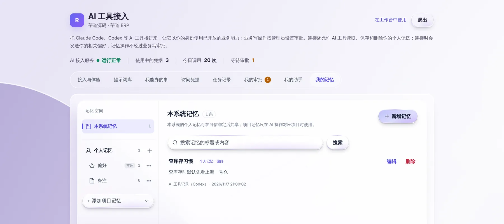

# 让 AI 记住你的习惯

> 适合：经常用 AI 工具办业务、不想每次都重复交代的业务人员。

## 做完你会得到什么

告诉 AI 一次「查库存时默认先看上海一号仓」，以后你只说「查一下罗技鼠标的库存」，它就会先看上海一号仓，不用每次重复。

这些记忆只属于你自己，别人看不到。

## 开始前你需要

- 已经按 [在自己的 AI 工具里办业务](own-ai-tool.md) 接好了 Codex 或 Claude Code。

## 第 1 步：直接告诉 AI 要记住什么

在你的 AI 工具里说：

```text
请记住：我查库存时默认先看上海一号仓
```

AI 工具会把这句话保存成你的一条个人记忆，并告诉你已经记住。

适合记的内容：

- 习惯和偏好：常看的仓库、常用的单位、喜欢的结果格式。
- 常用信息：负责的客户、所在部门、常用供应商。

**不要让 AI 记密码、银行卡号、身份证号**这类敏感信息。

## 第 2 步：在个人页查看和整理

打开个人页的「我的记忆」，能看到 AI 记下的全部内容，以及每条是从哪个工具、什么时候记的。



在这里可以：

- **新增记忆**：自己手动写一条。
- **编辑**：AI 记得不准，直接改。
- **删除**：不想让 AI 再用的内容，删掉即可。
- **分组**：个人记忆默认分「偏好」「备注」两组，也可以自己加分组。

## 第 3 步：确认 AI 用上了记忆

下次在 AI 工具里问「罗技无线鼠标还有多少库存？」，看它是不是先给出上海一号仓的数字。也可以直接问它：「你记得我哪些习惯？」

## 个人记忆和项目记忆

左边的「记忆空间」里有两种：

| 类型 | 什么时候用 |
| --- | --- |
| 个人记忆 | 你的个人习惯，AI 替你办任何事时都会参考。 |
| 项目记忆 | 只和某个项目有关的信息，只有 AI 操作这个项目时才用。点「添加项目记忆」创建。 |

## 背后发生了什么

- AI 工具连接上时，会拿到和你相关的偏好，所以不用每次重新交代。
- 记住、修改、删除记忆**不需要审批**，因为它只影响 AI 怎么帮你，不会改业务系统里的数据。
- 删除后，这条记忆不会再被使用。但在删除之前已经发出去的对话里，内容可能还留在那次对话中。

## 遇到问题

**AI 说它记不了。** 确认 AI 工具已经接好并重启过；可以在个人页手动新增一条。

**AI 记错了。** 在个人页「我的记忆」里直接编辑或删除。

## 下一步

- [用同事沉淀的 Skill](skills.md)
- [我的个人页](my-portal.md)
