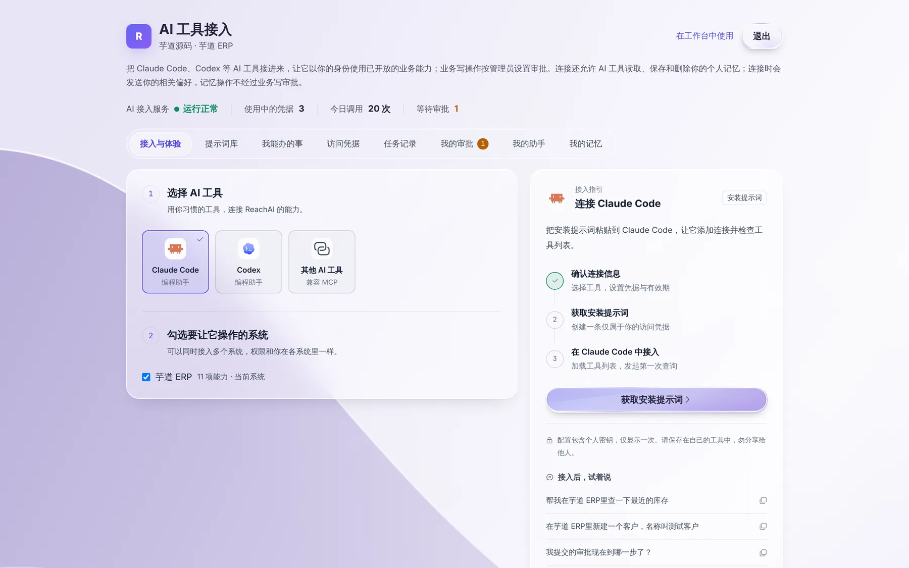
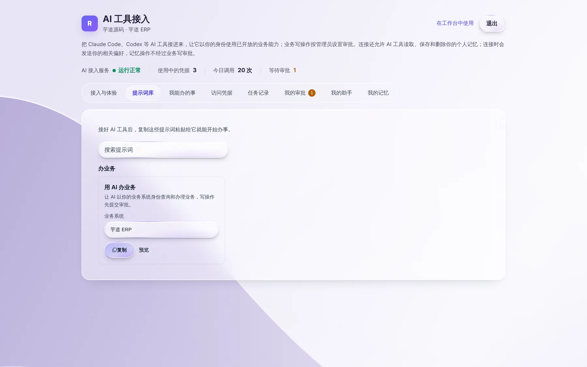
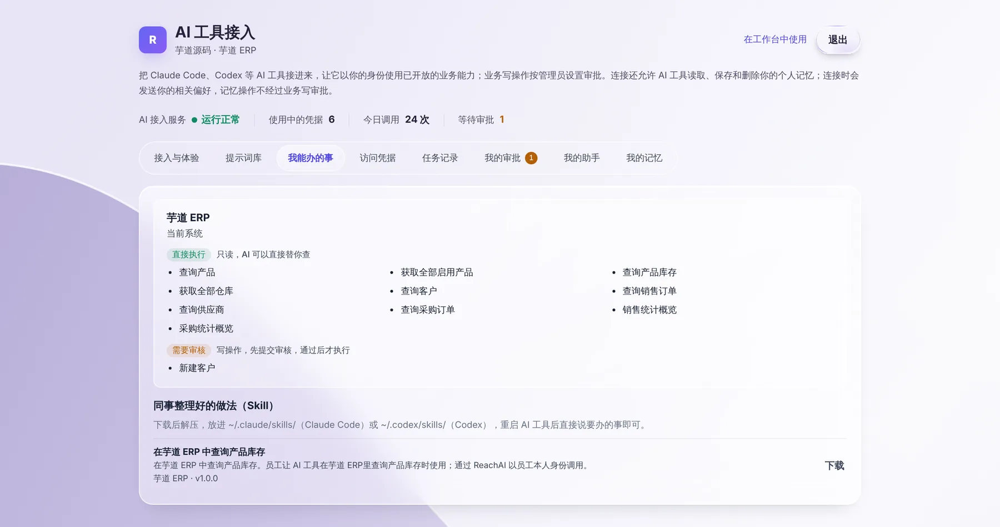
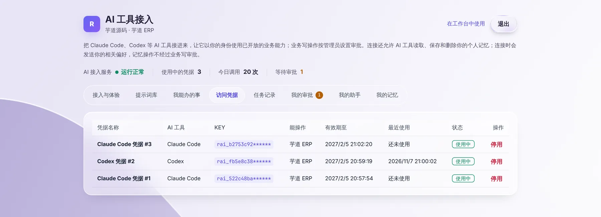
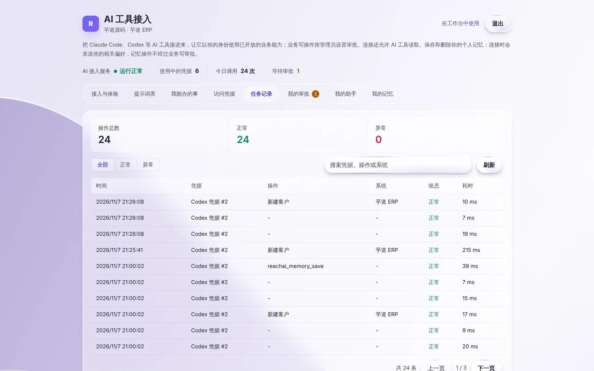
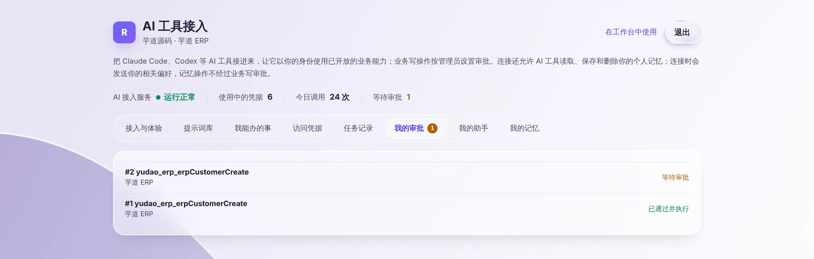

# 我的个人页

> 适合：所有业务人员。个人页是你管理「AI 替你办事」的地方：接 AI 工具、看能办什么、查记录、跟进审批、管理记忆。

## 怎么打开

不需要另外的账号和密码，从业务系统里进：

1. 登录业务系统（例如芋道 ERP）。
2. 在右下角助手的标题栏点 AI 工具图标「在我的 AI 工具中使用」。
3. 点「在浏览器里管理」，浏览器会打开一个新标签页，就是你的个人页。

打开后两小时内可以一直用；过期了从助手里再点一次即可。

页面顶部一排数字告诉你现在的状况：AI 接入服务是否正常、你有几条在用的连接（凭据）、今天 AI 替你调用了多少次、有几条审批在等。

下面按标签页逐个说明。

## 接入与体验：把 AI 工具接进来

左边选你用的 AI 工具（Claude Code、Codex 或其他支持 MCP 的工具），勾选要让它操作的系统；右边点 **获取安装提示词**，把整段提示词粘贴给你的 AI 工具，它会自己完成配置并检查能不能用。

右下方的「接入后，试着说」是几句可以直接复制去试的话。

完整步骤见 [在自己的 AI 工具里办业务](own-ai-tool.md)。

## 提示词库：不知道怎么说，就抄一句

按场景整理好的说法，点复制就能粘贴给 AI 工具。适合刚开始用、不知道 AI 能听懂什么的时候。

## 我能办的事：AI 能替你做哪些操作

按系统列出管理员开放给你的全部操作，分两类：

- **直接执行**：只读的查询，AI 可以直接替你查。
- **需要审核**：会改数据的操作，先提交审批，批准后才执行。

如果同事把常用做法整理成了 Skill，这里下方还会出现「同事整理好的做法（Skill）」，可以下载安装，见 [用同事沉淀的 Skill](skills.md)。

想做的事不在清单里，说明管理员还没开放，可以找管理员申请。

## 访问凭据：你的每一条连接

每次「生成连接」或「获取安装提示词」都会产生一条凭据，也就是你给 AI 工具的那把钥匙。这里能看到每条凭据给了哪个 AI 工具、能操作哪个系统、什么时候到期、最近一次什么时候用过。

出现下面情况时，点右边的 **停用**：

- 密钥不小心发给了别人，或贴到了群里、代码里。
- 换电脑了，旧电脑上的 AI 工具不再用。
- 看到「最近使用」时间不对，怀疑不是你本人在用。

停用立即生效，用这条凭据的 AI 工具马上就不能再替你办事。之后可以重新生成一条。

## 任务记录：AI 替你做过的每一件事

每次 AI 工具调用都会记下来：时间、用的哪条凭据、做了什么操作、在哪个系统、结果是否正常。管理人员也能看到这些记录，所以 AI 替你办的事都有据可查。

## 我的审批：跟进 AI 提交的写操作

AI 替你新建、修改数据时会先提交审批，进度显示在这里。标签上的数字是还在等待的条数。各种状态的意思见 [让 AI 帮你改数据：为什么要审批](write-and-approval.md)。

## 我的助手：不打开业务系统也能问

和业务系统右下角的助手一样，可以用一句话查数据。适合手边没开业务系统、又想快速查一下的时候。

## 我的记忆：AI 记住的你的习惯

AI 工具帮你记下的偏好（例如「查库存默认先看上海一号仓」）都在这里，可以新增、修改、删除。详见 [让 AI 记住你的习惯](memory.md)。

## 遇到问题

**点「在浏览器里管理」没反应。** 浏览器可能拦截了弹出窗口，允许这个网站弹窗后再点一次。

**个人页提示登录过期。** 从业务系统助手里重新点「在浏览器里管理」。

**「我能办的事」是空的。** 管理员还没给你开通能让 AI 操作的系统，请联系管理员。

## 下一步

- [让 AI 记住你的习惯](memory.md)
- [用同事沉淀的 Skill](skills.md)
- [业务人员常见问题](faq.md)
