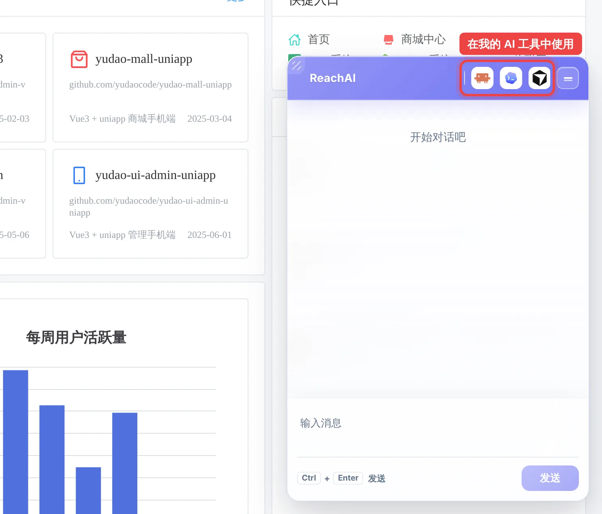
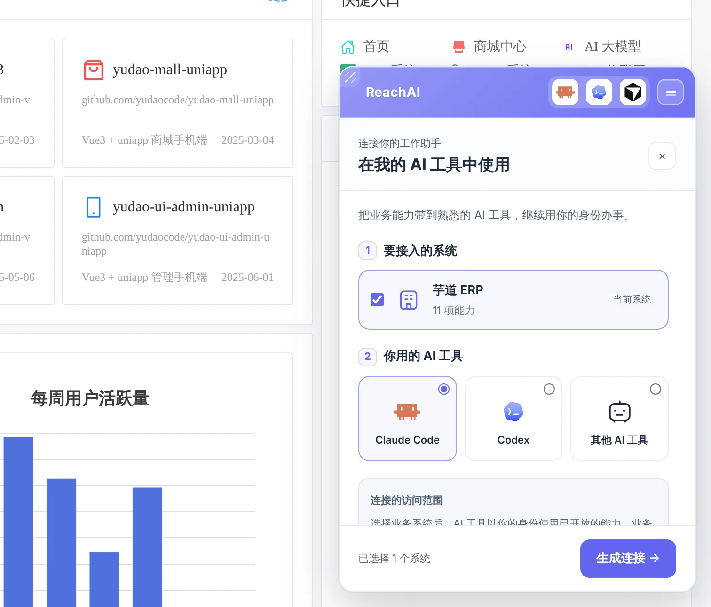
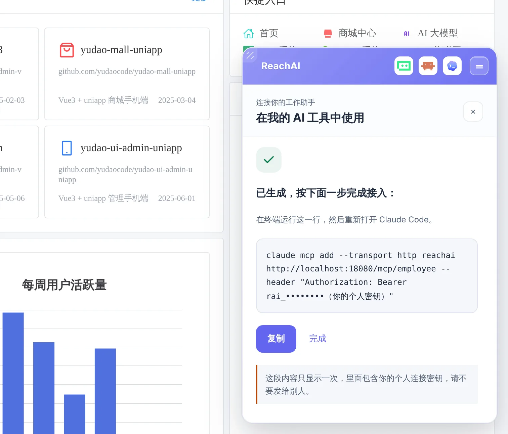
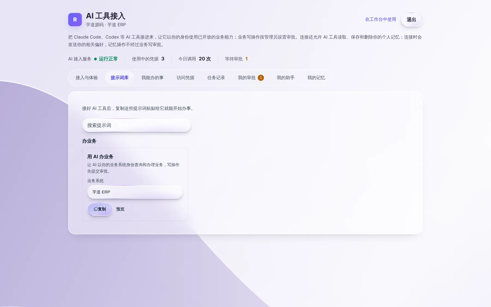
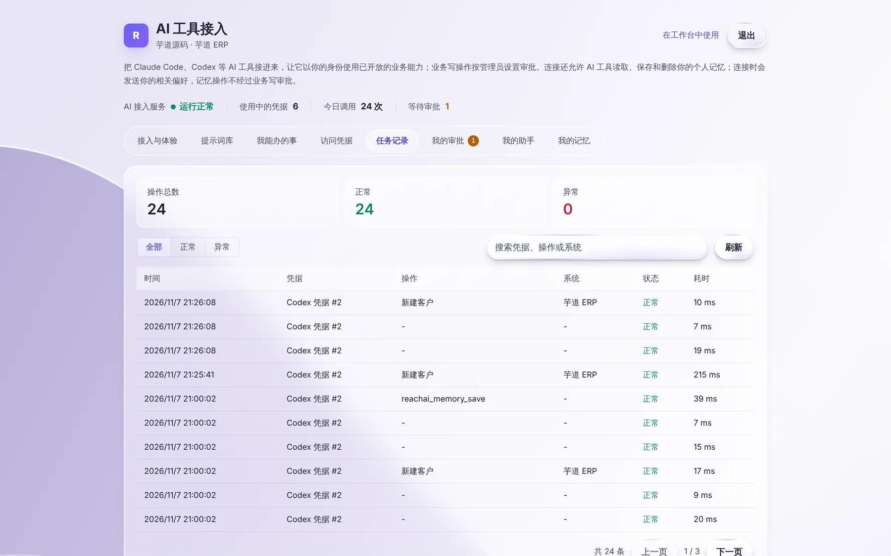

# 在自己的 Codex / Claude Code 里办业务

> 适合：已经在用 Codex、Claude Code 等 AI 工具的业务人员。读完你就能在自己熟悉的 AI 工具里，以本人身份查 ERP、提交业务。
>
> 全程大约 5 分钟，只需要做一次。

## 做完你会得到什么

在 Claude Code 或 Codex 里直接说「帮我查一下罗技无线鼠标在各仓库的库存」「在 ERP 里新建一个客户，叫华东贸易有限公司」，AI 工具会以**你本人的身份**去业务系统里办，结果直接回到对话里。

和业务系统里的助手相比，好处是：

- 不用打开业务系统页面，在你写文档、做表格的同一个工具里就能查数据。
- 可以一次连接多个业务系统，让 AI 跨系统帮你整理信息。
- 同事整理好的办事做法（Skill）可以直接装进你的 AI 工具。

## 开始前你需要

- 电脑上已经装好 Claude Code、Codex，或者其他支持 MCP 的 AI 工具。
- 能正常登录业务系统，并且右下角有 AI 助手。
- 管理员已经为这个系统开通了「员工使用」。如果下面第 1 步看不到可选的系统，就是还没开通，请联系管理员。

## 第 1 步：在助手里打开「在我的 AI 工具中使用」

登录业务系统，在右下角助手的标题栏上点 AI 工具图标（鼠标停上去会显示「在我的 AI 工具中使用」）。



## 第 2 步：选择系统和你用的 AI 工具

1. **要接入的系统**：默认勾选当前系统。如果你在多个业务系统都有账号，这里会列出来，可以一起勾选。
2. **你用的 AI 工具**：选 Claude Code、Codex，或者「其他 AI 工具」。
3. 点右下角 **生成连接**。



## 第 3 步：把生成的内容放进你的 AI 工具

生成后，助手会显示一段内容和操作说明。点「复制」，然后按你选的工具操作：



| 你选的工具 | 怎么做 |
| --- | --- |
| Claude Code | 打开终端，粘贴这一行命令并回车，然后重新打开 Claude Code。 |
| Codex | 把复制的几行粘贴到 `~/.codex/config.toml` 文件末尾，保存后重新打开 Codex。 |
| 其他 AI 工具 | 按工具自己的说明，把地址和密钥填进它的 MCP 配置里。 |

> **不会操作终端或配置文件？** 可以换一种方式：在助手里点「在浏览器里管理」打开个人页，在「接入与体验」里点 **获取安装提示词**，把整段提示词粘贴给你的 AI 工具，让它自己帮你完成配置。

**请务必注意：**

- 这段内容**只显示一次**，里面有你的个人连接密钥。
- 不要发给别人，不要贴到群里，也不要提交到代码仓库。别人拿到它就能以你的身份办事。
- 万一泄露或丢了，到个人页的「访问凭据」里把它**停用**，再重新生成一条。

## 第 4 步：试着说第一句话

重新打开 AI 工具后，可以先问它：「你现在能帮我在芋道 ERP 里做什么？」它会列出可以使用的能力。然后试试：

```text
帮我在芋道 ERP 里查一下罗技无线鼠标在各个仓库的库存
```

AI 工具会先查产品编号，再查库存，最后把结果整理给你。

更多可以直接复制的说法，见个人页的「提示词库」：



## 第 5 步：确认 AI 真的是用你的身份办的

打开个人页的「任务记录」，可以看到每一次调用：什么时间、用的哪条凭据、做了什么操作、在哪个系统、结果是否正常。



## 让 AI 帮你新建、修改数据

在 AI 工具里同样可以说「新建一个客户」。这类会改数据的操作，默认会先提交审批，管理人员批准后才执行。AI 工具会告诉你审批编号，你随时可以问它「我提交的审批到哪一步了？」。

详见 [让 AI 帮你改数据：为什么要审批](write-and-approval.md)。

## 能做什么，取决于什么

- **能用哪些功能**：由管理员开放。在个人页「我能办的事」里可以看到完整清单，分「直接执行」（只读）和「需要审核」（写操作）两类。
- **能看到哪些数据**：和你在业务系统里的权限完全一样。你看不到的，AI 也看不到。
- **连接有效期**：每条连接默认 90 天，到期后重新生成即可。离职或账号停用后，连接会立即失效。

## 遇到问题

**AI 工具说找不到 reachai 的工具。** 确认已经重新打开 AI 工具；Codex 检查 `config.toml` 是否保存成功；Claude Code 可以在终端运行 `claude mcp list` 看看有没有 reachai。

**AI 工具提示连接失败或 401。** 连接可能已被停用或过期，重新生成一条。还不行，请把地址发给管理员，确认你的电脑能访问这个地址。

**第 1 步里看不到任何系统。** 管理员还没有为你开通「员工使用」，请联系管理员。

## 下一步

- [我的个人页](my-portal.md)：管理连接、查看记录和审批
- [让 AI 记住你的习惯](memory.md)
- [用同事沉淀的 Skill](skills.md)
