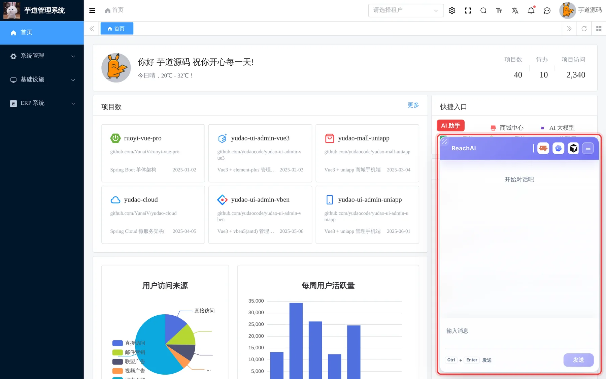

# 在业务系统里用 AI 助手

> 适合：所有业务人员。读完你就能在 ERP 等业务系统里，用一句话查数据、办业务。
>
> 本文以芋道 ERP 为例，其他系统里的助手用法一样。

## 做完你会得到什么

不用再翻菜单、填筛选条件。在业务系统右下角的助手里打一句「罗技无线鼠标还有多少库存？」，几秒钟后就能看到按仓库列好的结果：

## 开始前你需要

- 一个能正常登录业务系统的账号，就是你平时用的那个。**不需要另外注册 ReachAI 账号。**
- 管理员已经在这个业务系统里开通了 AI 助手。如果登录后右下角没有助手，请联系你们的系统管理员。

## 第 1 步：找到助手

登录业务系统后，页面右下角会出现标着「ReachAI」的对话框。

- 对话框右上角的 **一** 按钮可以把它收起来，收起后右下角留一个小按钮，点一下重新打开。
- 拖动对话框左上角的斜纹可以调整大小。
- 在系统里切换菜单时，助手一直留在右下角，对话不会中断。

## 第 2 步：用平常说话的方式提问

在下方「输入消息」里打字，按 **Ctrl + Enter** 或点「发送」。

可以这样问：

| 你想做的事 | 可以这样说 |
| --- | --- |
| 查库存 | 罗技无线鼠标还有多少库存？ |
| 查客户 | 帮我查一下上海的客户 |
| 查订单 | 最近有哪些销售订单？ |
| 查产品 | 显示器类的产品有哪些，售价多少？ |

**提问小技巧：**

- **说清楚对象。** 「罗技无线鼠标的库存」比「库存」更准确。如果说得不够清楚，助手会反问你。
- **一次问一件事。** 想查好几样东西，可以分几句问，结果更清楚。
- **可以接着问。** 助手记得这次对话前面说过的话，可以接着说「那北京仓呢？」。
- **想换个话题**，点对话框里的「清除上下文」，助手会忘掉这次对话前面的内容，重新开始。

## 第 3 步：看懂回答

助手给出的数字和名单，是它**以你的身份**去业务系统里实时查到的，和你自己在页面上查到的一样：

- 你在系统里没有权限看的数据，助手也查不到。
- 查不到时，助手会直接告诉你「没有找到」，不会编一个答案。

如果你对结果有疑问，可以到对应的业务页面再核对一遍。

## 助手还能帮你操作页面

如果管理员为某些页面开通了「页面动作」，助手还可以直接帮你在当前页面上操作，例如：

- 在产品列表里按名称筛选；
- 打开某张单据的详情；
- 帮你把表单填好，你检查后再提交。

管理员可以为页面动作设置「需要确认」，这时助手会先问你，你点确认后才会执行。

## 能不能让助手帮我新建、修改数据？

可以，但要看管理员开放了哪些能力。会改数据的操作（新建客户、修改订单等），助手会先把准备做的事和填好的内容列给你，**你确认后才执行**。删除、作废这类做了就收不回的操作，默认不让 AI 做。详细过程见 [让 AI 帮你改数据：为什么要审批](write-and-approval.md)。

## 遇到问题

**右下角没有助手。** 说明这个系统还没开通，或者你的账号不在开通范围内。请联系系统管理员。

**助手提示「当前页面无法访问该助手」。** 你的账号或当前页面没有被允许使用这个助手，请联系管理员检查权限。

**助手提示「身份认证已失效，请重新登录后重试」。** 业务系统登录过期了，刷新页面重新登录即可。

**助手说「这个助手做不到」。** 管理员还没有把这项功能开放给 AI。可以把你想做的事告诉管理员，请他评估是否开放。

更多问题见 [业务人员常见问题](faq.md)。

## 下一步

- 习惯用 Codex、Claude Code？[在自己的 AI 工具里办业务](own-ai-tool.md)
- 想了解助手背后是怎么工作的：[原理：一句话怎么变成一次 ERP 操作](../start/how-it-works.md)
