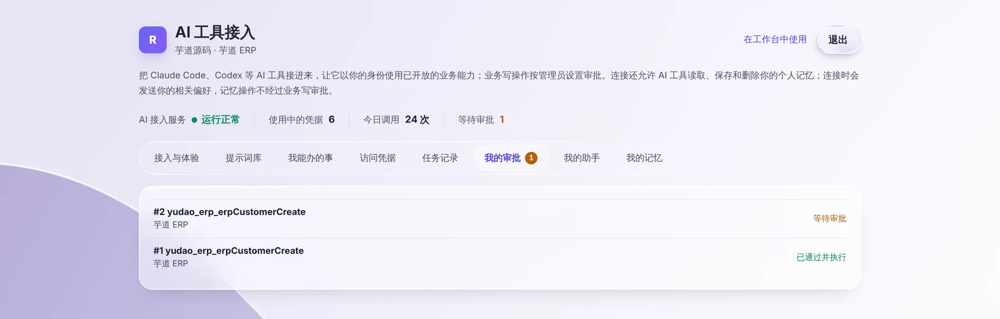

# 让 AI 帮你改数据：为什么要审批

> 适合：想让 AI 帮忙新建客户、修改订单等的业务人员。读完你会知道 AI 改数据时要经过哪些关口，以及怎么跟进进度。

## 先说结论

查数据，AI 可以直接替你查。**改数据**（新建、修改、删除）就要多一道关：

| 你在哪里让 AI 改数据 | 要过哪道关 | 谁来点头 |
| --- | --- | --- |
| 业务系统右下角的助手 | 助手先把要做的事列给你，**你自己确认**后才执行 | 你本人 |
| 你自己的 Codex / Claude Code | 先提交一条**审批**，管理人员批准后才执行 | 管理人员 |

这样设计是因为：AI 偶尔会听错、填错字段。查错了重查就行，改错了数据就要人去收拾。多看一眼，成本很低。

## 在自己的 AI 工具里新建一个客户

下面以「在芋道 ERP 里新建客户」为例，走一遍完整过程。开始前请先按 [在自己的 AI 工具里办业务](own-ai-tool.md) 接好 AI 工具。

### 第 1 步：用一句话说清楚要做什么

```text
帮我在芋道 ERP 里新建一个客户，名称叫华东贸易有限公司，联系人张经理，电话 13800000000
```

AI 工具会把你的话整理成一次「新建客户」操作，提交上去。因为这是写操作，它不会马上执行，而是回复类似这样的内容：

```text
这个操作需要审批，已提交。审批单 #1，审批人在 ReachAI「写操作审批」通过后会以你的身份执行。
```

### 第 2 步：看审批进度

两种方式都可以：

- 直接问 AI 工具：「我提交的审批到哪一步了？」它会去查最新状态告诉你。
- 打开个人页的「我的审批」（业务系统助手 → 在我的 AI 工具中使用 → 在浏览器里管理）。



每条审批会是下面几种状态之一：

| 状态 | 意思 |
| --- | --- |
| 等待审批 | 已经提交，管理人员还没处理。 |
| 已通过，执行中 | 管理人员批准了，系统正在业务系统里办。 |
| 已通过并执行 | 办完了，数据已经写进业务系统。 |
| 已通过但执行失败 | 批准了，但业务系统拒绝了这次操作（例如缺少必填字段）。可以让 AI 补全信息重新提交。 |
| 已驳回 | 管理人员没有同意。 |
| 已过期 | 24 小时内没人处理，自动作废。需要的话重新提交。 |

### 第 3 步：管理人员批准后，确认结果

管理人员在 ReachAI 的「写操作审批」页面看到你的申请，批准后，系统**以你的身份**在芋道里新建客户。完成后：

- 「我的审批」里状态变成「已通过并执行」。
- 在芋道 ERP 的客户列表里能看到「华东贸易有限公司」，创建人是你。
- 个人页「任务记录」里多一条记录。

管理人员那边怎么处理审批，见 [审批 AI 提交的操作](../manager/approvals.md)。

## 在业务系统的助手里改数据

在右下角助手里说「帮我新建一个客户……」时，如果管理员给助手开放了这项能力，助手不会直接执行，而是在对话里列出它准备做的事和填好的内容，等你确认：

- 点确认，助手才会执行，然后告诉你结果。
- 点取消，什么都不会发生。

有些操作做了就无法撤回（例如删除、作废单据），管理员默认不让 AI 做这类操作。

## 背后发生了什么

- **提交的内容会被「冻结」。** 审批单上写的是哪些字段、什么值，批准后执行的就是这些，AI 不能在批准后偷偷改内容。
- **批准时还会再检查一遍。** 系统会重新确认你的连接没被停用、账号还有效、你还有这项权限，任何一项不满足就不执行。
- **只执行一次。** 同一条审批不会被重复执行，重复提交相同内容也会合并成一条。
- **每人最多同时有 20 条等待中的审批**，避免 AI 一次提交一大堆。

## 遇到问题

**AI 工具说「已提交审批」，但很久没动静。** 审批要管理人员手动处理，可以直接联系他们。超过 24 小时会自动过期。

**状态是「已通过但执行失败」。** 打开那条审批看失败原因，一般是业务系统要求的字段没填全。告诉 AI 把缺的信息补上，重新提交。

**我想让某些写操作不用审批。** 是否需要审批由管理员按系统设置，可以和管理员商量。

## 下一步

- [我的个人页](my-portal.md)：查看审批、记录和连接
- [业务人员常见问题](faq.md)
