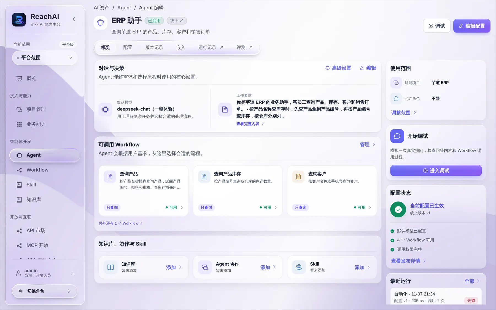
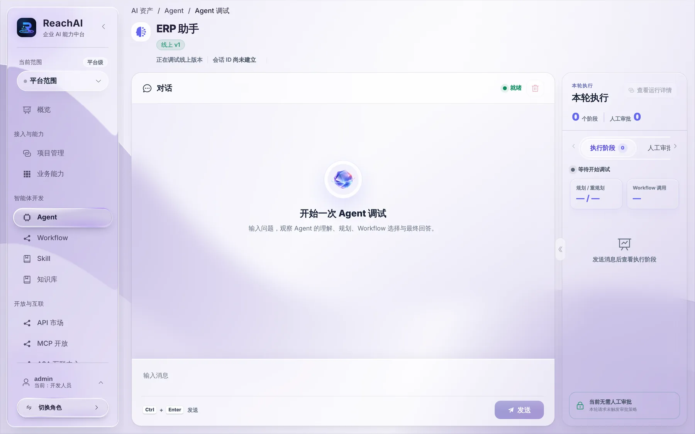

# 配置和调试 Agent

> 适合：开发者。读完你会知道 Agent 由哪几部分组成，怎么改配置、发布版本，以及调试时该看什么。

## Agent 是什么

Agent 就是业务页面右下角那个助手背后的「大脑」：它用一个大模型理解员工的话，从你给它的 Workflow 里挑合适的执行，再把结果组织成回答。一键体验环境里的「ERP 助手」就是一个 Agent。

## 第 1 步：打开 Agent

左侧「智能体开发 → Agent」，在「ERP 助手」上点 **编辑**，进入概览：

概览把一个 Agent 的组成摆在一页上：

| 区域 | 内容 |
| --- | --- |
| 对话与决策 | 默认模型、工作要求（系统提示词）。工作要求写清楚这个助手负责什么、按什么顺序办事，比如「按产品名称查库存时，先查产品拿到编号，再查库存」 |
| 可调用 Workflow | 这个助手能用的流程。点「管理」增减 |
| 知识库、协作与 Skill | 可选：挂知识库回答制度类问题，挂 Skill 沉淀固定做法 |
| 使用范围 | 所属项目、允许哪些角色使用 |
| 配置状态 | 当前线上版本、检查项（模型已配置、Workflow 可用、调用权限完整） |
| 最近运行 | 最近几次运行和结果，点进去看详情 |

顶部标签：概览、配置、版本记录、嵌入、运行记录、评测。

## 第 2 步：修改配置并发布

点右上角 **编辑配置**（或「配置」标签）：

1. 选默认模型。
2. 写工作要求。写清楚职责边界和办事顺序，不要写「你什么都能做」。
3. 在可调用 Workflow 里勾选已发布的 Workflow。
4. 保存后 **发布**，生成新的线上版本。

改动在发布之前不会影响线上。发布后，「版本记录」里能看到每个版本改了什么。

> 工作要求里写的能力，要和实际挂上的 Workflow 一致。没挂「销售统计」Workflow，就不要在介绍里说它能查销售统计，否则员工问了 AI 只能说做不了。

## 第 3 步：调试

点右上角 **调试**（或概览里的「进入调试」）：

左边是对话，右边「本轮执行」实时显示 Agent 的每一步：怎么规划的、调用了哪个 Workflow、有没有触发人工审批。用它来检查 Agent 是否选对了流程、参数是否传对。

**注意：** 调试页用的是你的**平台账号**，不是业务系统员工。业务方法声明了「需要业务身份」时（芋道的所有方法都是），调试里调用会被拒绝。这时调试页只能用来检查规划和流程选择；真实的数据结果要到业务页面的助手里，用员工账号验证。

## 第 4 步：看运行记录

「运行记录」列出这个 Agent 的每一次运行，包括业务页面里员工的提问。点进去能看到完整过程：理解、规划、调用的业务方法、入参出参、耗时、错误。排查「为什么答错了」时从这里开始。

全站的运行在左侧「运行中心」，见 [运行中心](../manager/run-center.md)。

## 写操作怎么处理

Agent 调用会改数据的业务方法时：

- **写操作**（`WRITE`）：助手先在对话里把要做的事列给员工，员工确认后才执行。
- **不可逆操作**（`IRREVERSIBLE`）：默认直接拦下，不让 AI 做。

这是按业务方法声明的副作用自动处理的，你不用在 Agent 里额外配置。

## 遇到问题

**Agent 不调用某个 Workflow。** 检查：Workflow 是否已发布并加到 Agent 里；Agent 是否重新发布；Workflow 的说明是否写清楚了适用场景。

**调试里报一串英文错误。** 多半是业务方法拒绝了没有员工身份的调用，见上面「注意」。去运行详情里看具体是哪一步失败。

## 下一步

- [在业务页面嵌入助手](embed-chat.md)
- [Agent、记忆和 Skill（参考）](../agent.md)
