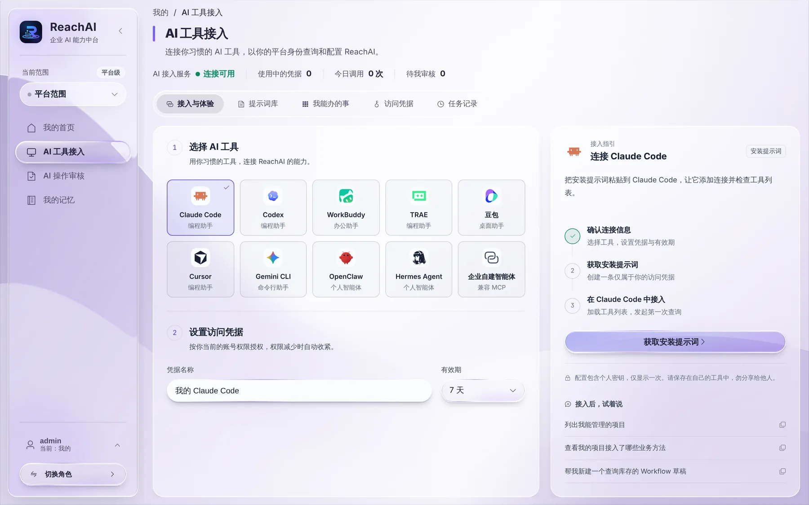
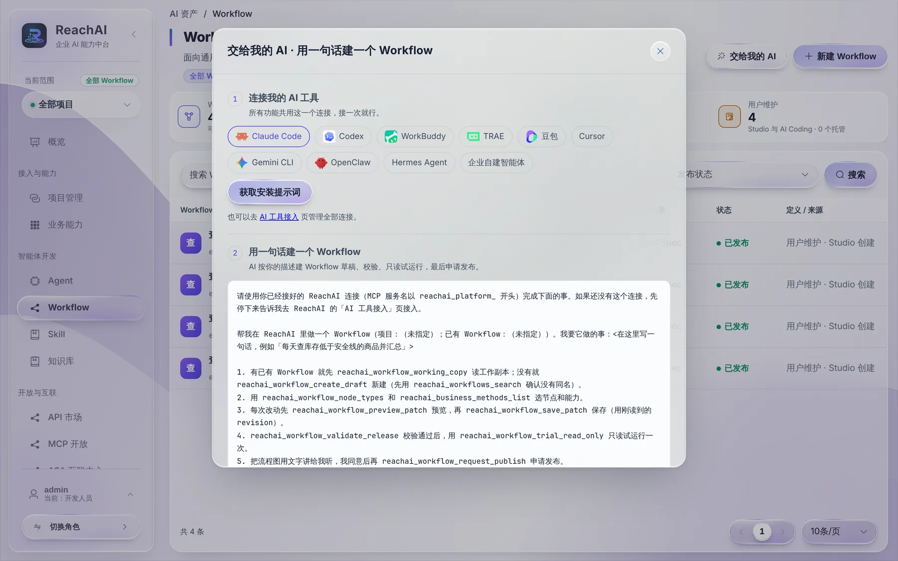

# 交给我的 AI：让 Codex、Claude Code 帮你干活

> 适合：开发者。读完你会把自己的 Codex 或 Claude Code 连上 ReachAI，然后在任何功能页点「交给我的 AI」，让它帮你接入系统、建 Workflow、配 MCP 服务。

## 做完你会得到什么

你的 AI 工具多了一组 ReachAI 平台工具（名字以 `reachai_platform_` 开头的 MCP 服务）。它能以**你的平台账号权限**查询和配置 ReachAI：列项目、查业务方法、建 Workflow 草稿、领取接入任务、提交结果。

只需要连一次，所有功能共用这一个连接，只是每个功能给 AI 的提示词不同。

> 这是给开发者和管理人员用的「平台连接」。员工在业务系统里生成的是另一种「员工连接」，只能办业务，不能改平台配置，见 [在自己的 Codex / Claude Code 里办业务](../business/own-ai-tool.md)。

## 第 1 步：连接你的 AI 工具

在工作台侧栏点「AI 工具接入」：

1. **选择 AI 工具**：Claude Code、Codex、WorkBuddy、TRAE、豆包、Cursor、Gemini CLI、OpenClaw、Hermes Agent，或兼容 MCP 的企业自建智能体。
2. 在工具列表下方获取安装提示词或生成接入配置，按页面提示复制使用。需要修改凭据名称或默认 7 天的有效期时，展开「凭据设置」。凭据的权限和你的账号一样，账号权限减少时自动收紧。
3. 把安装提示词粘贴给你的 AI 工具，让它添加连接并检查工具列表。

安装提示词里有你的个人密钥，只显示一次，不要分享给别人。

页面根据当前工作台展示使用场景，并在「接入后，试着说」推荐示例。切换工作台不改变连接或账号权限。

这一页其他标签：**提示词库**（所有功能的提示词，可手填项目编码后复制）、**我能办的事**、**访问凭据**（查看和吊销）、**任务记录**。

## 第 2 步：在功能页点「交给我的 AI」

项目接入工作台、业务页面工作台、用 AI 改造业务能力、Workflow、MCP 开放、知识库等页面右上角都有 **交给我的 AI**。例如在 Workflow 列表点它：

弹窗分两块：

1. **连接我的 AI 工具**：显示连接状态。还没连的话可以当场连，这时会出现「一起复制」，把接入和要做的事合成一段，粘贴一次就行。
2. **这个功能的提示词**：已填好当前功能所需的项目或任务信息。比如「用一句话建一个 Workflow」的提示词会让 AI 按顺序：读或新建草稿 → 选节点和业务方法 → 预览并保存 → 校验并只读试运行 → 把流程讲给你听，你同意后再申请发布。

复制，粘贴给你的 AI，把「我要它做的事」那一句改成你的需求即可。

## 接入任务怎么交接

连接完成后，也可以在业务系统代码仓库里对 AI 说「帮我接入 ReachAI」。AI 检查仓库并确认项目与技术栈，已有项目通过 `reachai_project_onboarding_start` 创建或续接任务。Codex、Cursor、Trae、Claude Code 对应的 `executorProvider` 分别是 `CODEX`、`CURSOR`、`TRAE`、`CLAUDE_CODE`，其他支持 MCP 的编码工具填 `OTHER`。已领取的任务可以继续，同一账号创建且未被占用的任务可以绑定当前连接；任务由其他连接持有时按返回提示处理。

首次接入的新项目先确认项目编码。AI 用 `reachai_onboarding_resources` 获取资源，用 `reachai_onboarding_enrollment_request` 申请首次注册授权。本人在「AI 操作审核」核对并批准后，AI 再用 `reachai_onboarding_enrollment_execute` 签发一次性 SDK 接入令牌。令牌用于业务服务的受保护环境配置；首次注册成功后，再启动接入任务。

在项目接入工作台点「交给我的 AI」，可复制带项目编码的提示词，让 AI 发起或续接任务。进度、问题、平台校验和验收在工作台查看。

业务页面工作台的「交给我的 AI」仍由页面签发**一次性领取码**。AI 用 `reachai_ai_coding_task_claim` 领取任务后：

- 任务只属于这条连接，换个对话窗口不用重新领取；
- AI 通过平台工具读任务上下文、写进度、向你提问、提交结果和验证；
- 你在页面上能实时看到它做到哪一步、问了什么问题。

页面接入任务的领取码只能由人在页面上生成。

## AI 能帮你做的检查

连上后，AI 还能用两个工具帮你排查：

- `reachai_integration_guide`：按框架取接入教程（Vue、React、Angular、纯脚本嵌入；Java、C#、Python、Node、Go 后端），里面的 ReachAI 地址和项目编码已经填成真实值。目前真实验证过的只有 Vue 3 + Spring Boot 2.7（芋道），其他教程开头写明了验证情况。
- `reachai_doctor`：一次查完一个项目的项目权限、SDK 实例、业务页面、嵌入策略、可用模型、MCP 发布和服务状态，每项给结果和修法。

所以接入卡住时，最快的办法通常是对你的 AI 说：「用 reachai_doctor 检查一下 order-service 项目」。

## 背后发生了什么

- AI 的每次操作都以你的平台账号执行，记录在运行中心。你没有权限的事，AI 也做不了。
- 会改平台配置的操作（比如发布 Workflow）走申请流程，需要在「AI 操作审核」里确认，或由 AI 先讲给你听、你同意后再提交。

## 遇到问题

**AI 说找不到 reachai_platform_ 开头的工具。** 安装提示词没执行成功，或者 AI 工具需要重启才能加载新的 MCP 服务。按工具的方式重启后再试。

**凭据过期了。** 回「AI 工具接入 → 访问凭据」新建一条，重新获取安装提示词。

## 下一步

- [用 AI 改造业务能力](retrofit.md)
- [AI Coding：用外部编码工具改造系统（参考）](../ai-coding.md)
