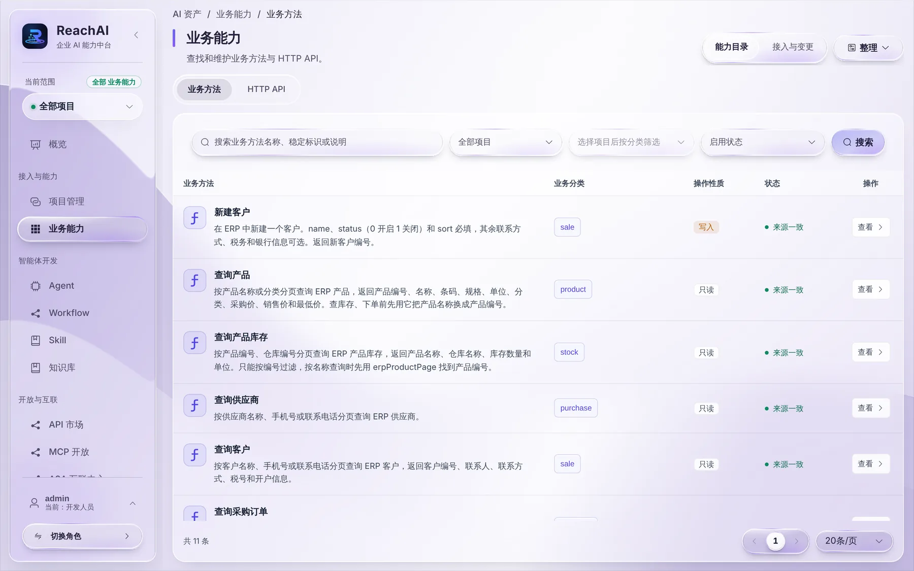
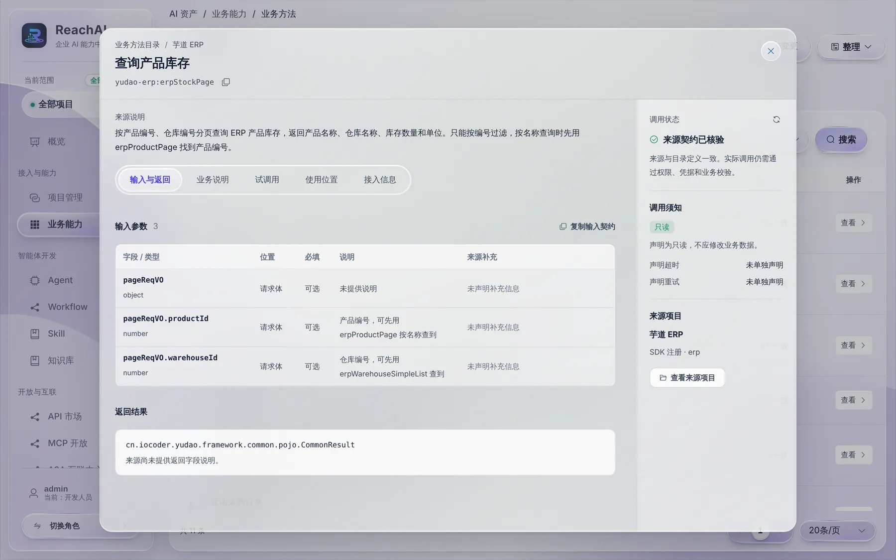

# 核对业务能力

> 适合：开发者。读完你会知道怎么检查平台收到的业务方法对不对、怎么试调用、接口变了怎么处理。

## 做完你会得到什么

一份确认过的业务能力清单：每个方法的说明 AI 看得懂，输入输出正确，副作用标得对。后面编 Workflow、发布 MCP 服务都从这份清单里选。

## 第 1 步：打开业务能力目录

左侧「接入与能力 → 业务能力」。这里按项目列出所有业务方法和 HTTP API：

一键体验环境里能看到芋道 ERP 的 11 个业务方法：查询产品、查询仓库、查询库存、查询客户、新建客户等。

## 第 2 步：查看一个方法

点某个方法右边的 **查看**，比如「查询产品库存」：

逐项检查：

| 看哪里 | 检查什么 |
| --- | --- |
| 来源说明 | 是不是写清楚了能查什么、怎么过滤、和别的方法怎么配合。例子里写了「按名称查询时先用 erpProductPage 找到产品编号」，AI 就知道要先查产品再查库存 |
| 输入与返回 | 参数名、类型、必填对不对；返回结构里有没有你需要的字段，字段路径是什么 |
| 调用须知 | 只读 / 写操作 / 不可逆是否正确。标错了会导致该审批的没审批 |
| 调用状态 | 「来源契约已核验」表示平台看到的定义和业务系统当前代码一致 |
| 来源项目 | 来自哪个项目、SDK 还是 OpenAPI |

说明写得不好，回业务代码里改注解的 `description`，重启后会自动同步。AI 能不能选对方法，八成取决于这段说明。

## 第 3 步：试调用

切到 **试调用** 标签，填参数，执行一次，看返回结果。

注意：试调用用的是**项目测试身份**，不是员工。声明了「需要业务身份」的方法会被拒绝，这是正常的。这类方法请在业务页面的助手里，用真实员工账号验证。原因见 [业务身份桥](business-identity.md#记得声明-businessidentityrequired)。

## 第 4 步：处理来源变化

业务代码改了方法签名（加参数、改返回、改副作用）后，重新同步时平台不会直接替换，而是标记为「来源变化」，等你确认：

- 只是补充说明：确认接纳即可。
- 参数或返回变了：先看哪些 Workflow、MCP 服务用到了它（详情里的「使用位置」），确认不会坏掉再接纳。
- 副作用从只读变成写：要特别注意，接纳后员工调用会开始走确认或审批。

## 背后发生了什么

- 平台给每个方法记一个来源版本。线上用的 Workflow 和 MCP 服务固定引用接纳过的版本，业务系统悄悄改了代码不会直接影响线上。
- 业务能力目录里出现了，不代表员工就能用。员工能用还需要：被编进已发布的 Workflow 或 MCP 服务，并且 [调用权限](../manager/permissions.md) 允许员工的角色调用。

## 遇到问题

**目录里方法数量不对。** 回项目接入工作台看「业务服务校验」，再看业务系统启动日志里同步了多少个方法。

**详情里返回结果只有一个类名，没有字段。** 返回类型是泛型包装时，部分 SDK 只能拿到外层类型。在注解里补充返回说明，或返回更明确的 DTO。

## 下一步

- [接入模型](model-setup.md)
- [创建第一个 Workflow](first-workflow.md)
- [发布 MCP 服务给员工](publish-mcp.md)
