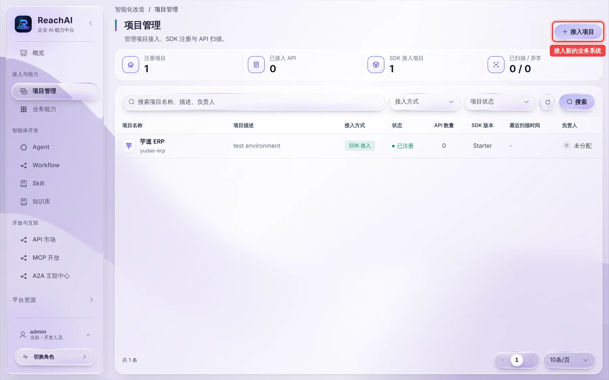
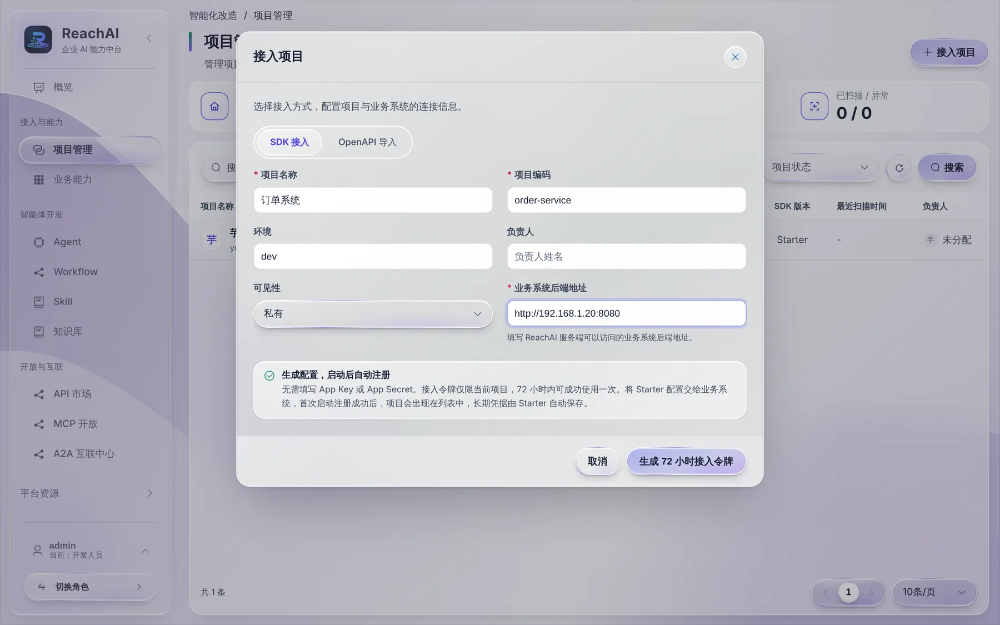
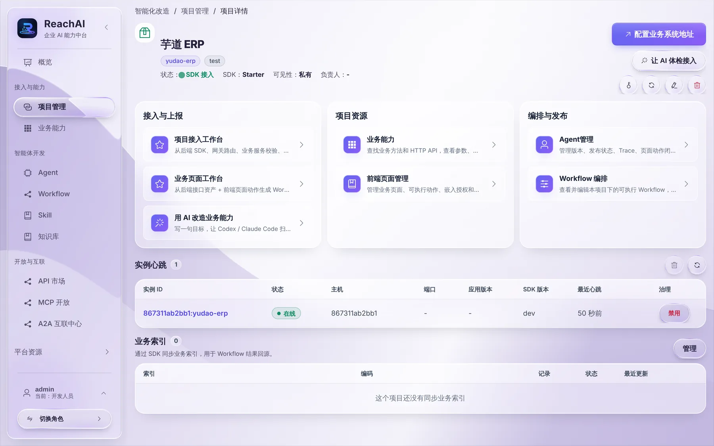
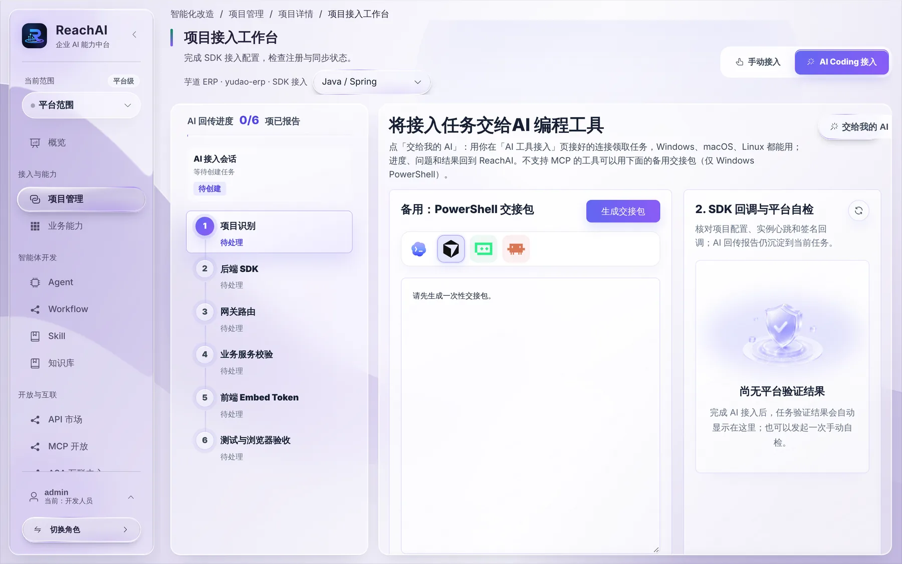

# 接入第一个业务系统

> 适合：开发者。读完你会在 ReachAI 里建好一个项目，拿到接入令牌，并知道接下来在业务系统里改什么。

## 做完你会得到什么

ReachAI 里多出一个「项目」，代表你的业务系统。业务系统启动后会自动注册到这个项目，并把声明的业务方法同步上来。

## 开始前你需要

- 角色是「开发人员」或「平台管理员」，当前身份切到 **开发人员**。
- 知道业务系统后端的访问地址（ReachAI 要能访问到）。

## 第 1 步：打开项目管理

左侧点「接入与能力 → 项目管理」。这里列出所有已接入的业务系统，一键体验环境里能看到「芋道 ERP」。

## 第 2 步：新建项目，生成接入令牌

点右上角 **接入项目**，先选接入方式：

| 接入方式 | 适合 |
| --- | --- |
| SDK 接入 | 能改业务系统代码。Java、C#、Python、Node.js、Go 都有 SDK，拿到的信息最完整 |
| OpenAPI 导入 | 改不了代码，只有 Swagger / OpenAPI 文档。见 [没有 SDK：导入 OpenAPI](openapi-import.md) |

选 SDK 接入后填写：

| 字段 | 填什么 | 例子 |
| --- | --- | --- |
| 项目名称 | 给人看的名字 | 订单系统 |
| 项目编码 | 唯一编码，业务系统配置里要用，建了就不要改 | order-service |
| 环境 | 开发、测试或生产 | 测试 |
| 负责人 | 出问题找谁 | 你自己 |
| 可见性 | 谁能在管理台看到这个项目 | 按团队情况选 |
| 业务系统后端地址 | ReachAI 回调业务方法用的地址 | http://192.168.1.20:8080 |

点 **生成 72 小时接入令牌**。令牌只显示这一次，复制下来，下一步配置到业务系统里。

> 令牌是一次性的：业务系统第一次注册成功后，SDK 会换成长期的项目凭据并保存在本地，令牌就作废了。72 小时内没用掉，回项目详情重新生成一个即可。

## 第 3 步：在业务系统里接 SDK

按业务系统的语言读对应的文章，把令牌配置进去，声明要开放的业务方法：

- Java / Spring Boot：[Java 接入](java-starter.md)
- C#、Python、Node.js、Go：[其他语言 SDK](other-sdks.md)

然后接上 [业务身份桥](business-identity.md)，让 AI 以员工本人身份执行。

## 第 4 步：在项目接入工作台里核对

回到项目管理，点项目名进入项目详情。这里汇总了这个系统接入相关的所有入口：

| 卡片 | 做什么 |
| --- | --- |
| 项目接入工作台 | 一步步检查接入是否完成 |
| 业务页面工作台 | 让 AI 能操作业务页面（筛选、跳转、填表） |
| 用 AI 改造业务能力 | 让你的 AI 扫代码、补更多业务方法，见 [用 AI 改造业务能力](retrofit.md) |
| 业务能力 | 这个系统同步上来的业务方法 |
| Agent 管理 / Workflow 编排 | 用到这个系统的 Agent 和 Workflow |

点 **项目接入工作台**：

工作台把接入拆成 6 项检查，每项会告诉你通过了没有、没通过怎么修：

1. **项目识别**：项目编码、后端地址对不对。
2. **后端 SDK**：业务系统有没有注册上来、心跳是否正常。
3. **网关路由**：`/reachai/**` 这条路径能不能从 ReachAI 访问到，有没有被业务系统的登录拦截挡住。
4. **业务服务校验**：业务方法有没有同步上来。
5. **前端 Embed Token**：业务页面能不能换到助手令牌（只有要嵌入助手时才需要）。
6. **测试与浏览器验收**：用真实员工账号走一遍。

右上角可以切「手动接入」或「AI Coding 接入」。选 AI Coding 时，点「交给我的 AI」，你的 Codex / Claude Code 会领取这个接入任务，自己改代码、自己回来核对这 6 项，见 [交给我的 AI](ai-tool-handoff.md)。

## 背后发生了什么

- 业务系统启动时，SDK 拿接入令牌向 ReachAI 注册，换回项目凭据（appKey / appSecret），保存在业务系统本机的凭据文件里。之后的心跳、同步、回调都用这对凭据签名。
- 平台调用业务方法时，请求发到「业务系统后端地址」下的 `/reachai/**`，SDK 先验签，再执行方法。浏览器永远拿不到项目凭据。

## 遇到问题

**令牌过期或丢了。** 在项目详情重新生成一个，替换业务系统配置后重启。

**工作台显示「后端 SDK 未注册」。** 看业务系统启动日志里有没有 ReachAI 相关报错。常见原因：注册地址写错、业务系统访问不到 ReachAI、令牌已经被用过。

**「网关路由」不通过。** 业务系统的登录过滤器拦了 `/reachai/**`。把这条路径放行（SDK 自己会验签），见 [业务身份桥](business-identity.md#放行-reachai-路径)。

更多见 [开发者常见问题](troubleshooting.md)。

## 下一步

- [Java 接入](java-starter.md)
- [其他语言 SDK](other-sdks.md)
