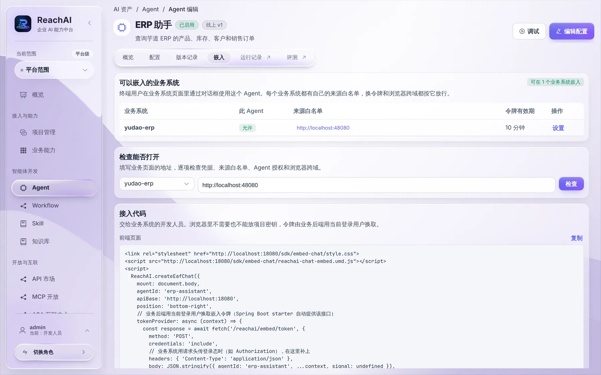
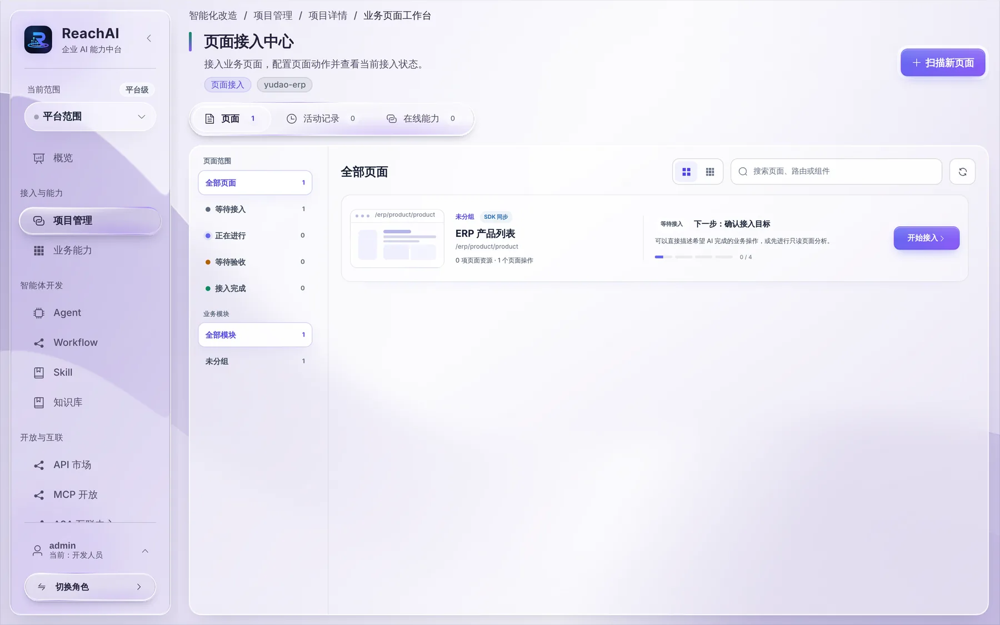

# 在业务页面嵌入助手

> 适合：开发者。读完你会把一个已发布的 Agent 放进业务系统页面右下角，员工用业务系统的登录身份直接和它对话。

## 做完你会得到什么

业务系统每个页面右下角出现 ReachAI 助手（就像一键体验里的芋道）。员工不用另外登录，AI 以员工本人身份查数据、办业务。

## 开始前你需要

- 一个已发布的 Agent，见 [配置和调试 Agent](agent.md)。
- 业务系统已经接入 SDK，并实现了 [身份解析](business-identity.md#第-1-段身份解析嵌入助手时需要)。Starter 会提供 `POST /reachai/embed/token` 这个换令牌接口。
- 业务页面的访问地址（协议、域名、端口），比如 `https://erp.example.com`。

## 第 1 步：在 Agent 里配置嵌入

打开 Agent，切到 **嵌入** 标签：



1. **可以嵌入的业务系统**：列出这个 Agent 能嵌进哪些业务系统。每个业务系统有自己的 **来源白名单**（业务页面的地址，协议、域名、端口要和浏览器地址栏完全一致）和 **令牌有效期**（默认 10 分钟，到期前助手自动续签）。点「设置」修改。
2. **检查能否打开**：选业务系统，填业务页面地址，点 **检查**，逐项检查凭据、来源白名单、Agent 授权和浏览器跨域。
3. **接入代码**：页面按当前配置生成好的前端代码，点「复制」，下一步用。

## 第 2 步：在业务前端挂载助手

先引入平台提供的嵌入 SDK（接入代码里有加载方式，样式文件 `style.css` 也要一起引入），然后：

```javascript
const chat = await ReachAI.createEafChat({
  mount: '#reachai-chat',                 // 页面里放助手的容器
  agentId: 'erp-assistant',               // Agent 编码
  apiBase: 'https://reachai.example.com', // ReachAI 地址
  position: 'bottom-right',
  tokenProvider: async (context) => {
    // 向业务系统自己的后端换令牌，带上业务系统的登录凭证
    const response = await fetch('/reachai/embed/token', {
      method: 'POST',
      credentials: 'include',
      headers: { 'Content-Type': 'application/json' },
      body: JSON.stringify({
        agentId: 'erp-assistant',
        pageKey: context?.pageKey,
        pageInstanceId: context?.pageInstanceId,
        route: context?.route,
        origin: context?.origin,
      }),
    })
    if (!response.ok) throw Object.assign(new Error('获取对话令牌失败'), { status: response.status })
    return response.json()   // { token, expiresIn, sessionHint }，有业务包装时要解包
  },
})
```

要点：

- 令牌**只能**由业务后端换取。浏览器不持有项目密钥，也不能自己指定用户。
- 业务系统用 Token 头认证（而不是 Cookie）时，在 `fetch` 里带上同样的认证头。
- 保留换令牌接口的 HTTP 状态码。401 表示没登录，403 表示没权限或来源不在白名单，助手会给员工不同的提示。

一键体验里芋道的前端接法见 [芋道 ERP 接入实战](yudao-example.md)。

## 第 3 步：退出登录时

员工退出业务系统时，调用 `chat.destroy()` 销毁助手，停止续签。

想让已经签发的令牌也立刻失效，在身份解析里多返回业务登录会话的标识，并在退出时由业务后端调用 `ReachAiEmbedTokenClient.revokeBusinessSession(sessionId)`。这个通知要可靠重试，网络失败不能当作已撤销。

## 第 4 步（可选）：让 AI 操作页面

除了调用后端业务方法，AI 还可以直接操作当前页面：筛选列表、跳转、填表单。比如员工说「只看罗技的产品」，AI 直接在产品列表页上筛选。

做法是在页面里用 `createEafPageBridge()` 显式注册这个页面允许的动作，再把 bridge 交给助手。平台在项目详情的 **业务页面工作台** 里管理这些页面：



点 **扫描新页面** 发现页面，对某个页面点 **开始接入**，按向导确认目标、注册动作、验收。也可以交给你的 AI 来做，见 [交给我的 AI](ai-tool-handoff.md)。

页面动作只改页面状态，写数据仍然要走后端业务方法。

## 第 5 步：验证

逐项测：

1. 员工登录后右下角出现助手，问一句能查到自己的数据。
2. 换一个权限不同的员工，结果不同。
3. 退出登录后助手消失或提示重新登录。
4. 用白名单外的地址打开页面，助手加载失败。
5. 让助手做一个写操作，会先让员工确认。

## 遇到问题

**助手不出现。** 打开浏览器控制台看报错。常见原因：SDK 脚本或样式没加载、`apiBase` 写错、容器元素不存在。

**换令牌返回 403。** 来源不在 Agent 的白名单里，或员工角色不在 Agent 的「使用范围」里。

**换令牌返回 401。** 业务后端没拿到登录态。检查 `fetch` 有没有带 Cookie 或认证头，`/reachai/**` 有没有被登录拦截挡住。

**升级 ReachAI 后助手 403。** 新版换令牌接口要求请求正文签名，业务系统里的 Starter 也要升级到同版本。

更多参数和细节见 [eafChat.ts](../../ai-admin-front/src/sdk/eafChat.ts)、[eafPageBridge.ts](../../ai-admin-front/src/sdk/eafPageBridge.ts)。

## 下一步

- [发布 MCP 服务给员工](publish-mcp.md)
- [在业务系统里用 AI 助手（业务人员视角）](../business/use-assistant.md)
