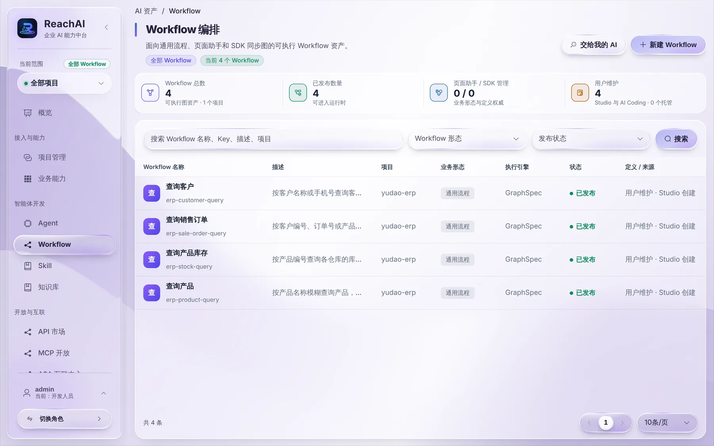
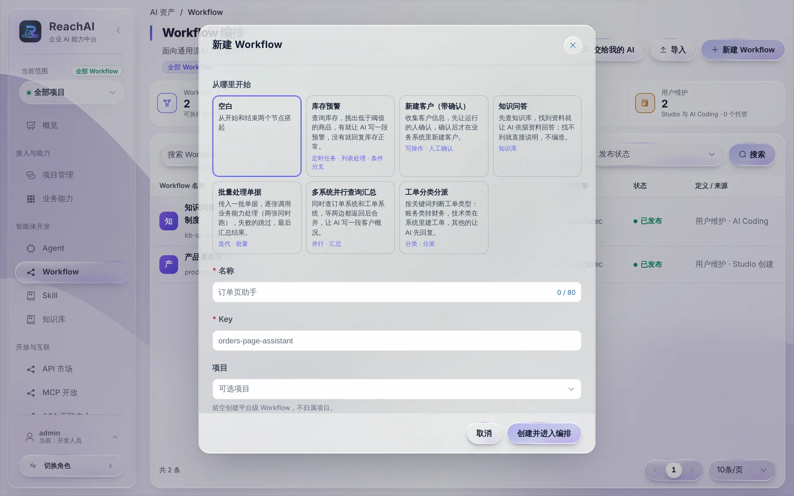
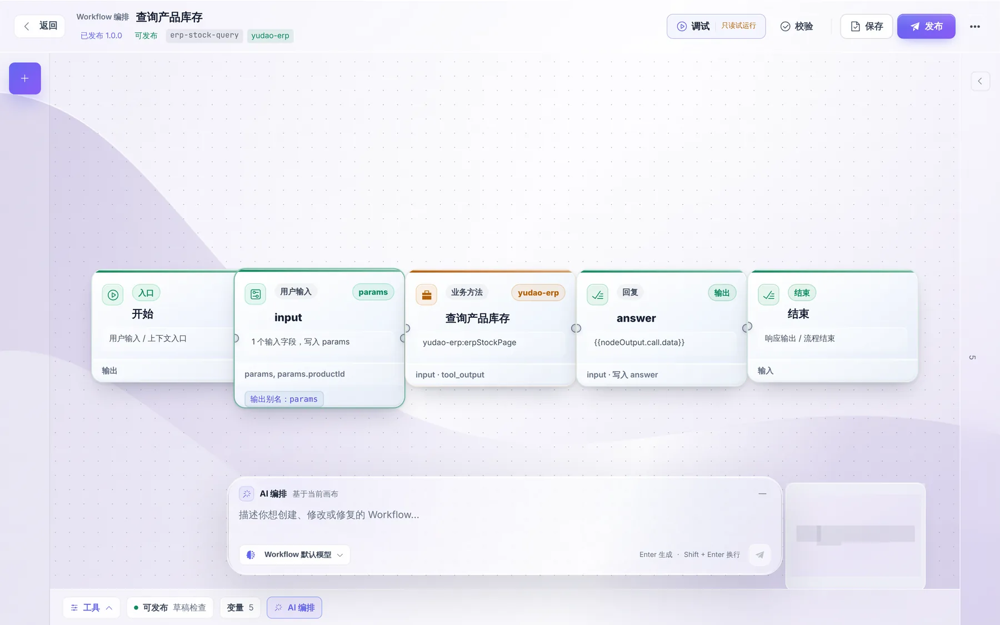

# 创建第一个 Workflow

> 适合：开发者。读完你会把一个业务方法编成 Workflow 并发布，让 Agent 可以稳定地调用它。

## 为什么要 Workflow

Agent 可以直接理解员工的话，但「查库存」这种事每次都应该按同样的步骤做：取产品编号 → 调用库存接口 → 整理结果。Workflow 就是把这套步骤固定下来的流程图。Agent 负责理解员工想干什么、挑哪个 Workflow；Workflow 负责把事情按步骤做对。

> 员工在自己的 Codex 里通过 MCP 默认用的是业务方法本身。要让员工的 AI 工具也能按固定步骤办事，发布时勾选「发布后开放给员工 AI 工具」即可，见第 4 步。

## 做完你会得到什么

一个已发布的 Workflow，比如「查询产品库存」，可以加进 Agent 的可调用列表，也可以发布到 MCP 服务里。

## 开始前你需要

- 业务能力目录里已经有要用的方法，并且核对过输入输出，见 [核对业务能力](capabilities.md)。
- 如果要用 AI 编排，已经 [接入模型](model-setup.md)。

## 第 1 步：新建 Workflow

左侧「智能体开发 → Workflow」：

一键体验环境里已经有 4 个查询 Workflow。点 **新建 Workflow**，选所属项目，填名称和编码，再在「从哪里开始」里选一个起点：

| 起点 | 适合 |
| --- | --- |
| 空白 | 自己从头编排 |
| 库存预警 | 查库存 → 筛出低库存 → 汇总提醒 |
| 新建客户（带确认） | 抽取客户信息 → 人工确认 → 调用新建方法 |
| 知识问答 | 检索知识库，有依据才回答 |
| 批量处理单据 | 循环逐条处理，失败的跳过，最后统计 |
| 多系统并行查询汇总 | 同时查两个系统，再合并结果 |
| 工单分类分派 | 按意图分到不同处理分支 |

模板里的业务方法节点是占位，进 Studio 后要换成你项目里真实的方法，校验会逐个提示。点「创建并进入编排」进入 Studio。

别的环境导出的 Workflow 文件（`.reachai-workflow.json`）可以用列表上的 **导入** 按钮导入。导入总是新建一个草稿，弹窗会列出它依赖的业务方法、知识库和子流程，这些在新环境里要重新选；原来选的模型不会带过来，改用当前 Workflow 的默认模型。在 Studio 右上角「更多操作」（⋯）里点 **导出工作流文件** 可以导出。

## 第 2 步：在 Studio 里编排

下面是已经编好的「查询产品库存」：

从左到右五个节点：

| 节点 | 作用 | 这个例子里 |
| --- | --- | --- |
| 开始 | 流程入口 | 接收用户输入 |
| 用户输入 | 声明流程要哪些参数 | 一个字段 `productId`，写入 `params` |
| 业务方法 | 调用业务系统 | `yudao-erp:erpStockPage`，把 `params.productId` 映射到方法参数 |
| 回复 | 组织输出 | 取 `{{nodeOutput.call.data}}` 作为回答 |
| 结束 | 流程结束 | |

常用节点：

| 节点 | 作用 |
| --- | --- |
| 用户输入、回复 | 流程的输入参数和最终回答 |
| 大模型、参数提取、意图分类 | 让模型生成、抽字段或分流 |
| 条件分支 | 按值比较走不同分支，支持等于、包含、大于、为空、是列表等比较 |
| 业务方法、HTTP 请求 | 调用业务系统 |
| 知识检索、写入知识库 | 读或写知识库，写入算写操作 |
| 代码 | 纯计算（JavaScript 或表达式），不能联网、读文件 |
| 列表处理 | 对列表筛选、排序、取前几条，输出 items 和 count |
| 循环 | 对列表逐个执行循环体，可设并发数和失败时停止/跳过/保留 |
| 并行 | 同时跑多个分支，再用变量汇总节点合并 |
| 子流程 | 调用另一个已发布的 Workflow |
| 人工确认 | 写操作前让执行的人确认，按「同意 / 拒绝」走不同分支 |

节点里可以引用 `params.<字段>`、`nodeOutput.<节点ID>`、`var.<输出别名>`、`sys.today` / `sys.now` / `sys.userId` 等系统变量，以及 `env.<名称>` 环境变量。环境变量在 Studio 右上角「更多操作 → 环境变量」里填，运行时只读，调用方不能改。

左上角 **+** 添加节点，点节点在右侧面板配置参数映射。映射时用业务方法真实返回的字段路径：返回是 `{ code, data: { list } }` 时，列表在 `data.list`，不是 `list`。

不想手动拖的话，用底部的 **AI 编排** 输入框，描述你想要的流程，比如「按产品名称查库存：先用查询产品找到编号，再查库存，按仓库列出」，AI 会在当前画布上生成或修改。生成后仍要检查每个节点的映射。

## 第 3 步：校验、调试、保存

右上角几个按钮：

- **校验**：检查必填项、连线、映射是否完整，有问题会逐项列出。
- **调试（只读试运行）**：用测试输入跑一遍，只允许只读操作。注意它用的是项目测试身份，要求员工身份的方法（比如芋道的所有方法）会被拒绝，这是预期行为。
- **保存**：保存草稿。

调试面板分三页：**节点轨迹** 列出每个节点的输入输出，循环里同一节点重复执行会标「第 N 次」；**变量** 按 params、var、nodeOutput、sys、env 分组显示本次运行结束时的值；**最近运行** 可以切回之前的调试结果。

改了中间某个节点，不用每次从头跑：

- 在节点轨迹里点某一步的 **从这里重新运行**，会用上次进入该节点时的数据从这个节点往后跑。旧记录和暂无输入快照的步骤需重新调试完整流程。
- 选中节点后，右侧面板的「节点测试」里点 **带入上次调试数据**，再点 **只运行此节点**，只跑这一个节点；点 **从这里往后运行** 则跑它和后面的节点。

## 第 4 步：发布并交给 Agent

校验通过后点 **发布**，生成一个版本号（例如 1.0.0）。然后：

1. 打开要用它的 Agent，在「可调用 Workflow」里点「管理」，加入这个 Workflow。
2. 保存并发布 Agent。

发布弹窗里还可以勾选 **发布后开放给员工 AI 工具**，选一个 MCP 服务，发布后这个 Workflow 会作为一个工具加入该服务并自动发布新版本，员工在自己的 Codex、Claude Code 里就能调用。风险等级默认按节点推算：有业务方法、HTTP 请求、写入知识库、子流程或人工确认的算「写操作」，员工调用要走写入审批。如果服务里有不可逆工具、或发布前检查没通过，会提示你到 MCP 服务里处理后手动发布。含页面动作或原始 HTTP 请求节点的 Workflow 暂时不能开放到 MCP。

Workflow 发布和 Agent 发布是两步。Agent 引用的是 Workflow 的某个发布版本，以后改了 Workflow 要重新发布，并在 Agent 里更新引用，线上才会变。

## 第 5 步：用真实员工验证

到业务页面的助手里，用员工账号问一句会触发这个 Workflow 的话。再去「运行中心」打开这次运行，确认调用了这个 Workflow、业务方法拿到的是员工身份、返回数据正确。

## 遇到问题

**校验提示字段路径不存在。** 回业务能力详情看真实返回结构，按完整路径映射。

**Agent 不调用这个 Workflow。** Workflow 的名称和说明要写清楚适用场景，Agent 是按说明挑选的。同时检查 Agent 是否已重新发布。

**草稿冲突。** 有人同时在改。保留自己的修改，刷新后比较再保存。

更多编排和调试规则见 [业务能力与 Workflow（参考）](../workflow.md)。

## 下一步

- [配置和调试 Agent](agent.md)
- [在业务页面嵌入助手](embed-chat.md)
