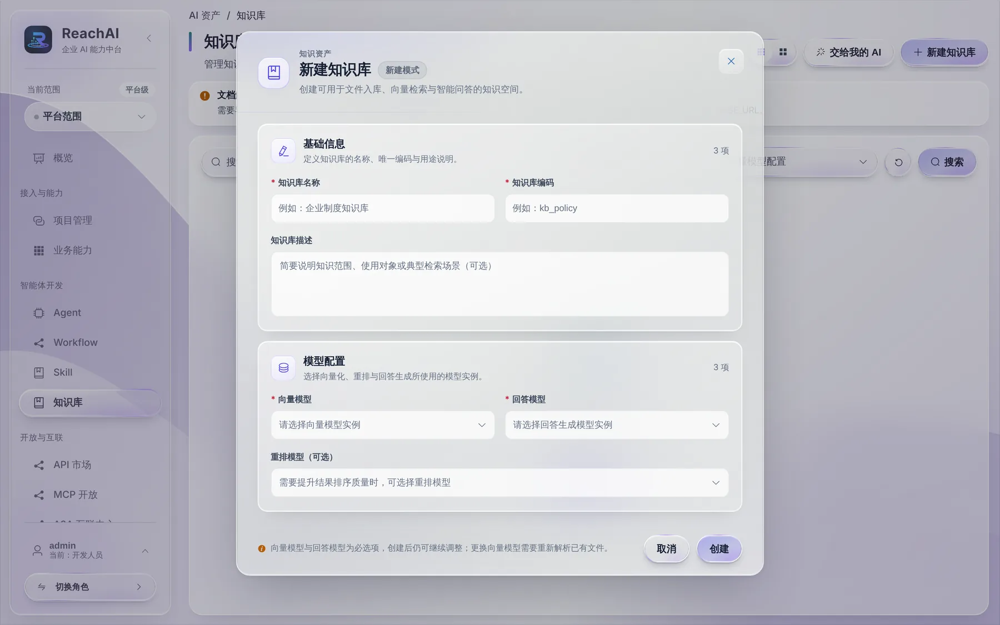

# 创建知识库

> 适合：开发者。读完你会建一个知识库、导入资料，并让 Agent 能根据资料回答问题、说明出处。

## 做完你会得到什么

员工问「差旅报销标准是多少」，助手从公司制度文档里找到原文回答，并附上出处。

## 开始前你需要

- 已 [接入模型](model-setup.md)，而且除了对话模型，还要有一个 **Embedding（向量）模型**。
- 部署环境里向量库（Milvus）可用；要解析 PDF、Word 的话，文档解析服务（Docling）也要开启。平台管理员可以在「开始使用 → 系统体检」里看到它们的状态。

> 一键体验环境默认没有 Embedding 模型，下面的步骤可以看，但要接上 Embedding 模型后才能真正入库和检索。

## 第 1 步：新建知识库

左侧「智能体开发 → 知识库」，点 **新建知识库**：

| 字段 | 填什么 |
| --- | --- |
| 知识库名称 | 给人看的名字，比如「企业制度知识库」 |
| 知识库编码 | 唯一编码，比如 `kb_policy` |
| 知识库描述 | 资料范围、给谁用。Agent 会参考它判断什么时候查这个库 |
| 向量模型 | 必选。把文本变成向量 |
| 回答模型 | 必选。根据检索到的段落组织回答 |
| 重排模型 | 可选。想让结果排序更准时选 |

以后更换向量模型，已有文件要重新解析。

## 第 2 步：导入资料

进入知识库，上传文件。上传后看导入任务和解析结果：正文、表格是否完整，段落切分是否合理。解析失败或内容为空的文件不算入库成功。

## 第 3 步：检索测试

在知识库的检索测试里，准备几类问题：资料里有答案的、没有答案的、容易混淆的。检查命中的段落是否相关、出处是否正确。

检索不准时，依次检查：解析结果 → 向量模型 → 切分设置 → 召回参数。

## 第 4 步：交给 Agent

两种方式：

- 在 Agent 概览的「知识库」卡片点「添加」，直接挂上这个知识库；
- 或者编一个知识问答 Workflow（知识检索节点 + 回答节点），发布后加进 Agent。

发布 Agent 后，到业务页面的助手里提问验证。

## 谁能检索到

知识库的「管理范围」决定谁能在管理台看到和编辑它；「检索范围」决定员工通过助手能查到什么。目前按文件单独授权的检索还在完善中，要严格区分可见范围的资料，先分成不同的知识库。详见 [数据与模型（参考）](../data.md)。

## 遇到问题

**上传后一直在解析。** 文档解析服务没开或资源不足。问平台管理员看系统体检。

**助手说找不到依据。** 不代表资料里没有。检查检索范围、文件是否解析成功，再用检索测试复现。

## 下一步

- [配置和调试 Agent](agent.md)
- [开发者常见问题](troubleshooting.md)
