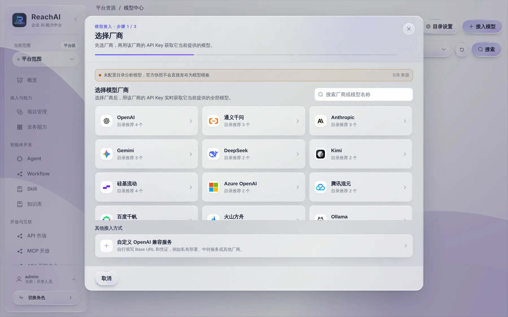

# 接入模型

> 适合：开发者、平台管理员。读完你会在 ReachAI 里接好一个大模型，让 Agent 和 Workflow 能用它理解问题、组织回答。

## 做完你会得到什么

「模型中心」里多出一个可用的模型实例。Agent、Workflow 的 AI 编排、知识库都从这里选模型。

## 开始前你需要

- 一个模型厂商的 API Key：DeepSeek、通义千问、OpenAI、Anthropic、Kimi、智谱、硅基流动等都可以；也可以是公司自建的 OpenAI 兼容服务或 Ollama。
- 角色是开发人员或平台管理员。

> 一键体验环境在 `.env` 里填了 `LLM_API_KEY` 的话，初始化时已经自动接好了一个模型，可以跳过本篇。

## 第 1 步：选择厂商

左侧最下面「平台资源 → 模型中心」，点右上角 **接入模型**：

接入分三步，第一步选厂商。每个厂商卡片上写着目录推荐了几个模型。列表里没有的，选最下面的 **自定义 OpenAI 兼容服务**，自己填 Base URL 和凭据，适合私有部署、中转服务。

## 第 2 步：填 API Key，获取模型列表

填入 API Key 后，平台会**实时**向厂商查询这个 Key 能用的全部模型，你从列表里勾选要用的。这样能避免填错模型名，也能看到账号实际有权限的模型。

同一个厂商的 Key 会保存为一个「厂商账号」，以后再加这个厂商的模型不用重新填 Key。

## 第 3 步：确认并测试

确认模型类型，创建实例，然后点 **测试连接**。

| 模型类型 | 用来做什么 | 什么时候需要 |
| --- | --- | --- |
| LLM（对话） | 理解问题、规划步骤、组织回答 | 一定要有 |
| Embedding（向量） | 把文本变成向量做检索 | 用知识库时 |
| Rerank（重排） | 给检索结果重新排序 | 知识库想要更准时，可选 |

测试失败时按提示检查：地址、Key、模型权限、网络（服务器能否访问厂商地址）。

## 第 4 步：在 Agent 里用上它

打开要用的 Agent，在「配置」里把默认模型选成刚建的实例，保存并发布。见 [配置和调试 Agent](agent.md)。

## 背后发生了什么

- API Key 只保存在服务端，页面和接口都只告诉你「已配置」，不会返回 Key 本身。编辑时不填 Key 表示保留原值；改了服务地址的域名或端口，要重新填 Key。
- Agent 和 Workflow 引用的是「模型实例」。以后换模型，改实例或改引用即可，不用改流程。

## 遇到问题

**获取模型列表为空。** Key 无效、账号没开通、或服务器访问不到厂商地址。先在服务器上 `curl` 一下厂商地址。

**测试通过，但 Agent 回答报错。** 看「运行中心」里这次运行的错误，常见是模型上下文长度不够或厂商限流。

**省钱。** 日常测试用便宜的小模型（比如 DeepSeek 的 Flash 系列），上线前再用目标模型完整验证一遍。

## 下一步

- [创建第一个 Workflow](first-workflow.md)
- [配置和调试 Agent](agent.md)
