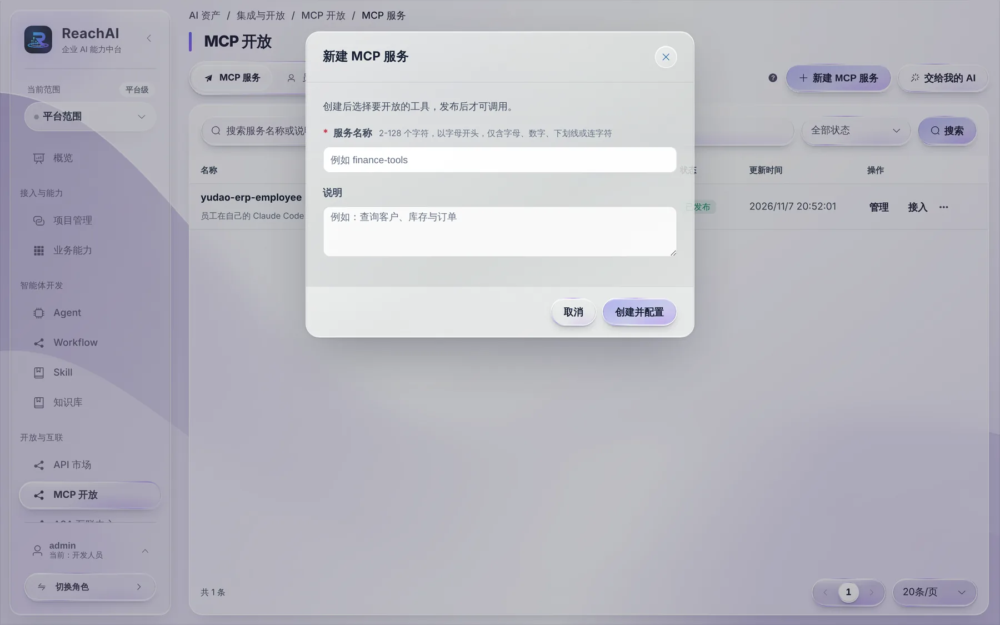
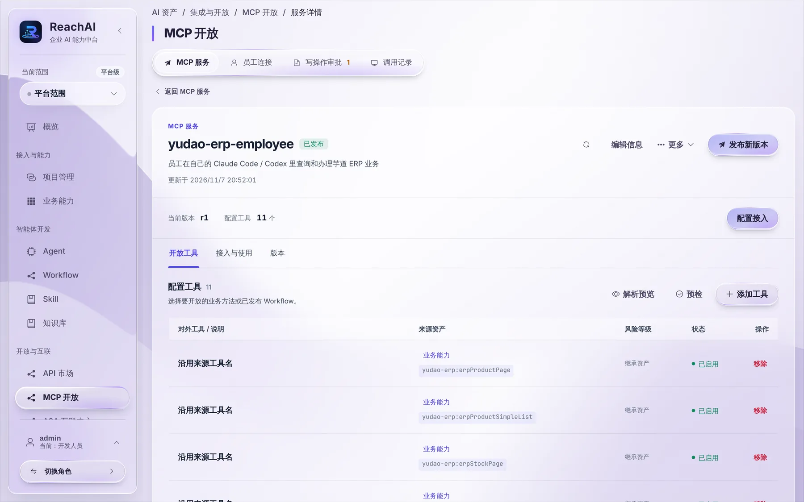

# 发布 MCP 服务给员工

> 适合：开发者。读完你会把一组业务方法打包成 MCP 服务并发布，员工就能在自己的 Codex、Claude Code 里用它们。

## 做完你会得到什么

一个已发布的 MCP 服务，比如一键体验里的 `yudao-erp-employee`，里面放着查询产品、查询库存、新建客户等工具。管理人员打开「员工可用」后，员工就能生成个人连接。

## MCP 是什么

MCP 是 AI 工具（Codex、Claude Code、Cursor 等）调用外部能力的通用协议。ReachAI 把你的业务方法包装成 MCP 工具，员工的 AI 工具连上来就能用，不需要你为每种 AI 工具单独开发。

## 开始前你需要

- 业务能力目录里有要开放的业务方法，见 [核对业务能力](capabilities.md)。
- 业务方法都接好了 [业务身份桥](business-identity.md)，员工调用时以本人身份执行。

## 第 1 步：新建 MCP 服务

左侧「开放与互联 → MCP 开放」，点 **新建 MCP 服务**：

- **服务名称**：英文，以字母开头，比如 `order-employee`。
- **说明**：写给员工和 AI 看，比如「员工在自己的 AI 工具里查询和办理订单业务」。

点 **创建并配置**。

## 第 2 步：选择开放的工具

进入服务详情的「开放工具」：

点 **添加工具**，从业务方法或已发布的 Workflow 里选。每个工具会显示：

| 列 | 含义 |
| --- | --- |
| 对外工具 / 说明 | AI 看到的工具名和说明。默认沿用来源业务方法的名称和说明，可以改 |
| 来源资产 | 来自哪个业务方法或 Workflow |
| 风险等级 | 默认继承业务方法的副作用：只读直接执行，写操作要审批，不可逆操作不会开放给员工 |
| 状态 | 启用 / 停用 |

挑选原则：

- 先开放查询，跑通后再开放写操作。
- 工具不要太多。同一件事有多个相近的方法时，只留一个说明最清楚的，AI 才不容易选错。
- 用 **解析预览** 看 AI 实际看到的工具列表，用 **预检** 检查有没有缺身份声明、缺说明等问题。

## 第 3 步：发布

点右上角 **发布新版本**。服务状态变成「已发布」，当前版本号加一。

以后增减工具，改完再发布一个新版本，员工的已有连接会自动用上新版本。

## 第 4 步：交给管理人员开通

发布后，员工还看不到它。还需要管理人员：

1. 在「接入与使用 → 员工使用」里打开「员工可用」，选业务系统，设置写操作是否要审批；
2. 在「调用权限」里允许员工的业务角色调用这些能力。

这两步是管理决策，见 [开通员工使用](../manager/open-to-employees.md)。你自己有管理权限的话，也可以直接做。

## 背后发生了什么

- 员工的 AI 工具连到 ReachAI 的员工 MCP 地址，用的是员工自己生成的连接密钥。每次调用，ReachAI 都以这个员工在业务系统里的身份执行。
- 员工能用的工具 = MCP 服务开放的工具 ∩ 调用权限允许的能力。两层都允许才行。
- 写操作提交后先进审批，审批通过后平台以员工身份执行一次。见 [让 AI 帮你改数据：为什么要审批](../business/write-and-approval.md)。

## 遇到问题

**员工说看不到这个系统。** 服务是否已发布、管理人员是否打开了「员工可用」、员工角色在调用权限里是否有允许规则。

**员工调用时说没有权限。** 用「调用权限」页的权限检查看员工角色能否调用这个能力。

**一个业务系统能不能发布多个员工服务？** 员工使用里每个业务系统只能关联一个 MCP 服务。按部门分开开放的需求，用调用权限控制。

## 下一步

- [开通员工使用（管理人员）](../manager/open-to-employees.md)
- [在自己的 Codex / Claude Code 里办业务（员工视角）](../business/own-ai-tool.md)
