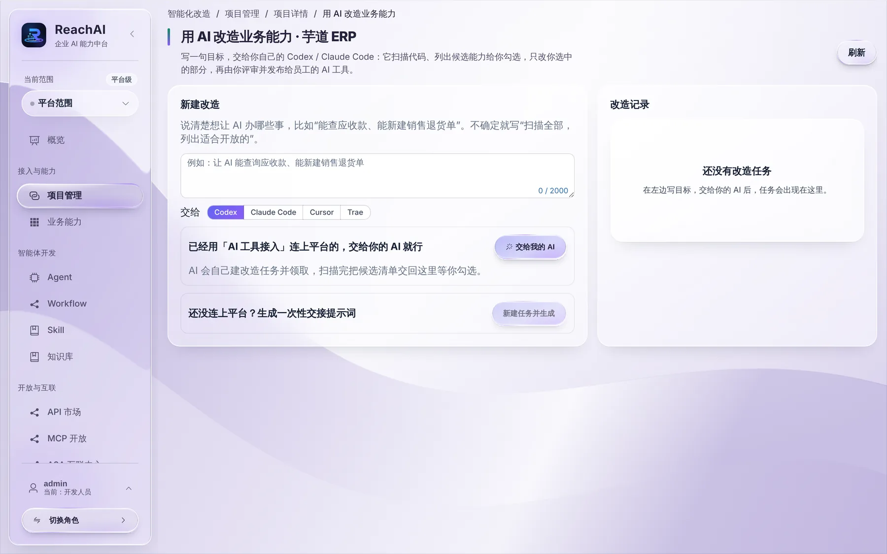

# 用 AI 改造业务能力

> 适合：已经接入 ReachAI 的开发者。读完你会让自己的 Codex 或 Claude Code 扫描业务代码、列出适合开放给 AI 的方法，由你勾选后它来补代码，最后发布给员工。

## 做完你会得到什么

业务系统里多出一批声明好的业务方法（比如「查询应收款」「新建销售退货单」），已同步到 ReachAI，并发布到员工的 MCP 服务里。整个过程你只需要写一句目标、勾选、评审。

## 开始前你需要

- 业务系统已经用 SDK 接入，见 [接入第一个业务系统](connect-project.md)。
- 你的 Codex / Claude Code 能打开业务系统的代码仓库。
- 最好已经用「AI 工具接入」连上了平台，见 [交给我的 AI](ai-tool-handoff.md)。没连也可以，用一次性交接提示词。

## 第 1 步：写一句目标

进入项目详情，点 **用 AI 改造业务能力**：

在「新建改造」里写清楚想让 AI 能办哪些事，比如「能查询应收款、能新建销售退货单」。不确定就写「扫描全部，列出适合开放的」。

在「交给」里选你用的工具：Codex、Claude Code、Cursor 或 Trae。

## 第 2 步：交给你的 AI

两种方式：

- **已经连上平台**：点 **交给我的 AI**，复制提示词粘贴给 AI。AI 会自己建改造任务并领取。
- **还没连上**：点 **新建任务并生成**，得到一段一次性交接提示词，粘贴给 AI。

## 第 3 步：勾选候选能力

AI 扫完代码后，会把候选清单交回这个页面，出现在右边的「改造记录」里。每个候选写着：对应哪段代码、做什么、是只读还是写、建议的名称和说明。

你勾选要开放的，没勾的 AI 不会动。

## 第 4 步：AI 补代码并同步

AI 只修改你勾选的部分：给对应方法加上能力声明（Java 是 `@ReachCapability`），写好给 AI 看的说明和副作用。然后它会让业务系统重新同步，并在平台上核对同步结果。

你像平时一样评审它的代码改动，合并、部署。

## 第 5 步：评审并发布给员工

新方法出现在「业务能力」里，标记为来源变化。核对说明、输入输出、副作用（见 [核对业务能力](capabilities.md)），接纳后加进员工的 MCP 服务并发布新版本（见 [发布 MCP 服务给员工](publish-mcp.md)）。

## 背后发生了什么

- 改造任务是一种接入任务。AI 通过平台工具领取任务、读上下文、提交候选清单、向你提问、提交验证；你在页面上能看到全过程。
- AI 不能绕过你：候选要你勾选，代码要你评审，新能力要你接纳，发布要你点。

## 遇到问题

**AI 列出的候选太多太杂。** 把目标写得更具体，只说你要的几件事。

**AI 改完代码，平台上看不到新方法。** 业务系统要重新部署并启动，SDK 才会同步。看项目接入工作台的「业务服务校验」。

## 下一步

- [发布 MCP 服务给员工](publish-mcp.md)
- [开发者常见问题](troubleshooting.md)
