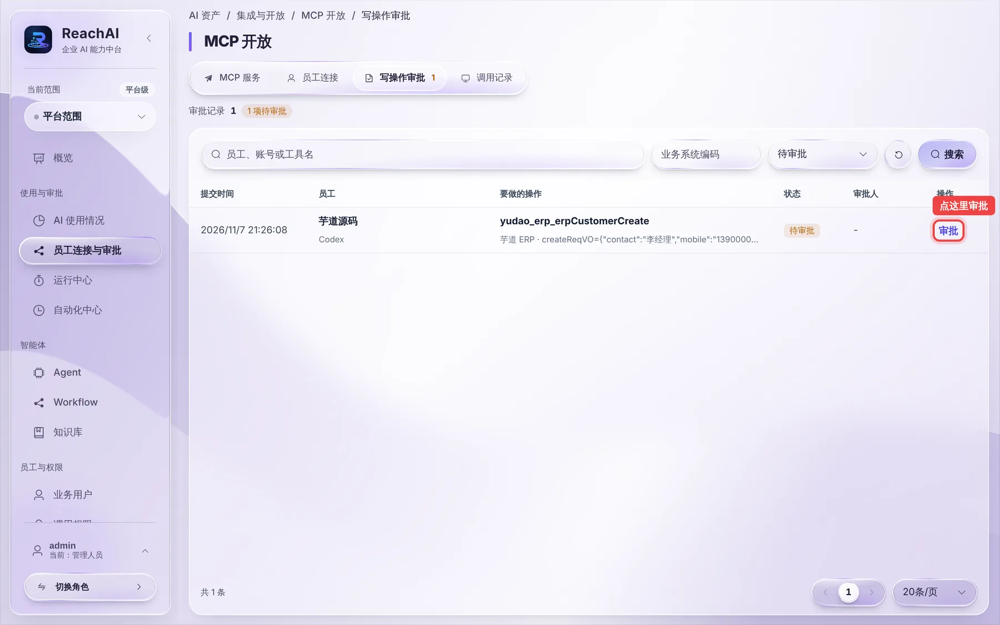
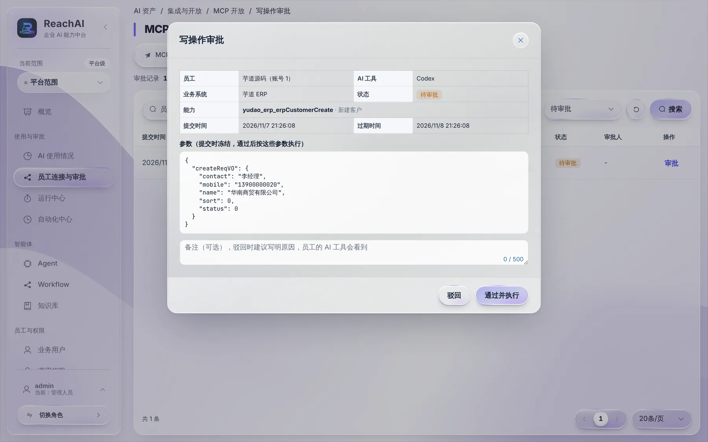
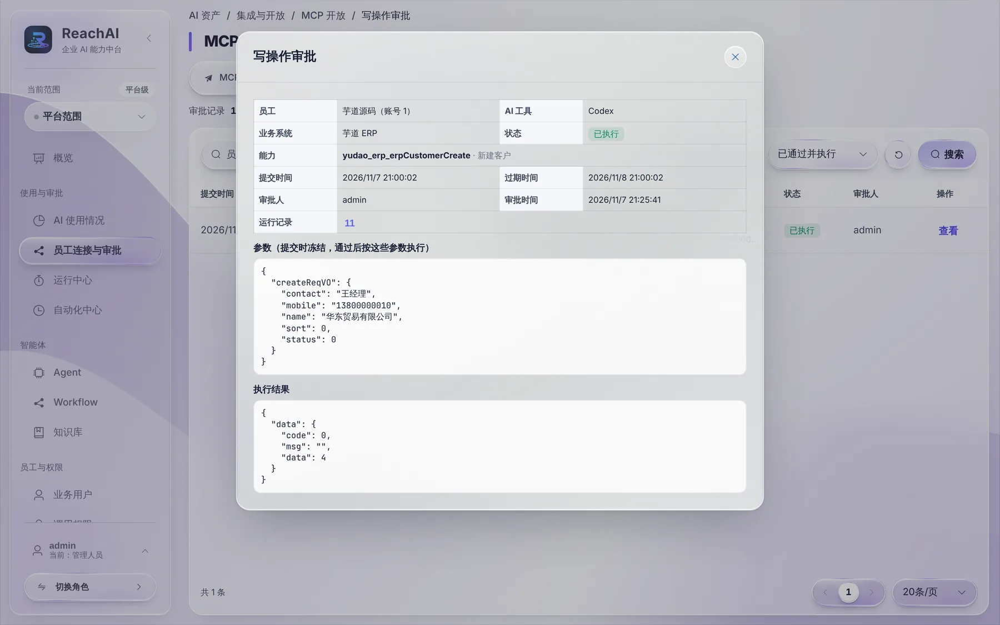

# 审批 AI 提交的操作

> 适合：管理人员。读完你能处理员工的 AI 工具提交的写操作，看清楚它要做什么，再决定通过还是驳回。

## 为什么要你审批

员工在自己的 Codex、Claude Code 里说「新建一个客户」时，AI 不会直接改业务系统的数据，而是提交一条审批。你看过之后点通过，系统才**以员工本人的身份**执行一次。员工那边看到的过程见 [让 AI 帮你改数据](../business/write-and-approval.md)。

## 第 1 步：打开待审批列表

左侧点「员工连接与审批」，切到 **写操作审批** 标签。标签上的数字就是待审批的条数。

每一行是一条申请：什么时候提交的、哪位员工、用的什么 AI 工具、要做什么操作。默认只显示「待审批」，可以在右上角切换状态查看历史。

## 第 2 步：看清楚要做什么

点 **审批**，打开详情：

重点看三处：

1. **员工、AI 工具、业务系统**：是谁、通过什么工具、在哪个系统里办。
2. **能力**：要执行的操作，例如「新建客户」。
3. **参数**：要提交的具体内容，例如客户名称、联系人、电话。这些参数在提交时已经**冻结**，通过后就按这些内容执行，AI 不能再改。

如果信息有误或不该做，在备注里写明原因（员工的 AI 工具会看到），点 **驳回**。确认没问题，点 **通过并执行**。

## 第 3 步：确认执行结果

通过后，系统马上去业务系统执行，详情里会显示执行结果和对应的运行记录：

上图中「执行结果」里的 `"data": 4` 是芋道返回的新客户编号。可以到芋道的客户列表核对「华东贸易有限公司」是否已经创建。

点「运行记录」后面的编号，能在运行中心看到这次执行的完整过程。

## 背后发生了什么

- **通过时会再检查一遍**：员工的连接是否还有效、业务账号是否还在、调用权限是否还允许、这个操作的定义是否变过。任何一项不满足就不执行。
- **只执行一次**，不会重复。
- 审批 **24 小时**内不处理会自动过期，员工需要重新提交。
- 每位员工最多同时有 20 条待审批，防止 AI 一次提交一大堆。

## 不想每次都审批？

在 MCP 服务的「员工使用」里，可以把「写操作需要审批」改成「直接执行」（见 [开通员工使用](open-to-employees.md)）。建议先审批运行一段时间，确认 AI 填写的内容可靠后再考虑。做了就收不回的操作，无论怎么设置都不会开放给员工。

## 遇到问题

**状态是「已通过但执行失败」。** 打开详情看执行结果，一般是业务系统校验没通过（比如缺少必填字段）。这时驳回不了，可以告诉员工让 AI 补全信息后重新提交。

**看不到「写操作审批」。** 你的账号需要「管理人员」角色，或请平台管理员给你写操作审批的权限。

## 下一步

- [看员工的 AI 使用情况](usage.md)
- [运行中心：查每一次运行](run-center.md)
