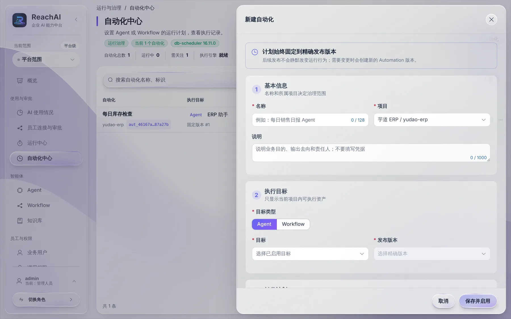
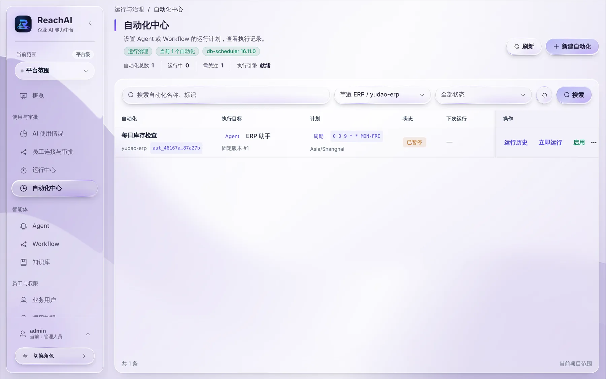

# 让 AI 按计划自动办事

> 适合：管理人员。读完你能让一个 Agent 或 Workflow 每天、每周按时自动运行，例如每个工作日早上生成销售日报。

## 先了解一个限制

自动化运行时，**不代表任何一位员工**，而是用「自动化服务账号」的身份运行。所以：

- 适合：不依赖员工身份的事情，例如汇总知识库内容、调用允许服务账号访问的接口。
- 不适合：要求员工本人身份的业务操作。比如一键体验里的芋道 ERP，每个查询都要求员工身份，放进自动化会失败，运行记录里会提示「该业务方法要求经过验证的业务用户身份」。

要不要让某个业务操作允许服务账号调用，由开发人员在接入业务系统时决定。

## 开始前你需要

- 一个**已发布**的 Agent 或 Workflow。自动化固定使用某个发布版本，之后再发布新版本也不会悄悄改变自动化的行为。
- 平台已开启自动化。自动化中心顶部显示「执行引擎 就绪」就可以；如果提示「自动运行暂未开启」，请平台管理员按 [日常运维](../admin/operations.md#开启自动化) 打开。

## 第 1 步：新建自动化

左侧点 **自动化中心**，点右上角 **新建自动化**：

按四部分填写：

1. **基本信息**：名称（例如「每日库存检查」）、所属项目、说明。说明里写清楚目的和负责人，**不要写密码等凭据**。
2. **执行目标**：选 Agent 或 Workflow，再选具体的目标和发布版本。
3. **触发计划**：
   - 「周期执行」：点「常用」里的预设最方便，例如「每天 09:00」「工作日 09:00」。也可以自己写计划表达式，格式是「秒 分 时 日 月 周」，例如 `0 30 8 * * MON-FRI` 表示工作日 8:30。时区默认 Asia/Shanghai。
   - 「单次执行」：选一个未来的时间，只跑一次。
   - 下面的「错过计划」「并发策略」「超时」「最多尝试」一般保持默认即可。
4. **提问内容**（Agent）或 **输入**（Workflow）：每次运行时发给它的内容，例如「汇总昨天的新增客户」。

点 **保存并启用**。

## 第 2 步：试跑一次

在列表里点 **立即运行**，不用等到计划时间。

## 第 3 步：看运行结果

点 **运行历史**，能看到每次运行的时间、状态、尝试次数和结果。点结果里的编号，可以到运行中心看完整过程。失败时可以点 **重试**。

不需要时点 **暂停**；更多操作里可以归档。

## 遇到问题

**提示「自动运行暂未开启」。** 平台没有打开自动化，请平台管理员开启。

**运行失败，提示需要业务用户身份。** 见本文开头的限制说明。

**运行失败，状态是「重试耗尽」。** 点运行编号到运行中心看是哪一步失败，修好后点「重试」。

## 下一步

- [运行中心：查每一次运行](run-center.md)
- [管理人员的工作台](workspace.md)
