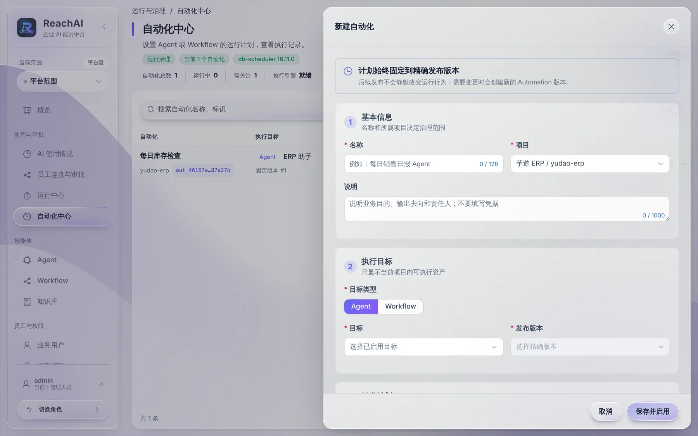
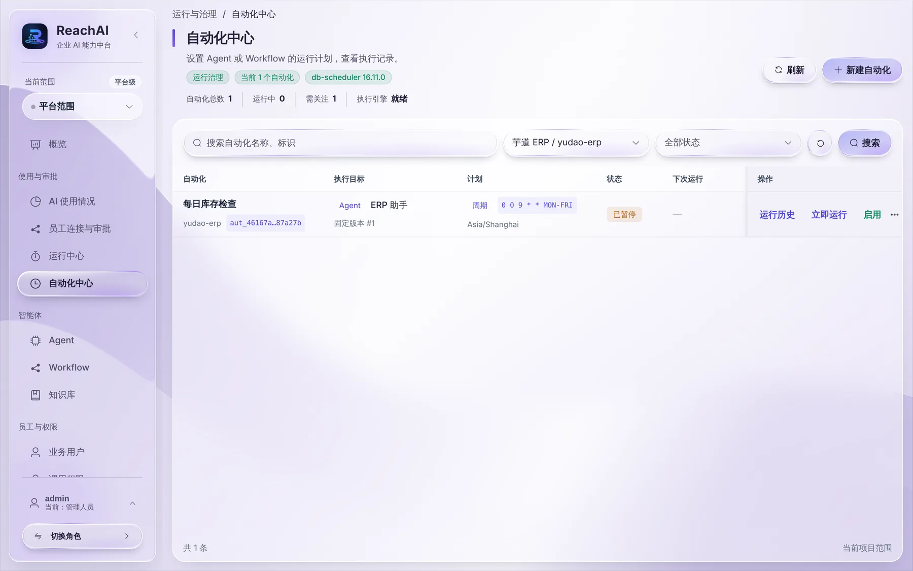

# 让 AI 按计划自动办事

> 适合：管理人员。读完你能让一个 Agent 或 Workflow 每天、每周按时自动运行，例如每个工作日早上生成销售日报。

## 先了解：自动化用谁的身份办事

自动化以**最后保存它的人**的身份运行。每次运行前，平台都会重新查一遍这个人在业务系统里的账号：

- **查到了**：自动化就像这个人自己在办事。业务系统按他的账号和权限放行，例如芋道 ERP 里他能看到哪些仓库，自动化就只能查哪些仓库。
- **查不到**（没有为他配置「运行时用户映射」，或者他的业务账号停用了）：自动化改用不代表任何人的「服务账号」。要求员工身份的业务操作（比如芋道 ERP 的所有查询）会失败，运行历史里会写明原因和怎么处理。

所以新建自动化之前，先确认你在这个业务系统里有账号映射。没有的话，请平台管理员在「身份与权限 → 运行时用户映射」里把你的平台账号绑到你的业务系统账号。

两条始终不变的规则：

- **写操作不会自动执行。** 自动化跑到需要审批的写操作（例如新建客户）时会直接停下，不会替任何人点同意。适合放进自动化的是查询、汇总、提醒这类事情。
- **换人保存就换身份。** 别人编辑并保存了这个自动化，之后就以那个人的身份运行。员工离职、账号停用后，自动化会自动退回服务账号，不会继续用他的权限。

## 开始前你需要

- 一个**已发布**的 Agent 或 Workflow。自动化固定使用某个发布版本，之后再发布新版本也不会悄悄改变自动化的行为。
- 平台已开启自动化。自动化中心顶部显示「执行引擎 就绪」就可以；如果提示「自动运行暂未开启」，请平台管理员按 [日常运维](../admin/operations.md#开启自动化) 打开。

## 第 1 步：新建自动化

左侧点 **自动化中心**，点右上角 **新建自动化**：

按四部分填写：

1. **基本信息**：名称（例如「每日库存检查」）、所属项目、说明。说明里写清楚目的和负责人，**不要写密码等凭据**。
2. **执行目标**：选 Agent 或 Workflow，再选具体的目标和发布版本。
3. **触发计划**：
   - 「周期执行」：点「常用」里的预设最方便，例如「每天 09:00」「工作日 09:00」。也可以自己写计划表达式，格式是「秒 分 时 日 月 周」，例如 `0 30 8 * * MON-FRI` 表示工作日 8:30。时区默认 Asia/Shanghai。
   - 「单次执行」：选一个未来的时间，只跑一次。
   - 下面的「错过计划」「并发策略」「超时」「最多尝试」一般保持默认即可。
4. **提问内容**（Agent）或 **输入**（Workflow）：每次运行时发给它的内容，例如「汇总昨天的新增客户」。

点 **保存并启用**。

## 第 2 步：试跑一次

在列表里点 **立即运行**，不用等到计划时间。

## 第 3 步：看运行结果

点 **运行历史**，能看到每次运行的时间、状态、尝试次数和结果。点结果里的编号，可以到运行中心看完整过程。失败时可以点 **重试**。

不需要时点 **暂停**；更多操作里可以归档。

## 遇到问题

**提示「自动运行暂未开启」。** 平台没有打开自动化，请平台管理员开启。

**运行失败，提示「这一步需要员工身份，但本次自动化只能用服务账号运行」。** 最后保存自动化的人在这个业务系统里没有可用账号。请平台管理员在「身份与权限 → 运行时用户映射」里为他绑定业务账号，或者换一位有账号的人重新保存自动化，然后点「重试」。

**运行失败，提示需要人工交互。** 自动化跑到了需要审批的写操作，按规则停下了。写操作请员工在自己的 AI 工具或业务系统助手里办。

**运行失败，状态是「重试耗尽」。** 点运行编号到运行中心看是哪一步失败，修好后点「重试」。

## 下一步

- [运行中心：查每一次运行](run-center.md)
- [管理人员的工作台](workspace.md)
