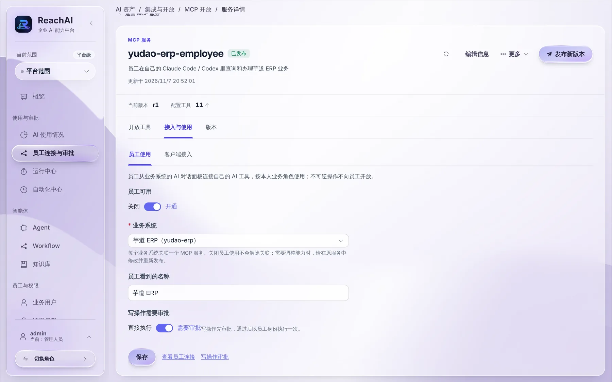
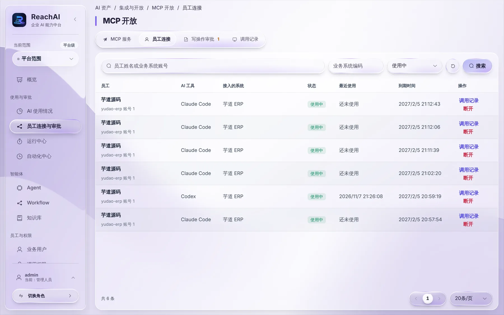

# 开通员工使用

> 适合：管理人员。读完你能让员工在自己的 Codex、Claude Code 里，以本人身份操作某个业务系统。

## 做完你会得到什么

员工在业务系统右下角的助手里点「在我的 AI 工具中使用」，能看到这个系统并生成连接；之后在自己的 AI 工具里就能查数据、提交写操作。

## 开始前你需要

- 业务系统已经接入 ReachAI（开发人员完成，见 [开发者从这里开始](../developer/overview.md)）。
- 已经有一个 **MCP 服务**，里面放好了要开放给员工的操作（查询产品、新建客户等）。一般由开发人员创建并发布，你确认内容即可。

> 一键体验环境里已经准备好了 MCP 服务 `yudao-erp-employee`，并且已经开通。

## 第 1 步：找到 MCP 服务

左侧点「员工连接与审批」，在「MCP 服务」标签里找到要开放的服务，点 **管理**。

在「开放工具」里确认员工能用的操作。每个操作都有风险等级：只读的查询可以直接执行，会改数据的操作要审批，做了就收不回的操作**不会**开放给员工。

## 第 2 步：打开「员工可用」

切到「接入与使用 → 员工使用」：

1. **员工可用**：打开。
2. **业务系统**：选这个服务对应的业务系统。每个业务系统只能关联一个 MCP 服务。
3. **员工看到的名称**：员工在连接时看到的系统名，例如「芋道 ERP」。
4. **写操作需要审批**：建议保持「需要审批」。打开后，员工让 AI 做的写操作会先提交给你审批，通过后才执行。
5. 点 **保存**。

## 第 3 步：确认员工能看到

请一位员工（或你自己用业务系统账号）登录业务系统，在助手标题栏点「在我的 AI 工具中使用」，「要接入的系统」里应该能看到这个系统。

员工生成连接后，会出现在「员工连接」标签里：

这里能看到每个员工用的是哪个 AI 工具、接入了哪个系统、最近什么时候用过、什么时候到期。点 **调用记录** 看这条连接做过什么；点 **断开** 立即让它失效（比如员工离职、电脑丢失）。

## 背后发生了什么

- 员工的 AI 工具连上来后，每次调用都**以员工本人的业务系统身份**执行。员工在业务系统里看不到的数据，AI 也拿不到。
- 员工能用哪些操作，同时受两层控制：这个 MCP 服务开放了哪些工具，以及 [调用权限](permissions.md) 允许员工的业务角色调用哪些能力。两层都允许才行。
- 关闭「员工可用」后，员工不能再新建连接；已有连接也不能再调用。

## 遇到问题

**员工说「要接入的系统」里是空的。** 确认「员工可用」已打开并保存，MCP 服务是「已发布」状态，并且员工的业务角色在调用权限里有允许规则。

**员工调用时提示没有权限。** 去 [调用权限](permissions.md) 用「权限检查」看员工的角色能不能调用这个能力。

## 下一步

- [调用权限：谁能让 AI 做什么](permissions.md)
- [审批 AI 提交的操作](approvals.md)
