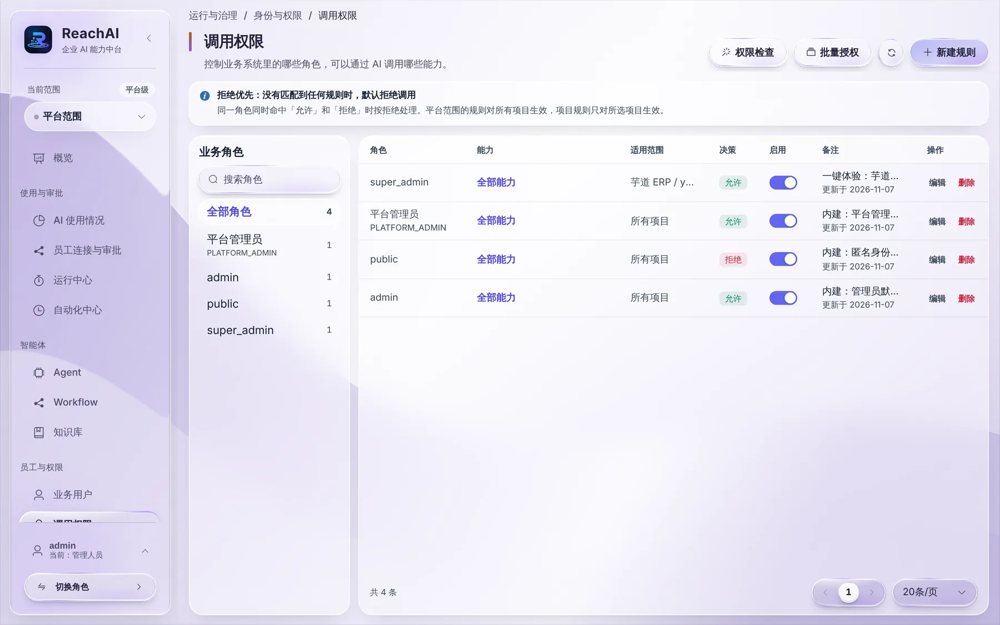

# 调用权限：谁能让 AI 做什么

> 适合：管理人员。读完你能控制业务系统里的哪些角色，可以通过 AI 调用哪些业务操作。

## 先理解一条原则

ReachAI 不重新发明一套权限，而是**跟着业务系统的角色走**：

- 员工让 AI 做事时，ReachAI 知道他在业务系统里是什么角色（例如芋道里的「超级管理员」「销售」）。
- 「调用权限」里的规则决定：这个角色能不能通过 AI 调用某个业务操作。
- **没有匹配到任何规则，就拒绝。** 同一个角色既有「允许」又有「拒绝」时，按拒绝处理。

调用通过之后，业务系统还会按员工本人的数据权限再检查一遍。所以调用权限管的是「能不能让 AI 做这类事」，业务系统管的是「能看到、能改哪些数据」。

## 第 1 步：打开调用权限

左侧「员工与权限」下点 **调用权限**。

左边是业务角色，右边是规则列表。每条规则写着：哪个角色、哪些能力、在哪个业务系统（适用范围）、允许还是拒绝、是否启用。

一键体验环境里已经有一条规则：芋道的 `super_admin` 角色可以调用芋道 ERP 的全部能力。

## 第 2 步：新建一条规则

例如，想让芋道里的「销售」角色只能查询客户和订单：

1. 点右上角 **新建规则**。
2. **角色**：选 `sale`（以你们业务系统里的角色编码为准）。
3. **能力**：选「查询客户」「查询销售订单」，也可以选「全部能力」。
4. **适用范围**：选「芋道 ERP」。选「所有项目」时对所有业务系统生效。
5. **决策**：允许。
6. **备注**：写清楚为什么这样配，方便以后的人看懂。
7. 保存。

要一次给多个角色授权，用右上角 **批量授权**。

## 第 3 步：用「权限检查」确认

点右上角 **权限检查**，选角色和能力，系统会告诉你最终结果是允许还是拒绝，以及命中了哪条规则。上线前、员工反馈没权限时都用它查。

## 业务用户

左侧「业务用户」用来查看通过可信身份同步到 ReachAI 的业务系统用户、外部身份映射和角色绑定。排查「AI 认不出这个员工」一类问题时会用到。

## 遇到问题

**员工说 AI 提示没有权限。** 用「权限检查」查员工的角色。最常见的原因是没有任何允许规则（默认拒绝）。

**规则改了没生效。** 确认规则是「启用」状态；适用范围是否选对了业务系统。

## 下一步

- [开通员工使用](open-to-employees.md)
- [审批 AI 提交的操作](approvals.md)
