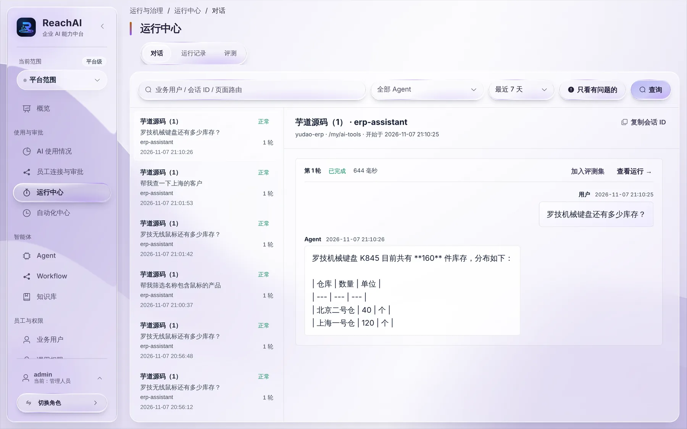
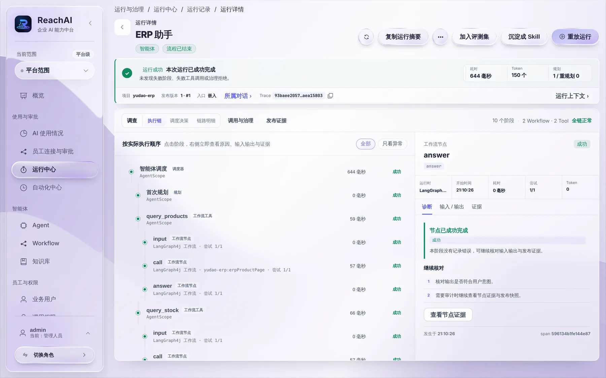

# 运行中心：查每一次运行

> 适合：管理人员、开发人员。员工说「AI 答错了」「AI 没办成」时，从这里找原因。

## 第 1 步：找到那次对话

左侧点 **运行中心**，默认是「对话」标签：

- 左边是对话列表：哪位员工、问了什么、用的哪个 Agent、结果是否正常。
- 右边是选中对话的完整内容：员工说了什么，AI 回答了什么。
- 上方可以按员工、Agent、时间筛选；打开「只看有问题的」，只列出失败或异常的对话。

## 第 2 步：看 AI 每一步做了什么

在对话里点某一轮右上角的 **查看运行**：

「执行链」按实际顺序列出 AI 的每一步，例如：

1. **智能体调度 → 首次规划**：AI 先想好要分几步做。
2. **query_products**：调用「查询产品」，在芋道里按名称找到产品编号。
3. **query_stock**：调用「查询库存」，拿到各仓库数量。
4. **answer**：整理成回答。

每一步都有耗时和成功、失败状态。点某一步，右边能看到它的输入、输出和诊断说明。

## 第 3 步：判断问题出在哪

| 看到的情况 | 一般原因 | 怎么办 |
| --- | --- | --- |
| 某个业务调用失败，提示需要身份或没有权限 | 员工在业务系统里没有这个权限，或调用权限没放开 | 查 [调用权限](permissions.md) |
| 业务调用成功，但返回空 | 名称不准确，或员工看不到这条数据 | 让员工换个说法，或核对业务系统里的数据 |
| 业务调用都成功，但回答不对 | AI 整理时理解错了 | 把这次运行「加入评测集」，交给开发人员改进 Agent |
| 根本没有调用业务操作 | AI 没听懂要做什么，或这个 Agent 没有这项能力 | 交给开发人员看 Agent 配置 |

运行详情页右上角还有几个常用按钮：

- **复制运行摘要**：把关键信息复制下来发给开发人员。
- **加入评测集**：把这次问答当成测试题，以后改 Agent 时自动回归。
- **沉淀成 Skill**：这次办得好，直接整理成 Skill。

## 「运行记录」标签

除了员工对话，自动化、Workflow 单独运行等也会产生运行。切到「运行记录」可以看到全部运行，按状态、来源筛选。

## 下一步

- [把好的做法沉淀成 Skill](skills.md)
- [让 AI 按计划自动办事](automations.md)
