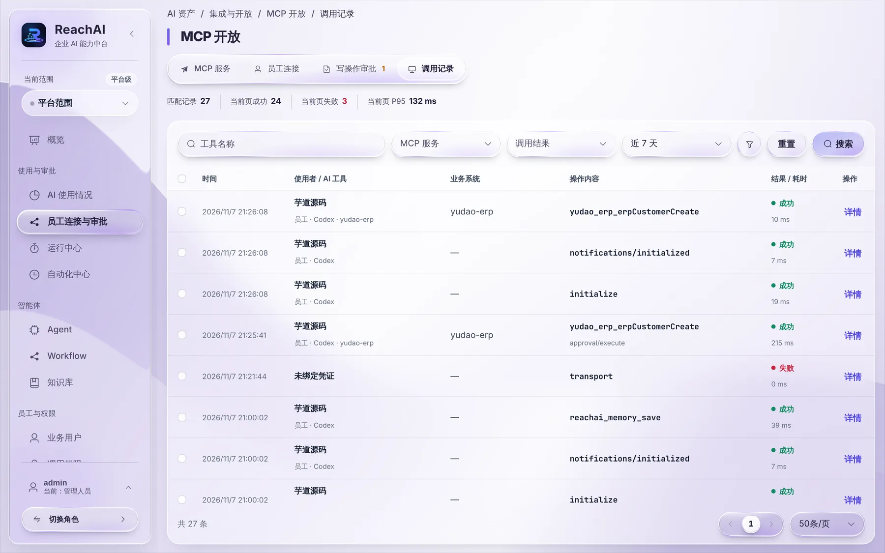
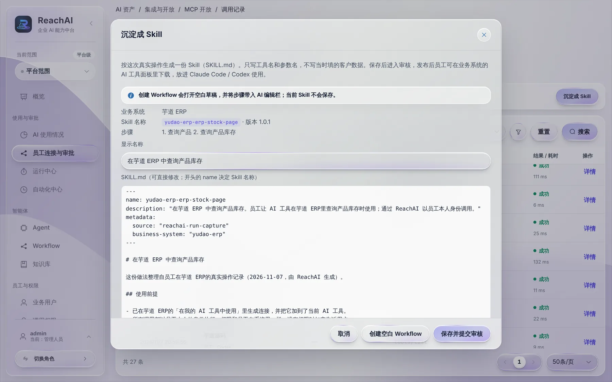
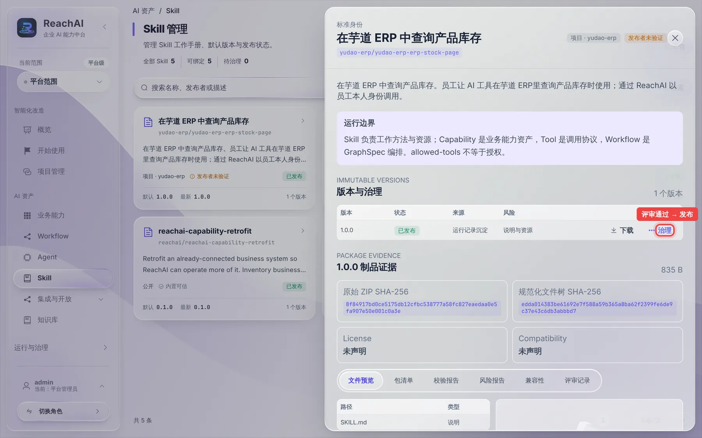

# 把好的做法沉淀成 Skill

> 适合：管理人员。读完你能把员工一次成功的操作，整理成一份 Skill，让其他员工的 AI 工具照着做。

## Skill 能带来什么

员工 A 用 AI 查库存，AI 先查产品编号、再查库存，一次就成功了。把这次操作沉淀成 Skill 后，其他员工装上它，AI 就会按同样的步骤办，不用每次重新摸索。员工怎么安装使用见 [用同事沉淀的 Skill](../business/skills.md)。

Skill 里只写**用了哪些操作、按什么顺序、填哪些字段**，不会带上当时的客户名、电话等具体数据。

## 第 1 步：选出一次成功的操作

左侧点「员工连接与审批」，切到 **调用记录** 标签：

这里记录了员工 AI 工具的每一次调用。在同一个业务系统里，按顺序勾选构成一件完整事情的几条**成功**调用。例如查库存：勾选「查询产品」和「查询产品库存」两条。

勾选后上方出现提示条，点 **沉淀成 Skill**。

> 也可以从 [运行中心](run-center.md) 的运行详情里点「沉淀成 Skill」。

## 第 2 步：确认草稿内容

系统按这次真实操作生成一份草稿：

- **步骤**：例如「1. 查询产品 2. 查询产品库存」。
- **显示名称**：员工看到的名字，例如「在芋道 ERP 中查询产品库存」，可以改得更好懂。
- **SKILL.md**：给 AI 看的说明书全文。可以直接修改，比如补一句「库存为 0 时提醒补货」。

确认后点 **保存并提交审核**。

> 如果这件事步骤固定、要反复执行，也可以点「创建空白 Workflow」，交给开发人员做成固定流程。

## 第 3 步：评审并发布

保存后，Skill 处于「待评审」状态，员工还看不到。**评审和发布需要平台管理员**来做：

1. 平台管理员打开左侧 **Skill**，点开这个 Skill。
2. 在版本那一行点 **治理 → 评审通过**，填写评审说明。
3. 再点 **治理 → 发布**。

发布后状态变成「已发布」，员工在业务系统助手的「在我的 AI 工具中使用」和个人页「我能办的事」里就能下载了。

## 背后发生了什么

- Skill 只是「做法说明」，不带权限。员工照着 Skill 办事，仍然用自己的身份和权限，写操作照样要审批。
- 每次修改都会生成新版本，旧版本保留，可以随时回看。
- 只有有这个业务系统权限的员工，才能看到和下载对应的 Skill。

## 遇到问题

**勾选框是灰的。** 只能勾选成功的、同一个业务系统里的业务调用；登录、初始化这类协议记录不能勾选。

**保存后员工还是看不到。** 确认平台管理员已经评审通过并发布。

## 下一步

- [让 AI 按计划自动办事](automations.md)
