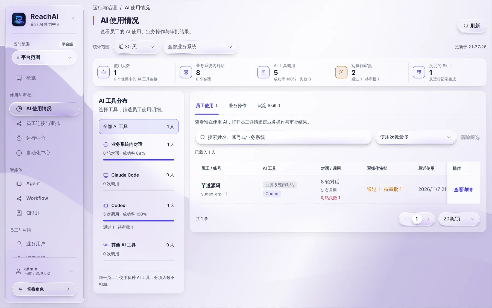
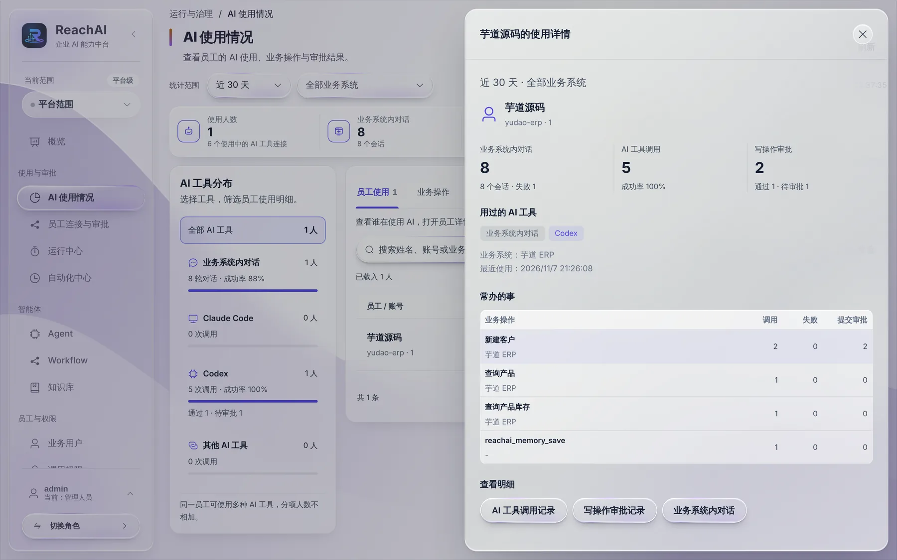

# 看员工的 AI 使用情况

> 适合：管理人员。读完你能回答「谁在用 AI、用得怎么样、AI 替大家做了哪些事」。

## 第 1 步：打开 AI 使用情况

左侧点 **AI 使用情况**。

顶部可以选统计范围（近 7 天、近 30 天等）和业务系统。下面一排数字：

| 指标 | 意思 |
| --- | --- |
| 使用人数 | 这段时间用过 AI 的员工数，以及有几个在用的 AI 工具连接 |
| 业务系统内对话 | 员工在业务系统右下角助手里的对话轮数 |
| AI 工具调用 | 员工的 Codex、Claude Code 等调用业务操作的次数和成功率 |
| 写操作审批 | 提交了多少写操作审批，还有几条待审批 |
| 沉淀的 Skill | 从运行记录整理出来的 Skill 数量 |

## 第 2 步：按 AI 工具看

左边「AI 工具分布」把使用情况按工具分开：业务系统内对话、Claude Code、Codex、其他 AI 工具。点某个工具，右边的员工列表就只显示用这个工具的人。

## 第 3 步：看某位员工

右边「员工使用」列出每位员工的对话和调用次数、写操作审批、最近使用时间。点 **查看详情**：

能看到这位员工用过哪些 AI 工具、最常办的事（每种业务操作调用了几次、失败几次、提交了几次审批），下方按钮可以直接跳到他的调用记录、审批记录和对话。

## 第 4 步：按业务操作看

切到「业务操作」标签，看哪些操作最常被 AI 调用、失败率高不高。失败多的操作值得请开发人员看看：可能是说明写得不清楚，AI 经常填错参数。

## 第 5 步：看花了多少钱

切到「费用」标签，看 ReachAI 自己调用大模型花的 Token 和估算费用：业务系统里的 AI 对话、自动化任务、工作流里的模型节点、搭建 Agent 和工作流时的 AI 生成都算在内。

- 上面三个数：估算费用、Token（输入和输出）、模型调用次数。
- 下面可以按 **人员 / 业务系统 / 入口 / 模型 / 按天** 切换排行。
- 费用按模型中心里填的价格计算：打开模型详情，在「价格」里填每百万输入 / 输出 Token 的价格。没填价格的模型只统计 Token，页面顶部会提示「有模型还没填价格」，点 **去填价格** 直接过去。
- 员工自己的 Claude Code、Codex 花的是员工自己工具的钱，ReachAI 看不到，这里不统计。
- 这个功能上线之前的运行只有总 Token、不知道用的哪个模型，所以不估算费用。

## 第 6 步：导出审计记录

点右上角 **导出审计记录**，选时间范围（最长 90 天）和业务系统，下载一个 Excel 能直接打开的 CSV。每行一件事：

| 列 | 内容 |
| --- | --- |
| 时间、类别 | AI 工具调用、写操作审批、业务系统内对话 / 自动化、登录 |
| 人员、业务系统账号 | 谁做的，用的哪个业务系统账号 |
| 入口、业务系统、做了什么 | 芋道里的 AI 对话、Claude Code、Codex 等；调用了哪个业务操作 |
| 结果、审批人、审批时间 | 成功还是失败；写操作谁批的 |
| Token、运行编号 | 用运行编号可以到 [运行中心](run-center.md) 查完整轨迹 |

- 不导出对话内容、调用参数和返回结果，也不导出任何密钥。
- 一次最多 5 万行，超出会提示缩小范围。
- 平台管理员导出全部系统时会附带登录记录（包括用业务系统账号登录的成功和失败）。只负责某个系统的人只能导出那个系统。
- 每次导出本身也会记一条审计。

## 用这些数据做什么

- **推广**：使用人数少的部门，可以组织一次分享，或把常用说法放进提示词库。
- **发现好做法**：某位员工某件事办得又多又稳，可以把他的操作 [沉淀成 Skill](skills.md) 给大家用。
- **发现问题**：失败率高的操作，去 [运行中心](run-center.md) 看具体原因。

## 下一步

- [运行中心：查每一次运行](run-center.md)
- [把好的做法沉淀成 Skill](skills.md)
