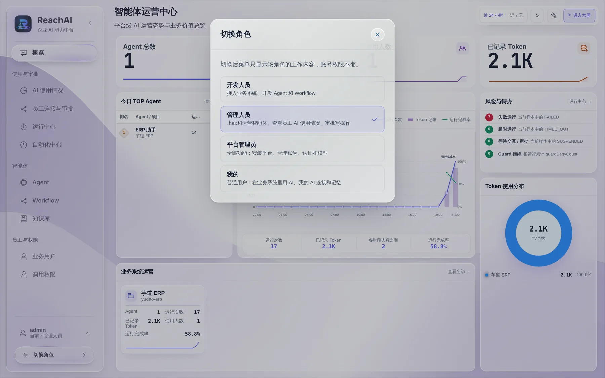
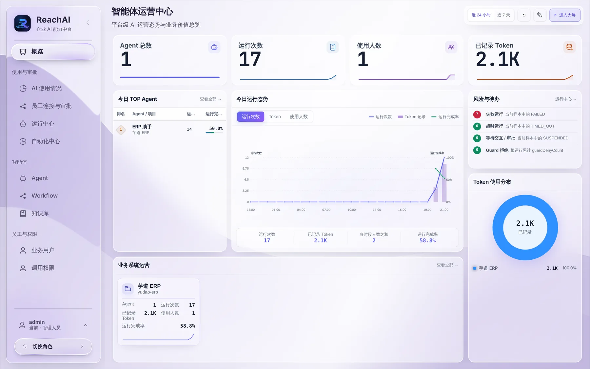

# 管理人员的工作台

> 适合：负责让员工用好 AI、并对 AI 做的事负责的业务主管、运营人员。读完你会知道在 ReachAI 里每天看什么、做什么。

## 管理人员要做的几件事

| 什么时候 | 做什么 | 在哪里 |
| --- | --- | --- |
| 上线前 | 决定员工能让 AI 做哪些事，开通「员工使用」 | [开通员工使用](open-to-employees.md)、[调用权限](permissions.md) |
| 每天 | 处理 AI 提交的写操作审批 | [审批 AI 提交的操作](approvals.md) |
| 每周 | 看谁在用、用得怎么样、哪里出错 | [看员工的 AI 使用情况](usage.md)、[运行中心](run-center.md) |
| 发现好做法时 | 把成功的操作沉淀成 Skill，给其他人复用 | [把好的做法沉淀成 Skill](skills.md) |
| 有固定的例行事务 | 让 AI 按计划自动跑 | [让 AI 按计划自动办事](automations.md) |

## 第 1 步：登录并切到「管理人员」

1. 打开 ReachAI 管理台，用平台管理员给你的账号登录。
2. 第一次登录会弹出一段体验说明，看完点「我已了解上述说明，并愿意继续体验」。
3. 左下角显示「当前：管理人员」就对了。如果不是，点 **切换角色**，选「管理人员」。

> 切换角色只改变左侧菜单显示什么，不改变你的权限。一个账号可以同时有几种角色，例如既是管理人员又是开发人员。

## 第 2 步：认识左侧菜单

| 菜单 | 用来做什么 |
| --- | --- |
| 概览 | 一屏看全局：有几个 Agent、今天跑了多少次、多少人在用、有没有失败的运行 |
| AI 使用情况 | 按人、按 AI 工具、按业务操作看使用情况 |
| 员工连接与审批 | 员工的 AI 工具连接、写操作审批、调用记录，以及「员工使用」设置 |
| 运行中心 | 每一次对话、每一次运行的详细过程，出问题从这里查 |
| 自动化中心 | 让 Agent 或 Workflow 按计划自动运行 |
| Agent / Workflow / 知识库 | 查看和上线智能体（一般由开发人员搭好，你负责上线和运营） |
| 业务用户 / 调用权限 | 业务系统里的哪些角色，可以通过 AI 做哪些事 |

左下角还有一个「我的」身份，是你作为普通员工使用 AI 的地方（自己的 AI 工具连接、记忆）。

## 第 3 步：养成每天看一眼的习惯

建议每天花两分钟：

1. 看「员工连接与审批」标签上的数字，有待审批就处理掉（审批 24 小时不处理会过期）。
2. 看「概览」右上方的「风险与待办」，有失败运行就点进「运行中心」看原因。

## 下一步

- [开通员工使用](open-to-employees.md)
- [审批 AI 提交的操作](approvals.md)
