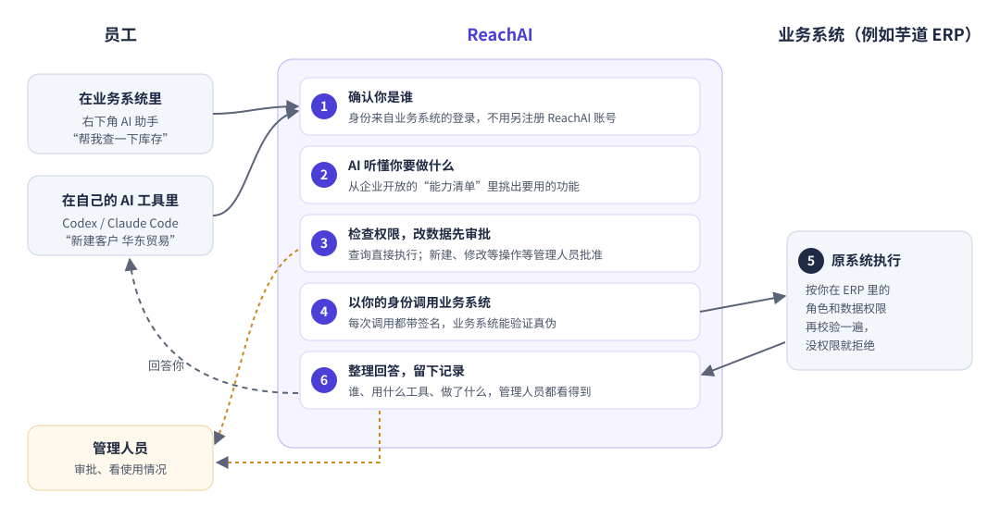

# 原理：一句话怎么变成一次 ERP 操作

> 适合所有人阅读，不需要技术背景。读完你会明白：AI 为什么能操作你的业务系统，又为什么不会乱来。

## 先看一张图

以芋道 ERP 为例。销售小王在 ERP 右下角的 AI 助手里输入「帮我查一下 A 产品的库存」，到他看到答案，中间发生了六件事。

## 第 1 步：确认你是谁

小王已经登录了 ERP。打开 AI 助手时，ERP 的后台会替他向 ReachAI 证明「这是小王，他是销售部的，租户是某某公司」。ReachAI 收到的不是小王自己填的名字，而是 ERP 后台用一把只有 ERP 和 ReachAI 知道的钥匙签过名的身份，别人伪造不了。

所以员工**不需要单独注册 ReachAI 账号**，也不用再登录一次。在 ERP 里是谁，在 AI 里就是谁。

如果小王用的是自己电脑上的 Codex 或 Claude Code，道理一样：他先在 ERP 的 AI 助手里点「在我的 AI 工具中使用」，生成一条只属于他的「个人连接」。之后 Codex 每次办事都带着这条连接，ReachAI 就知道是小王在操作。

## 第 2 步：AI 听懂你要做什么

ReachAI 里有一份**能力清单**，是开发人员事先从 ERP 里挑出来、明确允许 AI 使用的功能，例如「查询产品」「查询库存」「新建客户」。没进清单的功能，AI 根本看不到，也就调不了。

AI 读懂小王的话以后，会从清单里挑出要用的功能。查库存通常要两步：先用「查询产品」把「A 产品」换成产品编号，再用「查询库存」查数量。

开发人员还可以把几步固定成一个**流程（Workflow）**，比如「按产品名称查库存」。这样 AI 只需要选这一个流程，结果更稳定。

## 第 3 步：检查权限，改数据先审批

在真正动手之前，ReachAI 会检查：

- 小王所在的角色，有没有被允许使用这个功能（管理人员在「调用权限」里配置）。
- 这个功能是**只读**的（查询），还是会**改数据**的（新建、修改、删除）。

只读的直接执行。会改数据的，默认先生成一张**审批单**，把「谁、要做什么、具体参数」冻结下来，交给管理人员批准。批准之后才执行，而且参数不能再被改动。

## 第 4 步：以你的身份调用业务系统

ReachAI 把请求发给 ERP 时，同样带着签名和小王的身份。ERP 里装的 ReachAI 组件（开发人员接入时加进去的）会先验证签名，确认请求确实来自 ReachAI、没有被篡改，再把小王的身份还原成 ERP 里的登录用户。

## 第 5 步：原系统按自己的规则执行

接下来就和小王自己在 ERP 页面上点按钮一样：ERP 用它原有的权限规则再校验一遍。小王在 ERP 里看不到的数据，AI 替他查也看不到；小王没有「新建客户」权限，审批通过了也会被 ERP 拒绝。

这一点很重要：**ReachAI 不会给任何人超出原系统的权限**。最后一道关永远在业务系统自己手里。

## 第 6 步：整理回答，留下记录

ERP 返回数据后，AI 把结果整理成小王看得懂的话，比如「A 产品在 1 号仓还有 120 件」。

同时，ReachAI 记下这一次：谁、在什么时间、用什么工具（ERP 里的助手，还是 Codex）、调用了哪些功能、结果如何。管理人员在「AI 使用情况」和「运行中心」里都能查到。做得好的操作，还可以一键整理成 **Skill**，分享给同事复用。

## 三条使用路线，同一套规则

| 路线 | 谁在用 | 从哪里开始 |
| --- | --- | --- |
| 业务系统里的 AI 助手 | 普通员工 | 打开业务系统，点右下角助手 |
| 自己的 AI 工具（Codex、Claude Code 等） | 习惯用 AI 工具的员工 | 在助手里点「在我的 AI 工具中使用」 |
| ReachAI 管理台 | 开发人员、管理人员、平台管理员 | 浏览器打开 ReachAI 地址登录 |

不管走哪条路线，身份、权限、审批和记录都是同一套。

## 常见疑问

**AI 会不会自己乱改数据？**
不会。AI 只能用能力清单里的功能；改数据默认要审批；业务系统还会按原有权限再校验一次。

**AI 能看到我没权限看的数据吗？**
不能。调用时用的是你本人的身份，业务系统按你的权限返回数据。

**模型厂商会拿到我们的业务数据吗？**
AI 回答时，需要把问题和查到的结果发给你们配置的大模型来组织语言。用哪家模型、要不要用私有部署的模型，由平台管理员在「模型中心」决定。

## 下一步

- 想马上动手试试：[10 分钟本机体验](try-in-10-minutes.md)
- 业务人员：[在业务系统里用 AI 助手](../business/use-assistant.md)
- 开发人员想了解技术细节：[身份怎么一路传到业务系统](../principles/identity.md)
