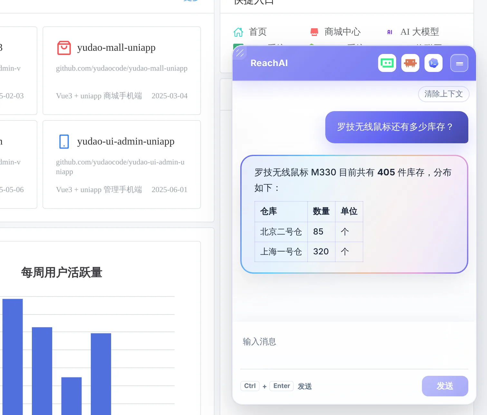

# 在自己电脑上体验 ReachAI

> 适合：想先亲手试一试再决定的人，开发者、管理人员都可以。读完你会在自己电脑上跑起 ReachAI 和一套已接好的芋道 ERP，用一句话查到 ERP 里的库存。

## 做完你会得到什么

一条命令，在本机启动两套系统：

| 地址 | 是什么 | 账号 |
| --- | --- | --- |
| http://localhost:48080 | 芋道 ERP（一个开源 ERP），右下角已经嵌好 AI 助手 | admin / admin123 |
| http://localhost:18080 | ReachAI 管理端 | admin / admin123 |

启动后，芋道已经接入 ReachAI，「ERP 助手」已经发布，你可以直接：

- 在芋道右下角问「罗技无线鼠标还有多少库存？」；
- 生成个人连接，在自己的 Codex / Claude Code 里查 ERP；
- 让 AI 新建一个客户，到 ReachAI 里审批。



## 开始前你需要

- 一台能装 Docker 的电脑（Windows、macOS、Linux 都行），已安装 **Docker Desktop** 或 Docker Engine + Compose v2。
- 建议有 **8 GB 以上空闲内存**、20 GB 以上磁盘空间。整套环境有 ReachAI 的 5 个服务、芋道、MySQL、Redis 和向量库。
- 能访问 Docker 镜像仓库和 Maven、npm 仓库（第一次需要从源码构建）。
- 一个大模型的 API Key（DeepSeek、OpenAI、通义千问、Kimi、智谱都可以）。**芋道里的对话助手需要它**；只体验「在自己的 AI 工具里用」可以不填。
- 这个仓库的代码：`git clone` 到本机。

> 名字叫「10 分钟体验」，但**第一次**要从源码构建全部镜像，视网络和电脑配置，通常需要 15～30 分钟或更久。之后再启动只要一两分钟。

## 第 1 步：填写配置

在仓库根目录执行：

```bash
cd deploy/quickstart
cp .env.example .env
```

Windows PowerShell 用 `Copy-Item .env.example .env`。

用文本编辑器打开 `.env`，至少填好模型这两行：

```bash
LLM_PROVIDER=deepseek
LLM_API_KEY=你的 API Key
```

其他配置都有演示默认值，本机体验不用改。如果端口 18080、48080、13306 被占用，改 `REACHAI_PORT`、`YUDAO_PORT`、`MYSQL_PORT`。

## 第 2 步：启动

```bash
docker compose up -d --build
```

这一步会构建镜像并启动所有服务。构建完成后，`reachai-init` 会自动做初始化：添加模型、等芋道注册、同步芋道的业务方法、设置调用权限、发布「ERP 助手」等。

看初始化进度：

```bash
docker compose logs -f reachai-init
```

看到最后一行是下面这样，就说明初始化完成了：

```text
[reachai-init] 完成。model=...
```

> 容器显示「已启动」不代表可以用了，一定以 `reachai-init` 打出「完成」为准。

## 第 3 步：在芋道里问一句话

1. 打开 http://localhost:48080 ，用 admin / admin123 登录芋道。
2. 右下角会出现 ReachAI 助手。
3. 输入「罗技无线鼠标还有多少库存？」，按 Ctrl + Enter。

几秒钟后，助手会按仓库列出库存。这些数字是 AI 以 admin 的身份从芋道里实时查出来的，可以到芋道的「库存」页面核对。

更多用法见 [在业务系统里用 AI 助手](../business/use-assistant.md)。

## 第 4 步：看看 ReachAI 里发生了什么

1. 打开 http://localhost:18080 ，用 admin / admin123 登录 ReachAI。
2. 第一次登录会弹出一段体验说明，看完点「我已了解上述说明，并愿意继续体验」。
3. 打开「运行中心」，能看到刚才那次提问：AI 先做了什么计划、调用了哪个芋道接口、拿到什么结果。

这就是 ReachAI 的工作方式，原理见 [一句话怎么变成一次 ERP 操作](how-it-works.md)。

## 第 5 步（可选）：在自己的 AI 工具里用

在芋道助手的标题栏点「在我的 AI 工具中使用」，按 [在自己的 AI 工具里办业务](../business/own-ai-tool.md) 操作。然后在 Codex / Claude Code 里说「帮我在芋道 ERP 里新建一个客户，叫华东贸易有限公司」，再到 ReachAI 的「MCP 开放 → 写操作审批」里批准，体验完整的审批过程。

## 停止和清理

```bash
docker compose ps        # 查看各服务状态
docker compose down      # 停止，数据保留，下次 up 还在
```

想彻底重来时才删数据：`docker compose down -v` 会删掉全部数据卷，包括 ERP 演示数据和 ReachAI 配置，**无法恢复**。

## 遇到问题

**芋道右下角没有助手，或助手说没有可用的模型。** 多半是没填 `LLM_API_KEY`。填好后执行：

```bash
docker compose up -d
docker compose up --force-recreate reachai-init
```

**构建时下载依赖失败或超时。** 网络访问 Docker Hub、Maven 中央仓库或 npm 不稳定。配置镜像加速或代理后重新执行 `docker compose up -d --build`。

**`reachai-init` 一直在等待。** 用 `docker compose logs --tail=100 yudao-server` 和 `docker compose logs --tail=100 reachai-control` 看是哪个服务没起来。内存不足时 Java 服务会反复重启，给 Docker 分配更多内存。

**打开页面显示 502。** 服务还在启动，等一两分钟再刷新。

**这套环境能直接给公司用吗？** 不能。账号密码和密钥都是公开的演示值。正式安装见 [安装 ReachAI](../admin/install.md)。

## 下一步

- [一句话怎么变成一次 ERP 操作](how-it-works.md)
- 业务人员：[在业务系统里用 AI 助手](../business/use-assistant.md)
- 开发者：[开发者从这里开始](../developer/overview.md)
